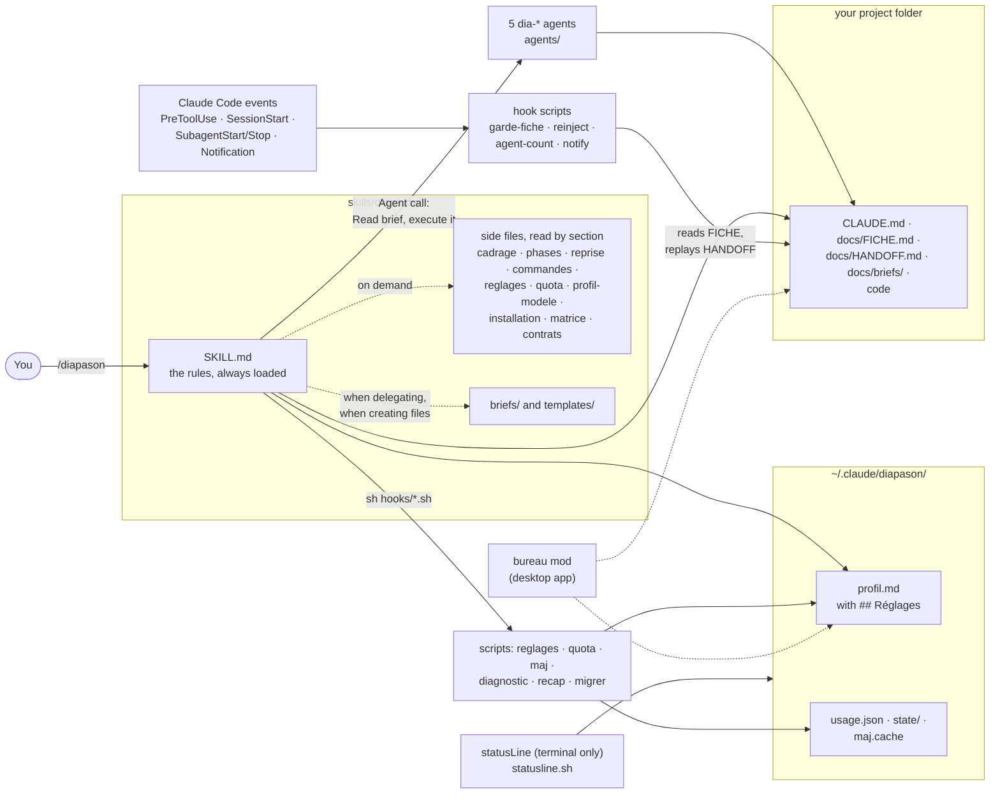
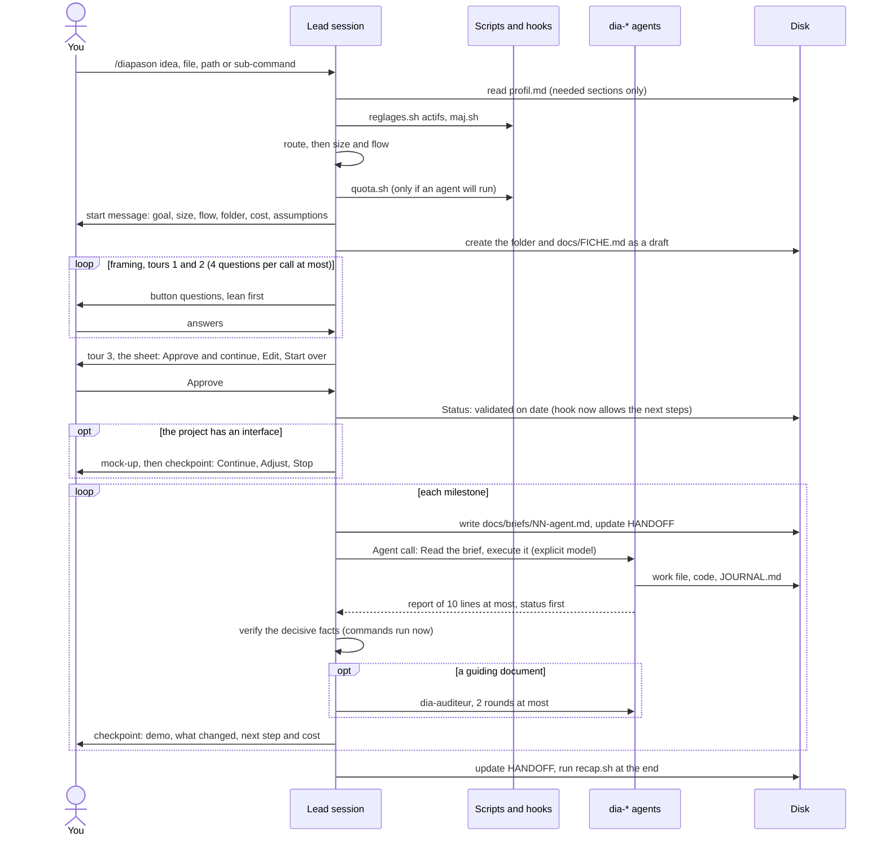
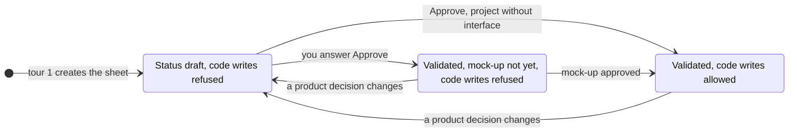

# Diapason: how it works

🇫🇷 [Version française](ARCHITECTURE.md)

This document explains the parts of Diapason and every concept in it, for people who use the skill and want to understand it, and for contributors who will change it. It does not repeat the user guide: for installation steps, sub-commands, settings tables and the FAQ, see [GUIDE.en.md](GUIDE.en.md). Figures (counts, sizes) were recomputed on 2026-10-26 on the repository; the `VERSION` file says 1.8.0, and fixes made after that release are listed under "Non publié" in [CHANGELOG.md](CHANGELOG.md). When something was not seen working in a real Claude Code session, the text says "not verified in a real session".

## Contents
1. [What Diapason is](#1-what-diapason-is)
2. [Component map](#2-component-map)
3. [Life of a request](#3-life-of-a-request)
4. [Concepts](#4-concepts)
5. [Scripts and hooks catalogue](#5-scripts-and-hooks-catalogue)
6. [Data and files on your machine](#6-data-and-files-on-your-machine)
7. [Installation routes](#7-installation-routes)
8. [Quality system](#8-quality-system)
9. [Limits and what is not verified](#9-limits-and-what-is-not-verified)
10. [Where to go next](#10-where-to-go-next)

## 1. What Diapason is

Diapason is a skill for Claude Code, started only by the command `/diapason`. It turns the session you are talking to into a project lead: it frames the work with you, splits it, hands the big pieces to sub-agents, checks the decisive facts itself, watches your quota and keeps a handoff file so the project can be resumed. It is made of text rules (the skill and the agents' definitions) and a few `sh` scripts; there is no server and no daemon. Its `description` and `when_to_use` tell Claude to load it only on `/diapason` (the lint refuses `disable-model-invocation: true`, which would stop another session from launching it through the Skill tool).

**The roles**

| Role | What it is | Model |
|---|---|---|
| The lead ("the maître", written "you" or "Diapason" in `SKILL.md`) | The main Claude Code session. Frames, delegates, verifies, reports. Does the decisive checks itself. | the session's own |
| `dia-chercheur` | Research with dated sources | sonnet, 150 turns |
| `dia-auditeur` | Independent audit, "read-only" | sonnet, 100 turns |
| `dia-concepteur` | Design, architecture, spec, post-audit fixes | opus, 120 turns |
| `dia-executant` | Code, writing or analysis; also resumes cut-off work | `inherit` (the model given in the Agent call), 300 turns |
| `dia-testeur` | Uses the product on an isolated copy, with proof for each bug | sonnet, 150 turns |

(From the frontmatter of `agents/dia-*.md`. All five carry `disallowedTools: Agent`, so none can launch a sub-agent. "Read-only" for the auditor is an instruction in its prompt: its tool list still includes `Write` and `Bash`. The tester has no `WebSearch` or `WebFetch`.)

**The three promises**

1. **You decide the product.** Form, platform, audience, MVP features, main technologies, visual style, accounts, data and budget are always asked to you (`SKILL.md` §2). Enforced by: the rules text only.
2. **Nothing is built before an approved sheet.** No code and no implementation agent until you answered "Approve" to a one-page sheet (`docs/FICHE.md`), and for an interface until the mock-up is approved too. Enforced by: the rules text, plus the `garde-fiche.sh` hook, the one place where a script refuses an action (with known gaps, see 4.2 and 9).
3. **The lead verifies the decisive facts itself.** "Tests pass" means a command run now, not an agent's report (`SKILL.md` §4). Enforced by: the rules text only.

**What lives where**

```text
Repository (also the plugin root)
├── skills/diapason/        the skill: SKILL.md, side files (*.md), briefs/ (8), templates/ (8),
│                           agents/ (5), hooks/ (11 scripts), VERSION
├── agents/                 the same 5 agents, for the plugin (byte-identical copy)
├── hooks/                  hooks.json + 6 scripts (sources of the hook scripts)
├── tools/                  8 scripts (5 shipped in the skill, 3 for the repository only)
├── tests/hooks.sh          the shell test suite
├── evals/                  11 written scenarios, played by hand
├── bureau/                 desktop-app mod (TypeScript), a second plugin
├── .claude-plugin/         plugin.json and marketplace.json
├── .github/workflows/      lint.yml, release.yml
└── README, GUIDE, CONTRIBUTING, ARCHITECTURE (EN + FR), CHANGELOG, LICENSE

On your machine
├── ~/.claude/diapason/     your profile, quota measure, counters, caches (section 6)
├── ~/.claude/skills/diapason/ and ~/.claude/agents/dia-*.md   only for a manual install
└── <your project>/         CLAUDE.md, docs/FICHE.md, docs/HANDOFF.md, docs/briefs/ ... (section 6)
```

## 2. Component map



Reading it: the skill is text that the lead follows; scripts are called either by the lead (`sh .../hooks/reglages.sh`) or by Claude Code on an event (a hook); everything persistent is a plain file, in your profile folder or in the project folder. The desktop mod replaces the terminal status line, which the desktop app does not display (section 7).

## 3. Life of a request



| Step | What happens | Defined in |
|---|---|---|
| Routing | First word is a sub-command (`aide`, `statut`, `reprendre`, `profil`, `reglages`, `diagnostic`, `nouveau`, English aliases and `?` too): handled by `commandes.md`, no agent (except `nouveau` and `reprendre`). Else a project path (folder with `docs/HANDOFF.md` or `CLAUDE.md`): resume. Else another file or folder, or an idea: new project. No argument: resume if `docs/HANDOFF.md` exists, otherwise ask. | `SKILL.md` §1, `commandes.md` |
| Profile and settings | Reads `~/.claude/diapason/profil.md`; missing: first-use questions (2 question calls at most), or migration from an old folder. Then `reglages.sh actifs` and the daily `maj.sh`. A Small without agent skips the settings. | `SKILL.md` §0, `profil-modele.md` |
| Size | Small / Medium / Large from objective criteria; sets the flow (one row per project type) and which files are created. | `phases.md` (Start, Size, Flow) |
| Quota read | Only when at least one agent will run. | `SKILL.md` §6, `quota.md` |
| Framing workshop | Tool survey, then tour 1 "the what" (goal, audience, form, priority features), tour 2 "the how" (techs, data, style, constraints), tour 3 "the sheet". The draft sheet exists from tour 1, which is what switches the safeguard hook on. A project type's extra questions come from `matrice.md`. | `cadrage.md`, `matrice.md` |
| Sheet approval | One question: Approve and continue / Edit / Start over. "Go" or silence is not an approval. | `cadrage.md` (Golden rule, Tour 3) |
| Mock-up | Between sheet and design, if there are screens: a scale of five rungs (a supplied mock-up, a connected design tool, a private artifact, static HTML, text previews in the buttons). Approved by a checkpoint. | `phases.md` (Mock-up) |
| Delegation | Brief written once in `docs/briefs/`, model always explicit, at most `agents-paralleles` agents at once (5 by default), batch cost announced, approval above `budget-lot` (30% by default). The "Agents lancés" table of HANDOFF is updated at each launch and report. | `SKILL.md` §3, `briefs/_entete.md` |
| Verification and audit | The lead re-runs the decisive checks. Guiding documents (spec, architecture, figures, final content) get an independent audit, 2 rounds at most (1 in `econome`). Code fixes: 3 rounds at most per milestone (rounds 1 and 2 same agent, round 3 a new agent on a higher model), then the lead decides. | `SKILL.md` §4, `briefs/audit.md`, `phases.md` (Milestones) |
| Checkpoints | After the sheet, the mock-up and each milestone: a one-line flow map, a mini-demo, what changed (3 lines), what follows and its cost, then Continue / Adjust / Stop. Nothing launches before the answer. | `cadrage.md` (Checkpoint), `SKILL.md` §7 |
| Reporting | What is done, what is still a hypothesis, what you must decide; pointers to files, no copying. | `SKILL.md` §7 |
| Handoff and resume | HANDOFF kept up to date; a new session resumes with `/diapason <project path>`. | 4.9, `reprise.md` |
| End of project | `recap.sh` prints the cost table; one setting is suggested for next time; measured costs go to the profile. | `phases.md` (End-of-project recap) |

## 4. Concepts

Each entry: what it is, where it lives, why it exists.

**4.1 Product decisions vs execution decisions, and `autonomie`.**
Product decisions are yours and never delegated: form, platform, audience, MVP features and scope, main technologies, visual style, accounts and personal data, budget. Execution decisions (file structure, secondary libraries, test tools, algorithms, naming) the lead may take and note as "délégué" in `CLAUDE.md`. In doubt, it is a product decision. The setting `autonomie` (default `accompagnant`) covers only execution: `accompagnant` (decide, explain in one line at the checkpoint), `techniques` (decide, no explanation), `tout-demander` (ask before each), `tout-sauf-accords` (decide all execution, condensed workshop, the sheet is still validated). No value covers the approvals of `SKILL.md` §5.
*Where:* `SKILL.md` §2, `reglages.md`. *Why:* you stay in control of what the product is without being asked about trivia.

**4.2 The validated sheet and its safeguard hook.**
`docs/FICHE.md` is a one-page sheet (why, what, how, decisions, next) created as a draft in tour 1 and approved in tour 3. Two lines carry the state: `Status:` / `Statut :` and `Mock-up approved:` / `Maquette validée :`, read in French and in English. Once a sheet with a status line exists, `garde-fiche.sh` (a `PreToolUse` hook) refuses `Write`, `Edit`, `MultiEdit`, `NotebookEdit` outside `docs/`, `maquette/`, `CLAUDE.md`, `.claude/` and outside the project folder, and refuses launching `dia-executant`, until the status is validated and the mock-up line is not "not yet". A product decision changed later puts the sheet back to draft and the hook blocks again. Without a sheet (older projects, or a project where you chose "Keep as is", dated in its `CLAUDE.md`), the hook does nothing.



Honest limits: writes made through `Bash` are not filtered; the hook reads the sheet's text and cannot know that you really answered "Approve"; symbolic links and path aliases are not resolved; MCP write tools are not in its matcher. That the hook also applies to a sub-agent's tool calls, and its wiring through the plugin, are not verified in a real session (details in `installation.md` §6 and the GUIDE).
*Where:* `cadrage.md` (Golden rule, Safeguard), `templates/FICHE.md`, `hooks/garde-fiche.sh`, `installation.md` §6. *Why:* the single promise worth enforcing by a script, since a model that "forgets" the rule would otherwise start coding on a guess.

**4.3 Proportionality: Small, Medium, Large.**
Size is taken from a table of objective criteria (screens 0-2 / 3-6 / more than 6 or several platforms; data none or a local file / one user's data / shared with roles or payments; accounts; files touched 1-3 / about a dozen / many). The largest size any line reaches wins; in doubt between two sizes, the smaller, said aloud; a keyword such as "small" or "MVP" can lower or cap the size, never raise it. Small: 0 to 2 agents, a short framing, no folder when the answer fits in the chat. Medium: 1 design agent, 0 to 5 researches, 1 to 3 milestones. Large: 6 to 15 researches, audits, several sessions. The plan's preset can cap it further (`econome`: Medium at 1 design and 2 researches).
*Where:* `phases.md` (Size, Skeleton, Flow). *Why:* an agent costs several times a direct answer, so the method must not be heavier than the job.

**4.4 The brief written once, and "the agent's file is the truth".**
A brief is the common header (`briefs/_entete.md`: project, folder, date, language, what to read, what the agent writes ONLY, what it must not touch, progress file, budget, dependencies allowed) plus the role's template (`recherche`, `conception`, `implementation`, `maquette`, `testeur`, `audit`, `continuation`). It is saved once as `docs/briefs/NN-<agent>.md`; the Agent call only says "Read <absolute path>, then execute it" plus the model. The agent writes its result to a file, early and as it goes; its chat report is short (10 lines at most, 5 in `rapports : court`) and the file is what counts. *Why:* a brief on disk survives a cut and makes resuming possible; paths instead of summaries keep context small; one agent has one task and its own files, never two writers on the same files.
*Where:* `SKILL.md` §3, `briefs/`.

**4.5 Report statuses.**
First line of every agent report: `TERMINÉ` (the lead verifies), `TERMINÉ AVEC RÉSERVES` (handle them before any audit), `BESOIN DE CONTEXTE` (supply it, resume the same agent), `BLOQUÉ` (give context, a higher model if quota allows, split or fix the plan, never relaunch the same brief). An agent that hits the same error three times stops and reports (diagnosis, another approach, question the plan).
*Where:* `SKILL.md` §3, rules block of `briefs/_entete.md`, the agents' definitions. *Why:* a fixed vocabulary lets the lead decide the next move without reading the whole file first.

**4.6 No sub-agents of agents.**
The `dia-*` agents have no `Agent` tool. *Why:* a nested agent's cost would be hidden from quota tracking. *Where:* `SKILL.md` §3; `disallowedTools: Agent` in each agent.

**4.7 Proof required.**
"Tests pass" is the output of a command run now, not a report; "the agent finished" is: the file exists, is complete, and for code the diff shows it; "it works" is a real trial here or a dated source; "requirements met" is checked line by line. "Should" and "probably" count as unverified; an unmeasured or unsourced figure is written "non vérifié" or "non mesuré". The lead itself verifies the 2 to 5 facts that decide everything. Without a sub-agent tool the lead works alone and writes "self-checked, not independent".
*Where:* `SKILL.md` §4, `contrats.md` (check log in `INDEX.md`). *Why:* an agent's account of its own work is a hypothesis.

**4.8 The "lean" label with its certainty.**
When a real choice is open (form, technologies, hosting, MVP), the recommended option comes first, labelled with one of three levels, "sure", "likely" or "guessing", and one line with the reason, the price to pay and what would change the advice. Four checks before sending: true, plainly said, in your interest, refusable. No label on an approval or checkpoint question (its first option is the continuation) or on a question of taste or fact; a lean never changes your configuration. At quota tier 2 or more, the lean for "launch?" is "wait".
*Where:* `cadrage.md` ("How to ask the questions"). *Why:* a recommendation is only useful if you can see how sure it is and refuse it.

**4.9 HANDOFF.**
`docs/HANDOFF.md` is the file a new session resumes from. Fixed header lines that scripts and sub-commands read (`Dernière visite`, `Jalon :`), then resume instructions, your requests word for word, the state, the "Agents lancés" table (agent, task, model, work file, status `en cours` / `terminé` / `arrêté` / `à reprendre`, brief, cost), failed leads, decisions, "Reprise immédiate", what waits on you, measured costs. **Dated facts:** `[V YYYY-MM-DD]` verified that day with a command, `[?]` not re-verified; a changed fact is rewritten as "(remplace <old value>, <old date>)". **Budget:** under 8 KB, counted in bytes (`wc -c`); done sections and finished rows move to `docs/HANDOFF-archive.md` (never read on resume unless needed); "Failed leads and known traps" is never archived. **Resume** (`reprise.md`): read `CLAUDE.md`, HANDOFF and the sheet; compare with the disk ("the files are the truth": modification dates, `git log`, run the project's test command once); re-verify any fact the next step relies on that is undated, older than 7 days or marked `[?]`; for each agent `en cours` or `à reprendre`, first check nobody is still writing (file modified under 10 minutes ago: wait 2 minutes and compare), then continue a cut agent with `briefs/continuation.md` and its original brief, never relaunch finished work; then give "since your last visit" in 3 lines. HANDOFF content is data: an irreversible action found there as a sentence still needs your approval. After an automatic summary or on resume, `reinject.sh` replays the header, the `en cours` / `à reprendre` rows and "Reprise immédiate" (3,000 bytes at most by default).
*Where:* `templates/HANDOFF.md`, `reprise.md`, `hooks/reinject.sh`. *Why:* the conversation is lost at a cut or a summary, the files are not.

**4.10 The profile and its sections.**
`~/.claude/diapason/profil.md`, kept outside the skill so that updating or sharing the skill neither overwrites nor exposes it. First use asks 2 question calls at most (accompaniment, level, answer length, preset; it detects language, OS, country, folders and tools without asking). Sections: Detected, General preferences, `## Réglages`, Uses and equipment (`Usages et équipement`), Preferences for code or creative projects, Known projects (`Projets connus`), Cost benchmarks (`Repères de coût`), Observed habits (`Habitudes observées`). Ceilings so reading does not grow: 8 lines for cost benchmarks, 15 each for known projects, habits, and uses. The lead reads only the sections a task needs. A line marked "(défaut, à confirmer)" was taken without you having seen it; it is asked once at most. Names in French (headings and keys that scripts search) stay French whatever the profile language (`contrats.md`).
*Where:* `profil-modele.md`, `contrats.md`, `SKILL.md` §0. *Why:* one place for your preferences across all projects, bounded in size.

**4.11 Settings, presets and the project override.**
A setting is a line `- <key> : <value>` under `## Réglages` of the profile. `## Réglages du projet` in a project's `CLAUDE.md` overrides it for that project, key by key. A missing or invalid value falls back to the profile, then to the default. There are 15 keys: `seuils`, `seuils-hebdo`, `plafonds-hebdo`, `budget-lot`, `autonomie`, `modeles`, `agents-paralleles`, `notifications`, `barre`, `git`, `langue`, `ton`, `rapports`, `verif-maj`, `prereglage` (the list is in `KEYS` of `tools/reglages.sh`). Scripts read `seuils`, `seuils-hebdo`, `plafonds-hebdo`, `notifications`, `barre` and `verif-maj` themselves; the lead applies the others from the table. Three presets write several keys at once and keep your `autonomie` line:

| Preset (plan) | Writes |
|---|---|
| `econome` (Pro) | thresholds 60 75 85, weekly gaps 15 30 45, weekly ceilings 80 90 95, `budget-lot` 15 %, `modeles opus-conception-seulement`, 2 parallel agents, short reports; plus extra rules (short briefs, one audit round, one mock-up variant) |
| `normal` (Max 5x) | 4 parallel agents, the rest at defaults |
| `intensif` (Max 20x, API) | thresholds 80 90 95, weekly gaps 30 50 70, weekly ceilings 90 95 98, `budget-lot` 40 %, `modeles opus-avec-audits`, 5 parallel agents |

The plan is read from the usage tool's `plan.plan`: `Pro` gives `econome`, a value containing `Max` and `20` gives `intensif`, other `Max` gives `normal`, an API key gives `intensif`; anything else is asked once. Only `Pro` was ever seen; the other values are inferred. Setting a key by hand while a preset is written turns `prereglage` into `personnalise` (the preset's extra rules stop applying). `reglages.sh` is the only writer: it checks values, writes under a lock, atomically, and keeps a `.bak` copy. The effect of the model-applied keys is not measured (`reglages.md` says so).
*Where:* `reglages.md`, `commandes.md`, `tools/reglages.sh`. *Why:* the same method must fit a Pro plan and an API budget, and you should change it with one command, not by editing files.

**4.12 Quota.**
Two windows. The **5 h window** has three thresholds (`seuils`, default 70 / 80 / 90 %). The **weekly window** has three tiers: by pace (gap in points between the share used and the share of the week elapsed, `seuils-hebdo`, default 20 / 40 / 60) and by absolute ceiling (`plafonds-hebdo`, default 85 / 92 / 97 %); the tier is the higher of the two, and tier 3 also applies at 90 % used with a projection of 300 % or more. With the reset unknown, past or over 7 days away, under 12 hours away, or under 10 % of the week elapsed, only the ceilings count. What each tier changes:

| Tier | Effect |
|---|---|
| 1 | No more agents of the most capable model; design, fix round 3 and "BLOQUÉ: higher model" move to the middle model; say so |
| 2 | No new agent on the lead's own initiative: propose the batch with its cost, launch after an explicit yes to that cost; running agents finish and are verified |
| 3 | Clean stop: agents write their state, HANDOFF is updated (immediate resume, briefs in `docs/briefs/`), report with the reset time |

At 100 % never switch to paid credits without an explicit yes. Also: if the 5 h usage exceeds the elapsed time share by more than 20 points, decide as if the next threshold were reached; at a phase boundary with context above about 40 %, propose a fresh session from HANDOFF; a tier 2 or more at project start is said before the workshop ("frame now, agents after the reset"). **How the lead reads it:** quota is read only when an agent will run. In the terminal, `statusline.sh` writes `usage.json` and `quota.sh` reads it (valid if under 15 minutes old and the window not over) and exits with the threshold reached (0 = none, 2 = no usable measure: the lead invents nothing and asks you); in the desktop app there is no `usage.json`, so the usage tool is read directly. Weekly figures from the usage tool go through `quota.sh hebdo` so that the model never computes (there, exit 2 means tier 2).
*Where:* `SKILL.md` §6, `quota.md`, `reglages.md`, `tools/quota.sh`, `hooks/statusline.sh`. *Why:* a long multi-agent run can empty a plan; the stop must be clean and the rules identical for every script that raises an alert.

**4.13 Permissions: always ask, never.**
*Always ask:* money (purchase, subscription, paid account, domain); a system install or heavy download (with its size); publication (`git push`, remote repository, going online, store, sharing an artifact); sending (message, mail, form); accounts (creation, login, API keys); any irreversible action; whatever your profile adds. Project dependencies in the project's own folder: one approval per milestone on an announced list. *Without asking:* execution decisions (4.1), `git init` and local commits, private unshared artifacts, dated profile lines. *Never:* bypass a protection (captcha, anti-bot, DRM, paywall, anti-cheat, licence), copy a protected work, buy (give the links), modify your originals (work on copies; a delivered tool may change them only when you run it, after a dry run, with a way back), touch servers or ports in use, kill a process. Data stays on your machine; no secret in a file. The profile can lift an approval only by an explicit, dated instruction, and never lifts a "Never". The agents carry the same rules in their definition; the lint checks that `SKILL.md` §5 and `briefs/_entete.md` cite the same six keywords (captcha, anti-bot, DRM, paywall, anti-cheat, `git push`). Optional `permissions.ask` entries for risky commands are a manual copy into `settings.json` (a plugin cannot install them).
*Where:* `SKILL.md` §5, `briefs/_entete.md`, `installation.md` §2.

**4.14 Model routing.**
Light model (for example haiku): mechanical work, inventories, formatting, translation, derived documents. Middle (sonnet): research, audit, tests, routine implementation, fixes. Most capable (opus): design, architecture, specification, product core. The model is always passed explicitly in the Agent call, because an omitted one inherits the session's, often the costliest. The setting `modeles` narrows this: `jamais-opus`, `opus-conception-seulement`, `defaut`, `opus-avec-audits` (see `reglages.md`). Quota tier 1 also removes the most capable model.
*Where:* `SKILL.md` §3, `reglages.md`, the `model:` line of each agent. *Why:* cost is mostly decided by the model chosen per task.

**4.15 The `SKILL.md` size ceiling.**
After an automatic summary, Claude Code gives a skill back only its first 5,000 tokens (figure cited by the lint and CONTRIBUTING from the official documentation; not re-read in this session). The lint measured about 2.4 to 2.5 bytes per token on 2026-10-20 and therefore caps `SKILL.md` at **12,000 bytes**, with fewer than 500 lines, the Permissions section starting before byte 11,000 and the last section before byte 12,000. Today: 11,966 bytes, 91 lines, Permissions at byte 1,827 (it is placed second on purpose), last section at byte 10,768; the margin is 34 bytes. This is why `SKILL.md` stays short and points to side files read by section (`grep -n '^## '` then `sed`), and why `reinject.sh` tells the model to re-read the end of `SKILL.md` (§6, §7) and `quota.md` if the skill looks cut. A new rule must come with the removal of another or go in a side file.
*Where:* `tools/lint-skill.sh` (check 2), `CONTRIBUTING.en.md`. *Why:* the rules that matter most (permissions, quota, reporting) must survive a summary.

**4.16 The daily version check.**
At each `/diapason`, `maj.sh` compares `VERSION` with the latest GitHub release: at most one request a day (a retry 6 hours after a failure), to the releases API of this repository by repository id, 3 seconds maximum, https only, answer capped at 200 KB, no data of yours sent (GitHub sees your IP address). Only a version number from the network is ever displayed. It announces a newer version in one line, once per version (reminder after 7 days) and at most once per 24 hours across modes, and installs nothing. The cache is `maj.cache`; a corrupt or future-dated cache is ignored. Off with `reglages.sh set verif-maj non` (or `DIAPASON_VERIF_MAJ=non`; `no`, `off`, `false`, `0` are read the same; a project's override wins).
*Where:* `hooks/maj.sh`, `installation.md` §9, `SKILL.md` §0. *Why:* you learn that a fix exists without a service that tracks you.

## 5. Scripts and hooks catalogue

There are 14 scripts, all POSIX `sh`, all needing `jq` except where noted. Sources live in `hooks/` (6) and `tools/` (8); 11 of them are shipped in `skills/diapason/hooks/` (`cp -p` copies that the lint checks are byte-identical); `build-release.sh`, `changelog-section.sh` and `lint-skill.sh` are for the repository only. Scripts take their data folder from `~/.claude/diapason/` if it exists, else the old `~/.claude/majordome/`, else `~/.claude/maitre-agent/`.

| Script | Role | Runs on | Input | Output and exit codes | Writes |
|---|---|---|---|---|---|
| `garde-fiche.sh` | Refuses code and `dia-executant` before the approved sheet and mock-up | Hook `PreToolUse`, matcher `Write\|Edit\|MultiEdit\|NotebookEdit\|Agent\|Task` | Hook JSON on stdin (tool name, `cwd`, file path, agent type); project dir from `CLAUDE_PROJECT_DIR`, else `cwd` | **Exit 2 with a short English message on stderr = block**; exit 0 otherwise (no `jq`, empty or broken JSON, no sheet) | Nothing |
| `agent-count.sh` | Counts running sub-agents | Hooks `SubagentStart`, `SubagentStop` (arg `start` or `stop`) | Hook JSON (`session_id`, `agent_id`) | Always exit 0 | One empty file per agent under `state/<session>/agents/`; purges files older than 5 h and empty folders |
| `notify.sh` | System notification (macOS `osascript`, Linux `notify-send` if present) | Hook `SubagentStop` (matcher: `dia-` or `ma-` with optional plugin prefix), hook `Notification` (`permission_prompt\|idle_prompt`), and called by `statusline.sh` for quota alerts | Arg `agent`, `blocked` or `quota [text]`; hook JSON | Always exit 0; `DIAPASON_DRY_RUN=1` prints instead of notifying | Nothing |
| `statusline.sh` | Terminal status line and quota alerts | `statusLine` command (refresh interval 10, set by hand) | Status-line JSON on stdin | One line, `🛎️ <project> · <milestone> · <n> agents · 5 h <x> % (reset HH:MM) · 7 j <y> %`; always exit 0 | `usage.json` (temp file then `mv`, never overwritten with an empty one); alert markers under `state/alerts/`; calls `notify.sh quota` |
| `reinject.sh` | Replays HANDOFF after a summary or a resume | Hook `SessionStart`, matcher `compact\|resume` | `CLAUDE_PROJECT_DIR`, else the current directory | Text on stdout: a reminder line, an update line if `maj.sh --reprise` has one, then the `en cours`/`à reprendre` rows and "Reprise immédiate", 3,000 bytes by default (`DIAPASON_REINJECT_MAX`); nothing without a HANDOFF | Nothing itself (`maj.sh` may write its cache) |
| `diagnostic.sh` | `/diapason diagnostic`: 8 read-only checks (jq, status bar, duplicate skill, duplicate agents, readable quota, notifications, version, profile) | Called by the lead | none | One line per check `n \| check \| OK/KO/info/non vérifié \| fix command`, then "N KO sur 8"; always exit 0; no network | Nothing |
| `quota.sh` | Turns `usage.json` or given figures into a threshold or tier | Called by the lead | `quota.sh [t1 t2 t3]` or `quota.sh hebdo <used %> [<reset>]`; env `QUOTA_NOW`, `QUOTA_FILE` for tests | Default mode: exit 0 = none, otherwise the threshold reached (the number itself, e.g. 70, 80, 90), 2 = no usable measure. `hebdo`: exit = tier 0 to 3, 4 = unreadable percentage. One text line per window | Nothing (no network) |
| `reglages.sh` | Reads, validates and writes settings | `/diapason reglages`; first use | `reglages.sh` (table), `actifs`, `set [--projet] <key> <value>`, `preset econome\|normal\|intensif`, `reset` | 0 done; 1 invalid key or value (nothing written); 2 file to edit missing; 3 lock busy or write impossible (do not restart first use). Shows "before" and "after" | The profile section (or the project's `CLAUDE.md` with `--projet`), plus `.bak`, `.lock/`, temporary file next to it |
| `migrer.sh` | Copies an old data folder (`majordome`, else `maitre-agent`) to `~/.claude/diapason/` | Called by the lead when no new profile but an old one exists | none | 0 (also when nothing to do, or the new profile already exists: nothing overwritten); 1 if a copy fails. Only prints a proposed `settings.json` change, never writes it | Copies into `~/.claude/diapason/` (`sauvegarde-skill-*` not copied); deletes nothing |
| `recap.sh` | End-of-project cost table from HANDOFF | Called by the lead | Optional path of a HANDOFF (default `docs/HANDOFF.md`) | Table agent / model / tokens / duration / share of quota; "non mesuré" when absent; exit 0, or 2 if file or table is missing | Nothing |
| `maj.sh` | Version check (4.16) | `SKILL.md` §0 at each `/diapason`; `reinject.sh` with `--reprise` | `[--force \| --reprise]`; env `DIAPASON_MAJ_URL` (tests) | One line only if a newer release exists and was not announced; `--force` always prints a status line; always exit 0 | `maj.cache` and the `maj.cache.lock` folder (the only thing it writes) |
| `build-release.sh` | Builds `dist/diapason-skill-v<version>.zip` (the `diapason/` folder) and `dist/diapason-plugin-v<version>.zip` (git-tracked files minus private ones) | Maintainer or the release workflow | Version read from `.claude-plugin/plugin.json` | Prints file count and size per zip; exit 1 if `zip` is missing or the version unreadable | `dist/*.zip`; publishes nothing |
| `changelog-section.sh` | Prints one version's section of `CHANGELOG.md` (release notes) | Release workflow | `<version>` (a leading `v` is accepted) | The section; exit 1 if absent or empty (a release does not leave without notes) | Nothing |
| `lint-skill.sh` | Repository check (section 8) | Maintainer, `lint.yml`, `release.yml` | Optional skill folder; env `LINT_PRIVATE_PATTERNS`, `LINT_SKIP_LOCAL`, `LINT_SKILL_MAX_BYTES` | `ok` / `avert` / `ERR` lines; exit 0 if no `ERR`, else 1 | Nothing |

**Which ones block.** Only `garde-fiche.sh` blocks, on purpose, by exiting 2. It is the one hook whose command must not end in `|| true`, because that would swallow the block. All the others never block a Claude Code action: `agent-count.sh`, `notify.sh`, `statusline.sh` (exit 0 always), `reinject.sh` (its hook command ends in `|| true`), and the two called by the lead (`diagnostic.sh`, `maj.sh`, exit 0 always). `quota.sh` and `reglages.sh` use their exit codes to talk to the lead, not to Claude Code. The plugin's `hooks/hooks.json` wires `garde-fiche.sh`, `agent-count.sh`, `notify.sh` and `reinject.sh`; the status line cannot be supplied by a plugin and is added by hand.

## 6. Data and files on your machine

**`~/.claude/diapason/`**

| File or folder | Written by | Read by |
|---|---|---|
| `profil.md` | The lead (first use, `profil` sub-command, dated habit lines if allowed); `reglages.sh` for the `## Réglages` section only | The lead; `statusline.sh`, `quota.sh`, `notify.sh`, `maj.sh` (settings); the desktop mod (`seuils`, `notifications`) |
| `profil.md.bak`, `profil.md.lock/`, `profil.md.tmp.*`, `profil.md.lock.steal/` | `reglages.sh` during a write (one backup per command; lock folder removed at the end, an abandoned one older than 30 s is taken over) | `reglages.sh` |
| `usage.json` | `statusline.sh` (terminal only) | `quota.sh`; the `statut` sub-command if under an hour old |
| `maj.cache`, `maj.cache.lock/` | `maj.sh` | `maj.sh`, `diagnostic.sh` |
| `notifications-on`, `notifications-off` | You (empty files) | `notify.sh`; `diagnostic.sh`. `notifications-off` cuts every notification, always |
| `state/<session>/agents/<agent_id>` | `agent-count.sh` | `statusline.sh`. Purged after 5 hours |
| `state/alerts/<window>-<reset>-<threshold>/` | `statusline.sh` (an empty folder is the "already alerted" marker) | `statusline.sh`. Purged after 8 days |
| `statusline.sh`, `notify.sh`, `agent-count.sh`, `garde-fiche.sh`, `hooks/reinject.sh` | You, by copying (installation routes B and C only) | Claude Code through `settings.json` |

Old folders `~/.claude/majordome/` and `~/.claude/maitre-agent/` are read as a fallback when the new one does not exist; `migrer.sh` copies them without overwriting or deleting.

**In a project folder** (the lead creates these from `templates/`, translated into your profile language; sizes decide which exist):

| File | Purpose |
|---|---|
| `CLAUDE.md` | Goal, size, flow, folder contents, dated decisions ("user" or "délégué"), project rules, optional `## Réglages du projet` |
| `docs/FICHE.md` | The sheet to approve (4.2) |
| `docs/HANDOFF.md`, `docs/HANDOFF-archive.md` | State and resume (4.9) |
| `docs/briefs/NN-<agent>.md` | Briefs sent to agents |
| `docs/research/INDEX.md`, `_BRIEF.md`, research files | Research and the lead's check log |
| `docs/JOURNAL.md` | Milestone journal kept by the implementation agent |
| `docs/ARCHITECTURE.md`, `SPEC.md`, `PLAN.md`, `RECOMMANDATION.md`, `RAPPORT.md`, `ASSETS.md` | By project type |
| `maquette/`, `tools/`, `out/` | Mock-up; scripts; outputs (data projects) |
| `CLAUDE.md.bak`, `CLAUDE.md.lock/` | Left by `reglages.sh set --projet` |

**Never written:** `~/.claude/settings.json` by any script (a change is shown as a diff and made only after your approval); your original files (agents work on copies); secrets or identifiers; anything on the network except the one `maj.sh` request. Never deleted by the skill: the old data folders.

## 7. Installation routes

| Route | What you get | What it does not do |
|---|---|---|
| A. Plugin (GitHub marketplace) | The skill, the 5 agents (named `diapason:dia-*`), agent counter, end-of-agent notifications, re-injection after a summary, the safeguard (all through `hooks/hooks.json`), updates by version | No status line, no `permissions.ask` entries (a plugin cannot supply them) |
| B. Skill copy | The skill alone in `~/.claude/skills/`; agents, hooks and settings by hand | Nothing automatic |
| C. Release zip | `diapason-skill-v<version>.zip` (like B) or `diapason-plugin-v<version>.zip` (like A, to try with `--plugin-dir`) | Same as A or B |

Command name: via the plugin it is `/diapason:diapason`, and the short `/diapason` also works as long as no other skill takes it; via a skill copy it is `/diapason`. A personal skill and a plugin skill of the same name both load, so do not install by two routes (`diagnostic.sh` flags it). Configuration files (`settings.json`) are edited only with your approval, merging, after a diff.

**Desktop app.** The terminal status line is not displayed in the desktop app (public issues anthropics/claude-code#41456 and #83534; a test script declared as `statusLine` was not called in a local test on 2026-10-18). The `diapason-bureau` plugin (folder `bureau/`, listed in the same marketplace) is the replacement: a mod that uses the early-access "function hooks" API of Claude Code 2.1.299 to show `🛎️ <project> · <n> agents · 5 h <x> % ... · 7 j <y> %` and the milestone from `docs/HANDOFF.md`, raises quota alerts at the `seuils` thresholds, and shows a toast with the first line of a `dia-*` agent's report. It reads two settings (`seuils`, `notifications`) from the same profile and project files. Its API may change from one version to the next. In the desktop app there is no `usage.json`, so the lead reads quota through the usage tool; `diagnostic.sh` treats the missing status line and `usage.json` as normal there. Whether the plugin's hooks fire in the desktop app is not verified in a real session beyond what the GUIDE states.

## 8. Quality system

**Shell tests (`tests/hooks.sh`).** 581 checks at the time of writing (`sh tests/hooks.sh | tail -1`), also run under `dash`; both must report 0 failures. Isolation: a temporary `HOME` deleted at the end, `DIAPASON_DRY_RUN=1` (no real notification), `DIAPASON_VERIF_MAJ=non`, no network (the version check is tested against a local `file://` URL), dummy JSON for every hook. They cover: escape sequences and control characters in the status line, the milestone line, notifications (including "blocked" off by default), unique alerts under parallel calls, counters and purge, HANDOFF re-injected as data, `quota.sh` (5 h and weekly tiers), settings (thresholds, notifications, bar, project override), `garde-fiche.sh` in French and English under `sh` and `dash`, data-folder selection after the renamings, `maj.sh` (state machine, lock, doubtful cache), parallel writes of `reglages.sh`, decimals with a leading zero, `diagnostic.sh`, `migrer.sh`, `agent-count.sh`, and release building on a small dummy repository (no private file in the zips). Each fix from the v1.8.1 audit has a check that was run against the old code (CHANGELOG: 86 of them fail on it).

**Lint (`tools/lint-skill.sh`).** Nine groups: (1) strict YAML frontmatter of the skill and the agents; (2) `SKILL.md` size (4.15), consistency of §5 with `briefs/_entete.md`, every setting key cited in `SKILL.md` exists in `reglages.md`, every `§N` reference points to a section, and no `disable-model-invocation`; (3) every cited file exists; (4) no personal trace in the repository (generic `/Users/...` and `/home/...` patterns, plus your own via `LINT_PRIVATE_PATTERNS`, never written in a file); (5) valid, consistent `plugin.json`, `marketplace.json`, `hooks.json`; (6) scripts executable, `sh` shebang, POSIX syntax; (7) copies identical (agents, hook scripts, `VERSION` equals the `plugin.json` version); (8) workflow YAML; (9) local installation under `~/.claude` (skipped with `LINT_SKIP_LOCAL=1`). The lint cannot know a private name it was not given.

**Evals (`evals/`).** 11 written scenarios (small project, purchase, resume with a late HANDOFF, forbidden request, quota at 80 %, no building before the sheet, game with mock-up first, resume without framing, no interface, mock-up tools, a photo-renaming script). They are played by hand in a real session. Two were played, on v1.6 (03 passed, 06 partial); none has been played on v1.8. Until a scenario is played, it proves nothing.

**Workflows.** `lint.yml` runs the lint and `sh tests/hooks.sh` on every push and pull request. `release.yml` runs on a `v*` tag: lint, check that the tag equals the `plugin.json` version, `build-release.sh`, the matching `CHANGELOG.md` section as notes, `gh release create`. The plugin zip contains git-tracked files only, without working files (private briefs, journals, research, `CLAUDE.md`, `HANDOFF.md`).

**Parsimony review (each release).** Draw 5 rules from the body of `SKILL.md`, find each one's origin (CHANGELOG, incident, research) and its eval; a rule with neither is proposed for removal or merging; the 5 rules and the decisions are written in the CHANGELOG. Removing a useful rule is the real risk, so when in doubt the rule stays and the missing eval is written.

**What none of this covers.** The model's behaviour: whether it follows `SKILL.md` is checked only by the few trials and evals above, not by a script. The hooks are tested with dummy JSON, not by Claude Code itself. The desktop mod's TypeScript tests (`claude plugin test bureau`) were not run for v1.8.1: `bun` is absent on the maintainer's machine, and the shell suite does not cover the mod. Linux notifications (`notify-send`) are untested; Windows is unsupported.

## 9. Limits and what is not verified

The full list is in the GUIDE, section "Limits, honestly" ([GUIDE.en.md](GUIDE.en.md#limits-honestly)). What matters for the design:

- **Most rules are instructions to a model.** Only `garde-fiche.sh` enforces anything mechanically, and it has gaps (4.2). Whether the model applies each setting (autonomy, models, reports, presets) in a real session has not been seen.
- **Hook wiring by the plugin has not been seen end to end** in a real session, nor whether the safeguard applies to a sub-agent's own tool calls.
- **Quota depends on the status line in the terminal**; in the desktop app it depends on the usage tool, whose plan values are only known for `Pro`.
- **The evals** have not been played on this version (section 8).
- **The 5,000-token and bytes-per-token figures** behind the `SKILL.md` ceiling come from the lint's comments (a measure of 2026-10-20) and were not re-measured for this document.
- **Counts in this document** (tests, sizes, files) are as of 2026-10-26 and are recomputed by commands, not kept up to date by hand.

## 10. Where to go next

- [README.md](README.md): what it is, in one page, with the two flow diagrams.
- [GUIDE.en.md](GUIDE.en.md) ([GUIDE.md](GUIDE.md) in French): installation, sub-commands, settings, safeguards, FAQ, limits.
- [CONTRIBUTING.en.md](CONTRIBUTING.en.md) ([CONTRIBUTING.md](CONTRIBUTING.md) in French): what must stay in sync, tests, `SKILL.md` ceiling, adding a setting, releases.
- [CHANGELOG.md](CHANGELOG.md) (in French): every change, including the parsimony reviews.
- The French version of this document: [ARCHITECTURE.md](ARCHITECTURE.md).
