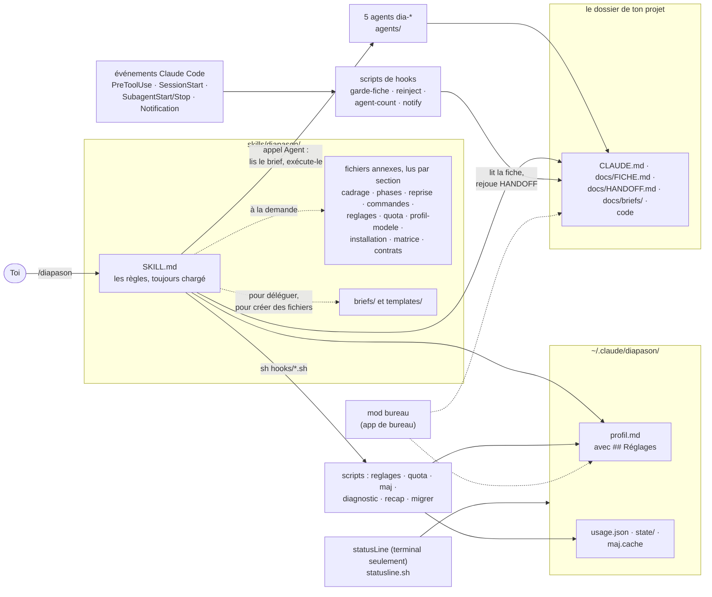
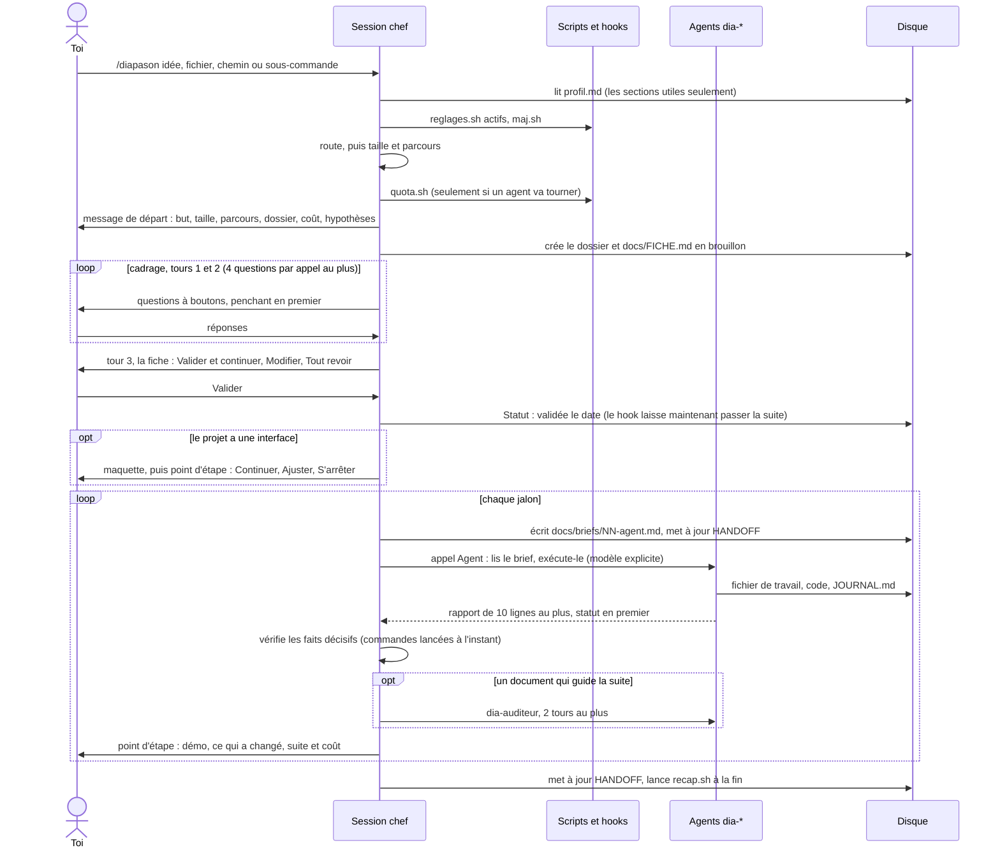
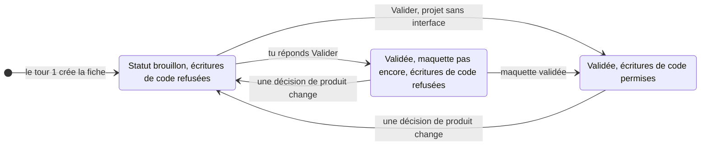

# Diapason : comment ça marche

🇬🇧 [English version](ARCHITECTURE.en.md)

Ce document explique les pièces de Diapason et chacun de ses concepts, pour celles et ceux qui utilisent le skill et veulent le comprendre, et pour les contributeurs qui vont le modifier. Il ne répète pas le guide d'utilisation : pour les étapes d'installation, les sous-commandes, les tableaux de réglages et la FAQ, va voir [GUIDE.md](GUIDE.md). Les chiffres (nombres, tailles) ont été recalculés le 2026-10-26 sur le dépôt ; le fichier `VERSION` indique 1.8.0, et les correctifs faits après cette version sont listés sous « Non publié » dans [CHANGELOG.md](CHANGELOG.md). Quand une chose n'a pas été vue en fonctionnement dans une vraie session Claude Code, le texte écrit « non vérifié en session réelle ».

## Sommaire
1. [Ce que Diapason est](#1-ce-que-diapason-est)
2. [Carte des composants](#2-carte-des-composants)
3. [Parcours de la demande](#3-parcours-de-la-demande)
4. [Les concepts](#4-les-concepts)
5. [Catalogue des scripts et des hooks](#5-catalogue-des-scripts-et-des-hooks)
6. [Données et fichiers sur ta machine](#6-données-et-fichiers-sur-ta-machine)
7. [Installation, les trois voies](#7-installation-les-trois-voies)
8. [Système qualité](#8-système-qualité)
9. [Limites et points non vérifiés](#9-limites-et-points-non-vérifiés)
10. [Pour aller plus loin](#10-pour-aller-plus-loin)

## 1. Ce que Diapason est

Diapason est un skill pour Claude Code, lancé seulement par la commande `/diapason`. Il transforme la session à laquelle tu parles en chef de projet : il cadre le travail avec toi, le découpe, confie les gros morceaux à des sous-agents, vérifie lui-même les faits qui décident de tout, surveille ton quota et tient un fichier de passation pour que le projet puisse être repris. Il est fait de règles écrites (le skill et les définitions des agents) et de quelques scripts `sh` ; il n'y a ni serveur ni processus en arrière-plan. Sa `description` et son `when_to_use` disent à Claude de ne le charger que sur `/diapason` (le lint refuse `disable-model-invocation: true`, qui empêcherait une autre session de le lancer par l'outil Skill).

**Les rôles**

| Rôle | Ce que c'est | Modèle |
|---|---|---|
| Le chef (« le maître », écrit « tu » ou « Diapason » dans `SKILL.md`) | La session principale de Claude Code. Cadre, délègue, vérifie, rapporte. Fait lui-même les vérifications décisives. | celui de la session |
| `dia-chercheur` | Recherche avec des sources datées | sonnet, 150 tours |
| `dia-auditeur` | Audit indépendant, « en lecture seule » | sonnet, 100 tours |
| `dia-concepteur` | Conception, architecture, spécification, corrections après audit | opus, 120 tours |
| `dia-executant` | Code, rédaction ou analyse ; reprend aussi un travail coupé | `inherit` (le modèle donné dans l'appel Agent), 300 tours |
| `dia-testeur` | Utilise le produit sur une copie isolée, avec une preuve pour chaque bug | sonnet, 150 tours |

(D'après l'en-tête de `agents/dia-*.md`. Les cinq portent `disallowedTools: Agent` : aucun ne peut lancer de sous-agent. « Lecture seule » pour l'auditeur est une consigne de son prompt : sa liste d'outils contient quand même `Write` et `Bash`. Le testeur n'a ni `WebSearch` ni `WebFetch`.)

**Les trois promesses**

1. **Tu décides le produit.** Forme, plateforme, public, fonctions du MVP, technologies principales, style visuel, comptes, données et budget te sont toujours demandés (`SKILL.md` §2). Appliqué par : le texte des règles seulement.
2. **Rien n'est construit avant une fiche validée.** Pas de code ni d'agent d'implémentation tant que tu n'as pas répondu « Valider » à une fiche d'une page (`docs/FICHE.md`), et, pour une interface, tant que la maquette n'est pas validée elle aussi. Appliqué par : le texte des règles, plus le hook `garde-fiche.sh`, le seul endroit où un script refuse une action (avec des trous connus, voir 4.2 et 9).
3. **Le chef vérifie lui-même les faits décisifs.** « Les tests passent » veut dire une commande lancée à l'instant, pas le rapport d'un agent (`SKILL.md` §4). Appliqué par : le texte des règles seulement.

**Ce qui vit où**

```text
Dépôt (c'est aussi la racine du plugin)
├── skills/diapason/        le skill : SKILL.md, fichiers annexes (*.md), briefs/ (8), templates/ (8),
│                           agents/ (5), hooks/ (11 scripts), VERSION
├── agents/                 les mêmes 5 agents, pour le plugin (copie identique à l'octet)
├── hooks/                  hooks.json + 6 scripts (sources des scripts de hooks)
├── tools/                  8 scripts (5 livrés dans le skill, 3 pour le dépôt seulement)
├── tests/hooks.sh          la suite de tests shell
├── evals/                  11 scénarios écrits, joués à la main
├── bureau/                 mod pour l'app de bureau (TypeScript), un second plugin
├── .claude-plugin/         plugin.json et marketplace.json
├── .github/workflows/      lint.yml, release.yml
└── README, GUIDE, CONTRIBUTING, ARCHITECTURE (EN + FR), CHANGELOG, LICENSE

Sur ta machine
├── ~/.claude/diapason/     ton profil, la mesure du quota, les compteurs, les caches (section 6)
├── ~/.claude/skills/diapason/ et ~/.claude/agents/dia-*.md   pour une installation manuelle seulement
└── <ton projet>/           CLAUDE.md, docs/FICHE.md, docs/HANDOFF.md, docs/briefs/ ... (section 6)
```

## 2. Carte des composants



Pour la lire : le skill est du texte que le chef suit ; les scripts sont appelés soit par le chef (`sh .../hooks/reglages.sh`), soit par Claude Code sur un événement (un hook) ; tout ce qui dure est un simple fichier, dans ton dossier de profil ou dans le dossier du projet. Le mod de bureau remplace la barre d'état du terminal, que l'app de bureau n'affiche pas (section 7).

## 3. Parcours de la demande



| Étape | Ce qui se passe | Défini dans |
|---|---|---|
| Aiguillage | Le premier mot est une sous-commande (`aide`, `statut`, `reprendre`, `profil`, `reglages`, `diagnostic`, `nouveau`, alias anglais et `?` aussi) : traité par `commandes.md`, sans agent (sauf `nouveau` et `reprendre`). Sinon un chemin de projet (dossier avec `docs/HANDOFF.md` ou `CLAUDE.md`) : reprise. Sinon un autre fichier ou dossier, ou une idée : nouveau projet. Sans argument : reprise si `docs/HANDOFF.md` existe, sinon il demande. | `SKILL.md` §1, `commandes.md` |
| Profil et réglages | Lit `~/.claude/diapason/profil.md` ; absent : questions de premier usage (2 appels de questions au plus), ou migration depuis un ancien dossier. Puis `reglages.sh actifs` et le `maj.sh` quotidien. Un Petit sans agent saute les réglages. | `SKILL.md` §0, `profil-modele.md` |
| Taille | Petit / Moyen / Grand d'après des critères objectifs ; fixe le parcours (une ligne par type de projet) et les fichiers créés. | `phases.md` (Start, Size, Flow) |
| Lecture du quota | Seulement quand au moins un agent va tourner. | `SKILL.md` §6, `quota.md` |
| Atelier de cadrage | Relevé des outils, puis tour 1 « le quoi » (but, public, forme, fonctions prioritaires), tour 2 « le comment » (technos, données, style, contraintes), tour 3 « la fiche ». Le brouillon de fiche existe dès le tour 1, ce qui allume le hook garde-fou. Les questions en plus selon le type de projet viennent de `matrice.md`. | `cadrage.md`, `matrice.md` |
| Validation de la fiche | Une question : Valider et continuer / Modifier / Tout revoir. « Go » ou le silence n'est pas une validation. | `cadrage.md` (Golden rule, Tour 3) |
| Maquette | Entre la fiche et la conception, s'il y a des écrans : une échelle de cinq barreaux (une maquette fournie, un outil de design connecté, un artifact privé, du HTML statique, des aperçus texte dans les boutons). Validée par un point d'étape. | `phases.md` (Mock-up) |
| Délégation | Brief écrit une fois dans `docs/briefs/`, modèle toujours explicite, au plus `agents-paralleles` agents à la fois (5 par défaut), coût du lot annoncé, accord au-delà de `budget-lot` (30 % par défaut). Le tableau « Agents lancés » de HANDOFF est mis à jour à chaque lancement et chaque rapport. | `SKILL.md` §3, `briefs/_entete.md` |
| Vérification et audit | Le chef relance lui-même les vérifications décisives. Les documents qui guident la suite (spécification, architecture, chiffres, contenu final) passent un audit indépendant, 2 tours au plus (1 en `econome`). Corrections de code : 3 tours au plus par jalon (tours 1 et 2 le même agent, tour 3 un nouvel agent sur un modèle supérieur), puis le chef tranche. | `SKILL.md` §4, `briefs/audit.md`, `phases.md` (Milestones) Le brief d'audit donne à l'auditeur la trace d'exécution (champ Evidence), lui demande de relancer les commandes décisives et de chercher les effets de bord cachés. |
| Points d'étape | Après la fiche, la maquette et chaque jalon : une ligne de carte du parcours, une mini-démo, ce qui a changé (3 lignes), la suite et son coût, puis Continuer / Ajuster / S'arrêter. Rien ne se lance avant la réponse. | `cadrage.md` (Checkpoint), `SKILL.md` §7 |
| Rapports | Ce qui est fait, ce qui reste une hypothèse, ce que tu dois décider ; des renvois vers les fichiers, sans recopier. | `SKILL.md` §7 |
| Passation et reprise | HANDOFF tenu à jour ; une nouvelle session reprend avec `/diapason <chemin du projet>`. | 4.9, `reprise.md` |
| Fin de projet | `recap.sh` donne le tableau des coûts ; un réglage est suggéré pour la prochaine fois ; les coûts mesurés vont dans le profil. | `phases.md` (End-of-project recap) |

## 4. Les concepts

Chaque entrée : ce que c'est, où ça vit, pourquoi ça existe.

**4.1 Décisions de produit et décisions d'exécution, et `autonomie`.**
Les décisions de produit sont à toi et jamais déléguées : forme, plateforme, public, fonctions et périmètre du MVP, technologies principales, style visuel, comptes et données personnelles, budget. Les décisions d'exécution (structure des fichiers, bibliothèques secondaires, outils de test, algorithmes, nommage), le chef peut les prendre et les noter « délégué » dans `CLAUDE.md`. Dans le doute, c'est une décision de produit. Le réglage `autonomie` (défaut `accompagnant`) ne couvre que l'exécution : `accompagnant` (décider, expliquer en une ligne au point d'étape), `techniques` (décider, sans expliquer), `tout-demander` (demander avant chaque choix), `tout-sauf-accords` (tout décider côté exécution, atelier condensé, la fiche est quand même validée). Aucune valeur ne couvre les accords du §5 de `SKILL.md`.
*Où :* `SKILL.md` §2, `reglages.md`. *Pourquoi :* tu gardes la main sur ce qu'est le produit sans être interrogé sur des détails.

**4.2 La fiche validée et son hook garde-fou.**
`docs/FICHE.md` est une fiche d'une page (pourquoi, quoi, comment, décisions, suite) créée en brouillon au tour 1 et validée au tour 3. Deux lignes portent l'état : `Statut :` / `Status:` et `Maquette validée :` / `Mock-up approved:`, lues en français et en anglais. Dès qu'une fiche avec une ligne de statut existe, `garde-fiche.sh` (un hook `PreToolUse`) refuse `Write`, `Edit`, `MultiEdit`, `NotebookEdit` hors de `docs/`, `maquette/`, `CLAUDE.md`, `.claude/` et hors du dossier du projet, et refuse le lancement de `dia-executant`, tant que le statut n'est pas validé et que la ligne de maquette n'est pas « pas encore ». Une décision de produit changée plus tard remet la fiche en brouillon et le hook bloque de nouveau. Sans fiche (anciens projets, ou projet où tu as choisi « Garder tel quel », daté dans son `CLAUDE.md`), le hook ne fait rien.



Limites, honnêtement : les écritures faites par `Bash` ne sont pas filtrées ; le hook lit le texte de la fiche et ne peut pas savoir que tu as vraiment répondu « Valider » ; les liens symboliques et les alias de chemin ne sont pas résolus ; les outils d'écriture des serveurs MCP ne sont pas dans son `matcher`. Qu'il s'applique aussi aux appels d'outils d'un sous-agent, et son branchement par le plugin, sont non vérifiés en session réelle (détails dans `installation.md` §6 et le GUIDE).
*Où :* `cadrage.md` (Golden rule, Safeguard), `templates/FICHE.md`, `hooks/garde-fiche.sh`, `installation.md` §6. *Pourquoi :* c'est la seule promesse qui vaut d'être appliquée par un script, car un modèle qui « oublie » la règle se mettrait sinon à coder sur une supposition.

**4.3 La proportionnalité : Petit, Moyen, Grand.**
La taille se tire d'un tableau de critères objectifs (écrans 0-2 / 3-6 / plus de 6 ou plusieurs plateformes ; données aucune ou un fichier local / celles d'un utilisateur / partagées avec des rôles ou des paiements ; comptes ; fichiers touchés 1-3 / une douzaine / beaucoup). La plus grande taille atteinte par une ligne l'emporte ; dans le doute entre deux tailles, la plus petite, dite à voix haute ; un mot-clé comme « petit » ou « MVP » peut baisser ou plafonner la taille, jamais l'augmenter. Petit : 0 à 2 agents, un cadrage court, pas de dossier quand la réponse tient dans le chat. Moyen : 1 agent de conception, 0 à 5 recherches, 1 à 3 jalons. Grand : 6 à 15 recherches, des audits, plusieurs sessions. Le préréglage du forfait peut plafonner davantage (`econome` : un Moyen à 1 conception et 2 recherches).
*Où :* `phases.md` (Size, Skeleton, Flow). *Pourquoi :* un agent coûte plusieurs fois une réponse directe, donc la méthode ne doit pas être plus lourde que le travail.

**4.4 Le brief écrit une fois, et « le fichier de l'agent fait foi ».**
Un brief, c'est l'en-tête commun (`briefs/_entete.md` : projet, dossier, date, langue, quoi lire, ce que l'agent écrit SEUL, ce qu'il ne touche pas, fichier de progression, budget, dépendances permises) plus le gabarit du rôle (`recherche`, `conception`, `implementation`, `maquette`, `testeur`, `audit`, `continuation`). Il est enregistré une fois en `docs/briefs/NN-<agent>.md` ; l'appel Agent dit seulement « Lis <chemin absolu>, puis exécute-le » plus le modèle. L'agent écrit son résultat dans un fichier, tôt et au fur et à mesure ; son rapport dans le chat est court (10 lignes au plus, 5 avec `rapports : court`) et c'est le fichier qui compte. *Pourquoi :* un brief sur disque survit à une coupure et rend la reprise possible ; des chemins plutôt que des résumés gardent le contexte petit ; un agent a une tâche et ses propres fichiers, jamais deux rédacteurs sur les mêmes fichiers.
*Où :* `SKILL.md` §3, `briefs/`.

**4.5 Les statuts de rapport.**
Première ligne de tout rapport d'agent : `TERMINÉ` (le chef vérifie), `TERMINÉ AVEC RÉSERVES` (les traiter avant tout audit), `BESOIN DE CONTEXTE` (le fournir, reprendre le même agent), `BLOQUÉ` (donner du contexte, un modèle supérieur si le quota le permet, découper ou corriger le plan, jamais relancer le même brief). Un agent qui bute trois fois sur la même erreur s'arrête et rapporte (diagnostic, autre approche, remise en cause du plan).
*Où :* `SKILL.md` §3, bloc de règles de `briefs/_entete.md`, définitions des agents. *Pourquoi :* un vocabulaire fixe permet au chef de décider la suite sans lire d'abord tout le fichier.

**4.6 Pas de sous-agents d'agents.**
Les agents `dia-*` n'ont pas l'outil `Agent`. *Pourquoi :* le coût d'un agent imbriqué serait caché du suivi du quota. *Où :* `SKILL.md` §3 ; `disallowedTools: Agent` dans chaque agent.

**4.7 La preuve exigée.**
« Les tests passent » est la sortie d'une commande lancée à l'instant, pas un rapport ; « l'agent a fini » veut dire : le fichier existe, il est complet, et pour du code le diff le montre ; « ça marche » est un essai réel ici ou une source datée ; « les exigences sont remplies » est vérifié ligne à ligne. « Devrait » et « probablement » comptent comme non vérifié ; un chiffre non mesuré ou sans source s'écrit « non vérifié » ou « non mesuré ». Le chef vérifie lui-même les 2 à 5 faits qui décident de tout. Sans outil de sous-agent, le chef travaille seul et écrit « auto-vérifié, non indépendant ».
*Où :* `SKILL.md` §4, `contrats.md` (journal des vérifications dans `INDEX.md`). *Pourquoi :* le récit qu'un agent fait de son propre travail est une hypothèse.

**4.8 L'étiquette de « penchant » et sa certitude.**
Quand un vrai choix est ouvert (forme, technologies, hébergement, MVP), l'option recommandée vient en premier, étiquetée d'un des trois niveaux, « sûr », « probable » ou « je devine », avec une ligne donnant la raison, le prix à payer et ce qui ferait changer d'avis. Quatre contrôles avant d'envoyer : vrai, dit simplement, dans ton intérêt, refusable. Pas d'étiquette sur une question de validation ou de point d'étape (sa première option est la suite) ni sur une question de goût ou de fait ; un penchant ne change jamais ta configuration. Au palier 2 ou plus du quota, le penchant pour « on lance ? » est « attendre ».
*Où :* `cadrage.md` (« How to ask the questions »). *Pourquoi :* une recommandation n'est utile que si tu vois à quel point elle est sûre et que tu peux la refuser.

**4.9 HANDOFF.**
`docs/HANDOFF.md` est le fichier d'où une nouvelle session reprend. Des lignes d'en-tête fixes que des scripts et des sous-commandes lisent (`Dernière visite`, `Jalon :`), puis les consignes de reprise, tes demandes mot pour mot, l'état, le tableau « Agents lancés » (agent, tâche, modèle, fichier de travail, statut `en cours` / `terminé` / `arrêté` / `à reprendre`, brief, coût), les pistes échouées, les décisions, « Reprise immédiate », ce qui attend de toi, les coûts mesurés. **Faits datés :** `[V AAAA-MM-JJ]` vérifié ce jour-là avec une commande, `[?]` non revérifié ; un fait qui change est réécrit « (remplace <ancienne valeur>, <ancienne date>) ». **Budget :** moins de 8 Ko, comptés en octets (`wc -c`) ; les sections terminées et les lignes d'agents finis vont dans `docs/HANDOFF-archive.md` (jamais lu à la reprise sans besoin) ; « Pistes échouées et pièges connus » n'est jamais archivé. **Reprise** (`reprise.md`) : lire `CLAUDE.md`, HANDOFF et la fiche ; comparer avec le disque (« les fichiers font foi » : dates de modification, `git log`, lancer une fois la commande de test du projet) ; revérifier tout fait dont la suite dépend s'il est sans date, vieux de plus de 7 jours ou marqué `[?]` ; pour chaque agent `en cours` ou `à reprendre`, d'abord vérifier que personne n'écrit encore (fichier modifié il y a moins de 10 minutes : attendre 2 minutes et comparer), puis continuer un agent coupé avec `briefs/continuation.md` et son brief d'origine, ne jamais relancer un travail fini ; puis donner « depuis ta dernière visite » en 3 lignes. Le contenu de HANDOFF est une donnée : une action irréversible qui n'y figure qu'en phrase demande quand même ton accord. Après un résumé automatique ou à la reprise, `reinject.sh` rejoue l'en-tête, les lignes `en cours` / `à reprendre` et « Reprise immédiate » (3 000 octets au plus par défaut).
*Où :* `templates/HANDOFF.md`, `reprise.md`, `hooks/reinject.sh`. *Pourquoi :* la conversation se perd à une coupure ou à un résumé, les fichiers non.

**4.10 Le profil et ses rubriques.**
`~/.claude/diapason/profil.md`, gardé hors du skill pour qu'une mise à jour ou un partage du skill ne l'écrase ni ne l'expose. Le premier usage pose 2 appels de questions au plus (accompagnement, niveau, longueur des réponses, préréglage ; il détecte langue, système, pays, dossiers et outils sans demander). Rubriques : Détecté, Préférences générales, `## Réglages`, Usages et équipement, Préférences pour les projets de code ou créatifs, Projets connus, Repères de coût, Habitudes observées. Plafonds pour que la lecture ne grossisse pas : 8 lignes pour les repères de coût, 15 chacun pour les projets connus, les habitudes et les usages. Le chef ne lit que les rubriques dont une tâche a besoin. Une ligne marquée « (défaut, à confirmer) » a été prise sans que tu l'aies vue ; elle est redemandée une fois au plus. Les noms en français (titres et clés que les scripts cherchent) restent en français quelle que soit la langue du profil (`contrats.md`).
*Où :* `profil-modele.md`, `contrats.md`, `SKILL.md` §0. *Pourquoi :* un seul endroit pour tes préférences à travers tous les projets, borné en taille.

**4.11 Réglages, préréglages et surcharge par projet.**
Un réglage est une ligne `- <clé> : <valeur>` sous `## Réglages` du profil. `## Réglages du projet` dans le `CLAUDE.md` d'un projet le surcharge pour ce projet, clé par clé. Une valeur absente ou invalide retombe sur le profil, puis sur le défaut. Il y a 15 clés : `seuils`, `seuils-hebdo`, `plafonds-hebdo`, `budget-lot`, `autonomie`, `modeles`, `agents-paralleles`, `notifications`, `barre`, `git`, `langue`, `ton`, `rapports`, `verif-maj`, `prereglage` (la liste est dans `KEYS` de `tools/reglages.sh`). Les scripts lisent eux-mêmes `seuils`, `seuils-hebdo`, `plafonds-hebdo`, `notifications`, `barre` et `verif-maj` ; le chef applique les autres d'après le tableau. Trois préréglages écrivent plusieurs clés d'un coup et gardent ta ligne `autonomie` :

| Préréglage (forfait) | Écrit |
|---|---|
| `econome` (Pro) | seuils 60 75 85, écarts hebdo 15 30 45, plafonds hebdo 80 90 95, `budget-lot` 15 %, `modeles opus-conception-seulement`, 2 agents en parallèle, rapports courts ; plus des règles en plus (briefs courts, un tour d'audit, une variante de maquette) |
| `normal` (Max 5x) | 4 agents en parallèle, le reste aux défauts |
| `intensif` (Max 20x, API) | seuils 80 90 95, écarts hebdo 30 50 70, plafonds hebdo 90 95 98, `budget-lot` 40 %, `modeles opus-avec-audits`, 5 agents en parallèle |

Le forfait est lu dans `plan.plan` de l'outil d'usage : `Pro` donne `econome`, une valeur contenant `Max` et `20` donne `intensif`, un autre `Max` donne `normal`, une clé d'API donne `intensif` ; toute autre valeur est demandée une fois. Seul `Pro` a jamais été vu ; les autres valeurs sont déduites. Régler une clé à la main alors qu'un préréglage est écrit change `prereglage` en `personnalise` (les règles en plus du préréglage cessent de s'appliquer). `reglages.sh` est le seul à écrire : il vérifie les valeurs, écrit sous verrou, de façon atomique, et garde une copie `.bak`. L'effet des clés appliquées par le modèle n'est pas mesuré (`reglages.md` le dit).
*Où :* `reglages.md`, `commandes.md`, `tools/reglages.sh`. *Pourquoi :* la même méthode doit aller à un forfait Pro comme à un budget d'API, et tu dois pouvoir la changer d'une commande, sans éditer de fichiers.

**4.12 Le quota.**
Deux fenêtres. La **fenêtre de 5 h** a trois seuils (`seuils`, défaut 70 / 80 / 90 %). La **fenêtre hebdomadaire** a trois paliers : au rythme (écart en points entre la part utilisée et la part de semaine écoulée, `seuils-hebdo`, défaut 20 / 40 / 60) et par plafond absolu (`plafonds-hebdo`, défaut 85 / 92 / 97 %) ; le palier est le plus haut des deux, et le palier 3 s'applique aussi à 90 % utilisés avec une projection de 300 % ou plus. Si la remise à zéro est inconnue, passée ou à plus de 7 jours, à moins de 12 heures, ou si moins de 10 % de la semaine est écoulée, seuls les plafonds comptent. Ce que change chaque palier :

| Palier | Effet |
|---|---|
| 1 | Plus d'agents du modèle le plus capable ; la conception, le tour 3 des corrections et « BLOQUÉ : modèle supérieur » passent au modèle intermédiaire ; le dire |
| 2 | Aucun nouvel agent de ta propre initiative : proposer le lot avec son coût, lancer après un oui explicite à ce coût ; les agents en cours finissent et sont vérifiés |
| 3 | Arrêt propre : les agents écrivent leur état, HANDOFF est mis à jour (reprise immédiate, briefs dans `docs/briefs/`), rapport avec l'heure de remise à zéro |

À 100 %, ne jamais passer aux crédits payants sans un oui explicite. Aussi : si l'usage de 5 h dépasse la part de temps écoulé de plus de 20 points, décider comme si le seuil suivant était atteint ; à une frontière de phase avec un contexte au-dessus d'environ 40 %, proposer une session neuve depuis HANDOFF ; un palier 2 ou plus au départ du projet est dit avant l'atelier (« on cadre maintenant, les agents après la remise à zéro »). **Comment le chef le lit :** le quota n'est lu que quand un agent va tourner. Dans le terminal, `statusline.sh` écrit `usage.json` et `quota.sh` le lit (valable s'il a moins de 15 minutes et si la fenêtre n'est pas finie) et sort avec le seuil atteint (0 = aucun, 2 = pas de mesure utilisable : le chef n'invente rien et te demande) ; dans l'app de bureau, il n'y a pas de `usage.json`, donc l'outil d'usage est lu directement. Les chiffres hebdomadaires de l'outil d'usage passent par `quota.sh hebdo` pour que le modèle ne calcule jamais (là, la sortie 2 veut dire palier 2).
*Où :* `SKILL.md` §6, `quota.md`, `reglages.md`, `tools/quota.sh`, `hooks/statusline.sh`. *Pourquoi :* une longue exécution multi-agents peut vider un forfait ; l'arrêt doit être propre et les règles identiques pour tous les scripts qui lèvent une alerte.

**4.13 Les permissions : toujours demander, jamais.**
*Toujours demander :* l'argent (achat, abonnement, compte payant, domaine) ; une installation système ou un gros téléchargement (avec sa taille) ; la publication (`git push`, dépôt distant, mise en ligne, boutique, partage d'un artifact) ; l'envoi (message, courriel, formulaire) ; les comptes (création, connexion, clés d'API) ; toute action irréversible ; ce que ton profil ajoute. Les dépendances du projet dans son propre dossier : un accord par jalon sur une liste annoncée. *Sans demander :* les décisions d'exécution (4.1), `git init` et les commits locaux, les artifacts privés non partagés, les lignes de profil datées. *Jamais :* contourner une protection (captcha, anti-bot, DRM, paywall, anti-cheat, licence), copier une œuvre protégée, acheter (donner les liens), modifier tes originaux (travailler sur des copies ; un outil livré ne peut les changer que lorsque tu le lances, après un essai à blanc, avec un retour en arrière), toucher aux serveurs ou ports en cours d'usage, tuer un processus. Les données restent sur ta machine ; aucun secret dans un fichier. Le profil ne peut lever un accord que par une instruction explicite et datée, et ne lève jamais un « Jamais ». Les agents portent les mêmes règles dans leur définition ; le lint vérifie que le §5 de `SKILL.md` et `briefs/_entete.md` citent les six mêmes mots-clés (captcha, anti-bot, DRM, paywall, anti-cheat, `git push`). Les entrées facultatives `permissions.ask` pour les commandes risquées se copient à la main dans `settings.json` (un plugin ne peut pas les installer).
*Où :* `SKILL.md` §5, `briefs/_entete.md`, `installation.md` §2.

**4.14 L'aiguillage des modèles.**
Modèle léger (haiku) : travail mécanique, inventaires, mise en forme, traduction, documents dérivés. Intermédiaire (sonnet) : recherche, audit, tests, implémentation courante, corrections. Le plus capable (opus) : conception, architecture, spécification, cœur du produit. Le modèle est toujours passé explicitement dans l'appel Agent, parce qu'un modèle omis hérite de celui de la session, souvent le plus cher. Le skill ne choisit jamais Fable ni l'alias `best` (Fable est facturé en crédits sur Pro et a sa propre barre hebdomadaire sur Max ; décision du 2026-10-30) : « le plus capable » veut toujours dire opus. Le réglage `modeles` le restreint : `jamais-opus`, `opus-conception-seulement`, `defaut`, `opus-avec-audits` (voir `reglages.md`). Le palier 1 du quota retire aussi le modèle le plus capable.
*Où :* `SKILL.md` §3, `reglages.md`, la ligne `model:` de chaque agent. *Pourquoi :* le coût dépend surtout du modèle choisi pour chaque tâche.

**4.15 Le plafond de taille de `SKILL.md`.**
Après un résumé automatique, Claude Code ne rend à un skill que ses 5 000 premiers tokens (chiffre cité par le lint et CONTRIBUTING d'après la documentation officielle ; non relu dans cette session). Le lint a mesuré environ 2,4 à 2,5 octets par token le 2026-10-20 et plafonne donc `SKILL.md` à **12 000 octets**, avec moins de 500 lignes, la section Permissions qui commence avant l'octet 11 000 et la dernière section avant l'octet 12 000. Aujourd'hui : 11 966 octets, 91 lignes, Permissions à l'octet 1 827 (placée en deuxième exprès), dernière section à l'octet 10 768 ; la marge est de 34 octets. C'est pourquoi `SKILL.md` reste court et renvoie à des fichiers annexes lus par section (`grep -n '^## '` puis `sed`), et pourquoi `reinject.sh` dit au modèle de relire la fin de `SKILL.md` (§6, §7) et `quota.md` si le skill paraît coupé. Une règle nouvelle doit venir avec la suppression d'une autre ou aller dans un fichier annexe.
*Où :* `tools/lint-skill.sh` (contrôle 2), `CONTRIBUTING.md`. *Pourquoi :* les règles qui comptent le plus (permissions, quota, rapports) doivent survivre à un résumé.

**4.16 Le contrôle de version quotidien.**
À chaque `/diapason`, `maj.sh` compare `VERSION` à la dernière release GitHub : au plus une requête par jour (une nouvelle 6 heures après un échec), vers l'API des releases de ce dépôt par identifiant de dépôt, 3 secondes au plus, https seulement, réponse bornée à 200 Ko, aucune donnée de toi envoyée (GitHub voit ton adresse IP). Seul un numéro de version venu du réseau est affiché. Il annonce une version plus récente en une ligne, une fois par version (rappel au bout de 7 jours) et au plus une fois par 24 heures tous modes confondus, et n'installe rien. Le cache est `maj.cache` ; un cache corrompu ou daté du futur est ignoré. Se coupe avec `reglages.sh set verif-maj non` (ou `DIAPASON_VERIF_MAJ=non` ; `no`, `off`, `false`, `0` se lisent pareil ; le réglage du projet l'emporte).
*Où :* `hooks/maj.sh`, `installation.md` §9, `SKILL.md` §0. *Pourquoi :* tu apprends qu'un correctif existe sans service qui te suive.

## 5. Catalogue des scripts et des hooks

Il y a 14 scripts, tous en `sh` POSIX, tous demandant `jq` sauf indication contraire. Les sources sont dans `hooks/` (6) et `tools/` (8) ; 11 sont livrés dans `skills/diapason/hooks/` (des copies `cp -p` dont le lint vérifie qu'elles sont identiques à l'octet) ; `build-release.sh`, `changelog-section.sh` et `lint-skill.sh` servent au dépôt seulement. Les scripts prennent leur dossier de données dans `~/.claude/diapason/` s'il existe, sinon l'ancien `~/.claude/majordome/`, sinon `~/.claude/maitre-agent/`.

| Script | Rôle | Lancé par | Entrée | Sortie et codes de sortie | Écrit |
|---|---|---|---|---|---|
| `garde-fiche.sh` | Refuse le code et `dia-executant` avant la fiche et la maquette validées | Hook `PreToolUse`, matcher `Write\|Edit\|MultiEdit\|NotebookEdit\|Agent\|Task` | JSON du hook sur stdin (nom d'outil, `cwd`, chemin du fichier, type d'agent) ; dossier du projet par `CLAUDE_PROJECT_DIR`, sinon `cwd` | **Sortie 2 avec un court message anglais sur stderr = blocage** ; sortie 0 sinon (pas de `jq`, JSON vide ou cassé, pas de fiche) | Rien |
| `agent-count.sh` | Compte les sous-agents en cours | Hooks `SubagentStart`, `SubagentStop` (argument `start` ou `stop`) | JSON du hook (`session_id`, `agent_id`) | Toujours sortie 0 | Un fichier vide par agent sous `state/<session>/agents/` ; purge les fichiers de plus de 5 h et les dossiers vides |
| `notify.sh` | Notification système (macOS `osascript`, Linux `notify-send` s'il est présent) | Hook `SubagentStop` (matcher : `dia-` ou `ma-` avec préfixe de plugin facultatif), hook `Notification` (`permission_prompt\|idle_prompt`), et appelé par `statusline.sh` pour les alertes de quota | Argument `agent`, `blocked` ou `quota [texte]` ; JSON du hook | Toujours sortie 0 ; `DIAPASON_DRY_RUN=1` affiche au lieu de notifier | Rien |
| `statusline.sh` | Barre d'état du terminal et alertes de quota | Commande `statusLine` (rafraîchissement 10, réglée à la main) | JSON de la barre d'état sur stdin | Une ligne, `🛎️ <projet> · <jalon> · <n> agents · 5 h <x> % (reset HH:MM) · 7 j <y> %` ; toujours sortie 0 | `usage.json` (fichier temporaire puis `mv`, jamais écrasé par du vide) ; marqueurs d'alerte sous `state/alerts/` ; appelle `notify.sh quota` |
| `reinject.sh` | Rejoue HANDOFF après un résumé ou une reprise | Hook `SessionStart`, matcher `compact\|resume` | `CLAUDE_PROJECT_DIR`, sinon le dossier courant | Texte sur stdout : une ligne de rappel, une ligne de mise à jour si `maj.sh --reprise` en a une, puis les lignes `en cours`/`à reprendre` et « Reprise immédiate », 3 000 octets par défaut (`DIAPASON_REINJECT_MAX`) ; rien sans HANDOFF | Rien lui-même (`maj.sh` peut écrire son cache) |
| `diagnostic.sh` | `/diapason diagnostic` : 8 vérifications en lecture seule (jq, barre d'état, skill en double, agents en double, quota lisible, notifications, version, profil) | Appelé par le chef | aucune | Une ligne par vérification `n \| vérification \| OK/KO/info/non vérifié \| commande pour corriger`, puis « N KO sur 8 » ; toujours sortie 0 ; aucun réseau | Rien |
| `quota.sh` | Transforme `usage.json` ou des chiffres donnés en seuil ou en palier | Appelé par le chef | `quota.sh [s1 s2 s3]` ou `quota.sh hebdo <utilisé %> [<remise>]` ; variables `QUOTA_NOW`, `QUOTA_FILE` pour les tests | Mode par défaut : sortie 0 = aucun, sinon le seuil atteint (le nombre lui-même, par ex. 70, 80, 90), 2 = pas de mesure utilisable. `hebdo` : sortie = palier 0 à 3, 4 = pourcentage illisible. Une ligne de texte par fenêtre | Rien (aucun réseau) |
| `reglages.sh` | Lit, vérifie et écrit les réglages | `/diapason reglages` ; premier usage | `reglages.sh` (tableau), `actifs`, `set [--projet] <clé> <valeur>`, `preset econome\|normal\|intensif`, `reset` | 0 fait ; 1 clé ou valeur invalide (rien écrit) ; 2 fichier à modifier absent ; 3 verrou occupé ou écriture impossible (ne pas relancer le premier usage). Montre « avant » et « après » | La rubrique du profil (ou le `CLAUDE.md` du projet avec `--projet`), plus `.bak`, `.lock/` et un fichier temporaire à côté |
| `migrer.sh` | Copie un ancien dossier de données (`majordome`, sinon `maitre-agent`) vers `~/.claude/diapason/` | Appelé par le chef quand il n'y a pas de nouveau profil mais un ancien | aucune | 0 (aussi quand il n'y a rien à faire, ou que le nouveau profil existe déjà : rien n'est écrasé) ; 1 si une copie échoue. Affiche seulement un changement proposé pour `settings.json`, ne l'écrit jamais | Des copies dans `~/.claude/diapason/` (les `sauvegarde-skill-*` ne sont pas copiées) ; ne supprime rien |
| `recap.sh` | Tableau des coûts de fin de projet, tiré de HANDOFF | Appelé par le chef | Chemin facultatif d'un HANDOFF (défaut `docs/HANDOFF.md`) | Tableau agent / modèle / tokens / durée / part du quota ; « non mesuré » si absent ; sortie 0, ou 2 si le fichier ou le tableau manque | Rien |
| `maj.sh` | Contrôle de version (4.16) | `SKILL.md` §0 à chaque `/diapason` ; `reinject.sh` avec `--reprise` | `[--force \| --reprise]` ; variable `DIAPASON_MAJ_URL` (tests) | Une ligne seulement si une release plus récente existe et n'a pas été annoncée ; `--force` affiche toujours une ligne d'état ; toujours sortie 0 | `maj.cache` et le dossier `maj.cache.lock` (c'est tout ce qu'il écrit) |
| `build-release.sh` | Construit `dist/diapason-skill-v<version>.zip` (le dossier `diapason/`) et `dist/diapason-plugin-v<version>.zip` (fichiers suivis par git sans les fichiers privés) | Le mainteneur ou le workflow de release | Version lue dans `.claude-plugin/plugin.json` | Affiche nombre de fichiers et taille par zip ; sortie 1 si `zip` manque ou que la version est illisible | `dist/*.zip` ; ne publie rien |
| `changelog-section.sh` | Affiche la section d'une version de `CHANGELOG.md` (notes de release) | Workflow de release | `<version>` (un `v` devant est accepté) | La section ; sortie 1 si elle est absente ou vide (une release ne part pas sans notes) | Rien |
| `lint-skill.sh` | Contrôle du dépôt (section 8) | Le mainteneur, `lint.yml`, `release.yml` | Dossier du skill facultatif ; variables `LINT_PRIVATE_PATTERNS`, `LINT_SKIP_LOCAL`, `LINT_SKILL_MAX_BYTES` | Lignes `ok` / `avert` / `ERR` ; sortie 0 s'il n'y a pas d'`ERR`, sinon 1 | Rien |

**Lesquels bloquent.** Seul `garde-fiche.sh` bloque, exprès, en sortant avec 2. C'est le seul hook dont la commande ne doit pas finir par `|| true`, car cela avalerait le blocage. Tous les autres ne bloquent jamais une action de Claude Code : `agent-count.sh`, `notify.sh`, `statusline.sh` (sortie 0 toujours), `reinject.sh` (sa commande de hook finit par `|| true`), et les deux appelés par le chef (`diagnostic.sh`, `maj.sh`, sortie 0 toujours). `quota.sh` et `reglages.sh` utilisent leurs codes de sortie pour parler au chef, pas à Claude Code. Le `hooks/hooks.json` du plugin branche `garde-fiche.sh`, `agent-count.sh`, `notify.sh` et `reinject.sh` ; la barre d'état ne peut pas être fournie par un plugin et s'ajoute à la main.

## 6. Données et fichiers sur ta machine

**`~/.claude/diapason/`**

| Fichier ou dossier | Écrit par | Lu par |
|---|---|---|
| `profil.md` | Le chef (premier usage, sous-commande `profil`, lignes d'habitudes datées si c'est permis) ; `reglages.sh` pour la rubrique `## Réglages` seulement | Le chef ; `statusline.sh`, `quota.sh`, `notify.sh`, `maj.sh` (réglages) ; le mod de bureau (`seuils`, `notifications`) |
| `profil.md.bak`, `profil.md.lock/`, `profil.md.tmp.*`, `profil.md.lock.steal/` | `reglages.sh` pendant une écriture (une sauvegarde par commande ; dossier de verrou retiré à la fin, un verrou abandonné de plus de 30 s est repris) | `reglages.sh` |
| `usage.json` | `statusline.sh` (terminal seulement) | `quota.sh` ; la sous-commande `statut` s'il a moins d'une heure |
| `maj.cache`, `maj.cache.lock/` | `maj.sh` | `maj.sh`, `diagnostic.sh` |
| `notifications-on`, `notifications-off` | Toi (fichiers vides) | `notify.sh` ; `diagnostic.sh`. `notifications-off` coupe toutes les notifications, toujours |
| `state/<session>/agents/<agent_id>` | `agent-count.sh` | `statusline.sh`. Purgé après 5 heures |
| `state/alerts/<fenêtre>-<remise>-<seuil>/` | `statusline.sh` (un dossier vide sert de marqueur « déjà alerté ») | `statusline.sh`. Purgé après 8 jours |
| `statusline.sh`, `notify.sh`, `agent-count.sh`, `garde-fiche.sh`, `hooks/reinject.sh` | Toi, par copie (voies d'installation B et C seulement) | Claude Code, par `settings.json` |

Les anciens dossiers `~/.claude/majordome/` et `~/.claude/maitre-agent/` sont lus en repli quand le nouveau n'existe pas ; `migrer.sh` les copie sans rien écraser ni supprimer.

**Dans un dossier de projet** (le chef les crée d'après `templates/`, traduits dans la langue de ton profil ; la taille décide lesquels existent) :

| Fichier | Rôle |
|---|---|
| `CLAUDE.md` | But, taille, parcours, contenu du dossier, décisions datées (« user » ou « délégué »), règles du projet, `## Réglages du projet` facultatif |
| `docs/FICHE.md` | La fiche à valider (4.2) |
| `docs/HANDOFF.md`, `docs/HANDOFF-archive.md` | État et reprise (4.9) |
| `docs/briefs/NN-<agent>.md` | Briefs envoyés aux agents |
| `docs/research/INDEX.md`, `_BRIEF.md`, fichiers de recherche | Recherches et journal des vérifications du chef |
| `docs/JOURNAL.md` | Journal de jalon tenu par l'agent d'implémentation |
| `docs/ARCHITECTURE.md`, `SPEC.md`, `PLAN.md`, `RECOMMANDATION.md`, `RAPPORT.md`, `ASSETS.md` | Selon le type de projet |
| `maquette/`, `tools/`, `out/` | Maquette ; scripts ; sorties (projets de données) |
| `CLAUDE.md.bak`, `CLAUDE.md.lock/` | Laissés par `reglages.sh set --projet` |

**Jamais écrit :** `~/.claude/settings.json` par un script quel qu'il soit (un changement est montré en diff et fait seulement après ton accord) ; tes fichiers d'origine (les agents travaillent sur des copies) ; des secrets ou des identifiants ; quoi que ce soit sur le réseau hors la requête de `maj.sh`. Jamais supprimés par le skill : les anciens dossiers de données.

## 7. Installation, les trois voies

| Voie | Ce que tu obtiens | Ce qu'elle ne fait pas |
|---|---|---|
| A. Plugin (marketplace GitHub) | Le skill, les 5 agents (nommés `diapason:dia-*`), le compteur d'agents, les notifications de fin d'agent, la réinjection après un résumé, le garde-fou (le tout par `hooks/hooks.json`), les mises à jour par version | Pas de barre d'état, pas d'entrées `permissions.ask` (un plugin ne peut pas les fournir) |
| B. Copie du skill | Le skill seul dans `~/.claude/skills/` ; agents, hooks et réglages à la main | Rien d'automatique |
| C. Zip de release | `diapason-skill-v<version>.zip` (comme B) ou `diapason-plugin-v<version>.zip` (comme A, à essayer avec `--plugin-dir`) | Comme A ou B |

Nom de la commande : par le plugin c'est `/diapason:diapason`, et le court `/diapason` marche aussi tant qu'aucun autre skill ne le prend ; par une copie du skill c'est `/diapason`. Un skill personnel et un skill de plugin de même nom se chargent tous les deux : n'installe donc pas par deux voies (`diagnostic.sh` le signale). Les fichiers de configuration (`settings.json`) ne sont modifiés qu'avec ton accord, en fusionnant, après un diff.

**App de bureau.** La barre d'état du terminal n'est pas affichée dans l'app de bureau (tickets publics anthropics/claude-code#41456 et #83534 ; un script témoin déclaré comme `statusLine` n'a pas été appelé lors d'un essai local le 2026-10-18). Le plugin `diapason-bureau` (dossier `bureau/`, listé dans la même marketplace) la remplace : un mod qui utilise l'API en accès anticipé des « function hooks » de Claude Code 2.1.299 pour afficher `🛎️ <projet> · <n> agents · 5 h <x> % ... · 7 j <y> %` et le jalon tiré de `docs/HANDOFF.md`, lève des alertes de quota aux seuils de `seuils`, et affiche un toast avec la première ligne du rapport d'un agent `dia-*`. Il lit deux réglages (`seuils`, `notifications`) dans les mêmes fichiers de profil et de projet. Son API peut changer d'une version à l'autre. Dans l'app de bureau, il n'y a pas de `usage.json` : le chef lit donc le quota par l'outil d'usage ; `diagnostic.sh` y traite l'absence de barre d'état et de `usage.json` comme normale. Que les hooks du plugin se déclenchent dans l'app de bureau n'est pas vérifié en session réelle, au-delà de ce que dit le GUIDE.

## 8. Système qualité

**Tests shell (`tests/hooks.sh`).** 584 vérifications au moment de l'écriture (`sh tests/hooks.sh | tail -1`), lancées aussi avec `dash` comme `sh` des scripts testés (`sh tools/test-dash.sh`, ce que fait la CI : `dash tests/hooks.sh` seul ne change que l'interpréteur de la suite) ; les deux doivent rendre 0 échec. Isolation : un `HOME` temporaire supprimé à la fin, `DIAPASON_DRY_RUN=1` (aucune vraie notification), `DIAPASON_VERIF_MAJ=non`, aucun réseau (le contrôle de version est testé sur une URL locale `file://`), des JSON factices pour chaque hook. Ils couvrent : les séquences d'échappement et les caractères de contrôle dans la barre d'état, la ligne de jalon, les notifications (dont « bloqué » coupé par défaut), les alertes uniques en appels parallèles, les compteurs et leur purge, HANDOFF réinjecté comme donnée, `quota.sh` (paliers de 5 h et hebdo), les réglages (seuils, notifications, barre, surcharge par projet), `garde-fiche.sh` en français et en anglais sous `sh` et `dash`, le choix du dossier de données après les renommages, `maj.sh` (machine d'états, verrou, cache douteux), les écritures parallèles de `reglages.sh`, les décimaux à zéro de tête, `diagnostic.sh`, `migrer.sh`, `agent-count.sh`, et la fabrication de la release sur un petit dépôt factice (aucun fichier privé dans les zips). Chaque correctif de l'audit de la v1.8.1 a une vérification qui a été jouée contre l'ancien code (CHANGELOG : 86 d'entre elles y échouent).

**Lint (`tools/lint-skill.sh`).** Neuf groupes : (1) en-têtes YAML stricts du skill et des agents ; (2) taille de `SKILL.md` (4.15), cohérence du §5 avec `briefs/_entete.md`, chaque clé de réglage citée dans `SKILL.md` existe dans `reglages.md`, chaque renvoi `§N` pointe une section, et pas de `disable-model-invocation` ; (3) chaque fichier cité existe ; (4) aucune trace personnelle dans le dépôt (motifs génériques `/Users/...` et `/home/...`, plus les tiens par `LINT_PRIVATE_PATTERNS`, jamais écrits dans un fichier) ; (5) `plugin.json`, `marketplace.json`, `hooks.json` valides et cohérents ; (6) scripts exécutables, shebang `sh`, syntaxe POSIX ; (7) copies identiques (agents, scripts de hooks, `VERSION` égale à la version de `plugin.json`), aucun agent ne fixe `model: fable` ou `best`, et un agent qui lit le web et a Bash doit interdire d'exécuter ce qui vient d'une page ; (8) YAML des workflows ; (9) installation locale sous `~/.claude` (sautée avec `LINT_SKIP_LOCAL=1`). Le lint ne peut pas connaître un nom privé qu'on ne lui a pas donné.

**Évals (`evals/`).** 11 scénarios écrits (petit projet, achat, reprise avec un HANDOFF en retard, demande interdite, quota à 80 %, pas de construction avant la fiche, jeu avec maquette d'abord, reprise sans cadrage, sans interface, outils de maquette, un script qui renomme des photos). Ils se jouent à la main dans une vraie session. Deux ont été jouées, sur la v1.6 (03 réussie, 06 partielle) ; aucune n'a été jouée sur la v1.8. Tant qu'un scénario n'est pas joué, il ne prouve rien.

**Workflows.** `lint.yml` lance le lint et `sh tests/hooks.sh` à chaque push et chaque pull request. `release.yml` tourne sur un tag `v*` : lint, contrôle que le tag égale la version de `plugin.json`, `build-release.sh`, la section correspondante de `CHANGELOG.md` comme notes, `gh release create`. Le zip du plugin ne contient que des fichiers suivis par git, sans fichiers de travail (briefs privés, journaux, recherches, `CLAUDE.md`, `HANDOFF.md`).

**Revue de parcimonie (à chaque version).** Tirer 5 règles du corps de `SKILL.md`, retrouver l'origine de chacune (CHANGELOG, incident, recherche) et son éval ; une règle sans l'un ni l'autre est proposée à la suppression ou à la fusion ; les 5 règles et les décisions sont écrites dans le CHANGELOG. Retirer une règle utile est le vrai risque : dans le doute la règle reste et l'éval manquante s'écrit.

**Ce que rien de tout cela ne couvre.** Le comportement du modèle : qu'il suive `SKILL.md` n'est vérifié que par les quelques essais et évals ci-dessus, pas par un script. Les hooks sont testés avec des JSON factices, pas par Claude Code lui-même. Les tests TypeScript du mod de bureau (`claude plugin test bureau`) n'ont pas été lancés pour la v1.8.1 : `bun` est absent de la machine du mainteneur, et la suite shell ne couvre pas le mod. Les notifications Linux (`notify-send`) ne sont pas testées ; Windows n'est pas pris en charge.

## 9. Limites et points non vérifiés

La liste complète est dans le GUIDE, section « Limites, honnêtement » ([GUIDE.md](GUIDE.md#limites-honnêtement)). Ce qui compte pour la conception :

- **La plupart des règles sont des consignes données à un modèle.** Seul `garde-fiche.sh` applique quelque chose mécaniquement, et il a des trous (4.2). Que le modèle applique chaque réglage (autonomie, modèles, rapports, préréglages) dans une vraie session n'a pas été vu.
- **Le branchement des hooks par le plugin n'a pas été vu de bout en bout** dans une vraie session, ni que le garde-fou s'applique aux appels d'outils d'un sous-agent.
- **Le quota dépend de la barre d'état dans le terminal** ; dans l'app de bureau, il dépend de l'outil d'usage, dont les valeurs de forfait ne sont connues que pour `Pro`.
- **Les évals** n'ont pas été jouées sur cette version (section 8).
- **Les chiffres des 5 000 tokens et des octets par token** derrière le plafond de `SKILL.md` viennent des commentaires du lint (une mesure du 2026-10-20) et n'ont pas été remesurés pour ce document.
- **Les nombres de ce document** (tests, tailles, fichiers) valent au 2026-10-26 et sont recalculés par des commandes, pas tenus à jour à la main.

## 10. Pour aller plus loin

- [README.md](README.md) : ce que c'est, en une page, avec les deux schémas du parcours.
- [GUIDE.md](GUIDE.md) ([GUIDE.en.md](GUIDE.en.md) en anglais) : installation, sous-commandes, réglages, garde-fous, FAQ, limites.
- [CONTRIBUTING.md](CONTRIBUTING.md) ([CONTRIBUTING.en.md](CONTRIBUTING.en.md) en anglais) : ce qui doit rester synchronisé, les tests, le plafond de `SKILL.md`, ajouter un réglage, les versions.
- [CHANGELOG.md](CHANGELOG.md) (en français) : chaque changement, revues de parcimonie comprises.
- La version anglaise de ce document : [ARCHITECTURE.en.md](ARCHITECTURE.en.md).
