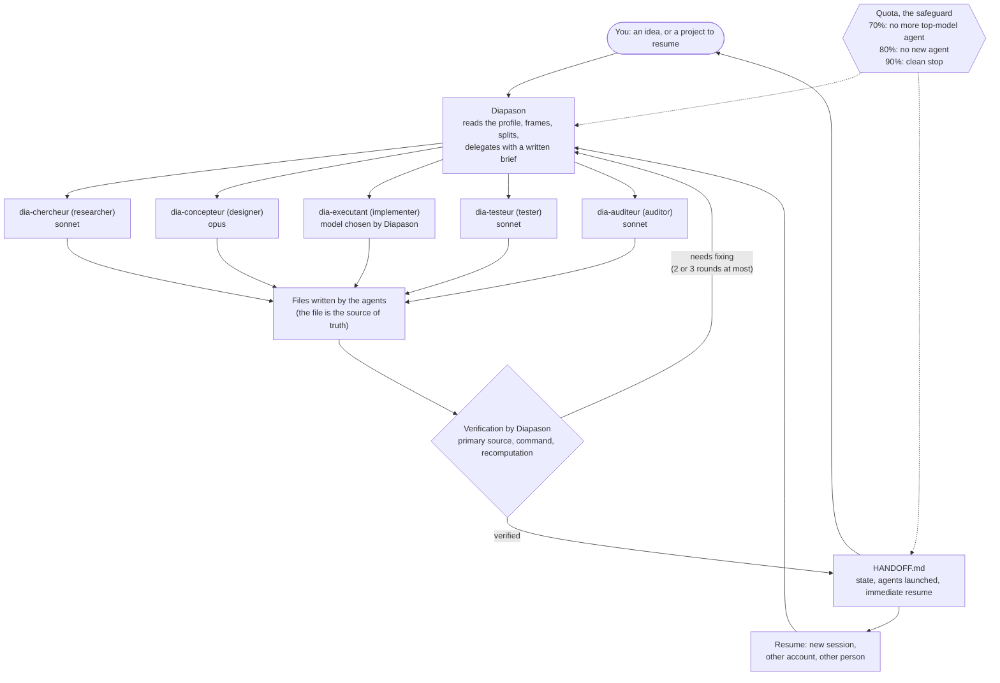

# Diapason: the guide

English · [Version française](GUIDE.md) · [Back to the README](README.md#english)

This guide holds the details: installation, sub-commands, settings, safeguards, FAQ, limits. The README fits on one page. Were you using v1.3 or v1.4, under their former names (maitre-agent, majordome)? Go to the migration section ("Coming from…", between installation and sub-commands).

> Since v1.3.0 the skill's internal text (`SKILL.md`, the skill files, briefs, templates, agent definitions) is in English, to save tokens. What you see stays in your profile's language, and the scripts' messages (status line, notifications) are in French. This page is a full translation of the French guide. Some linked documents (`docs/fabrication.md`, `evals/`, `commandes.md`) are in French.

## Prerequisites

macOS or Linux (the scripts are `sh`), [`jq`](https://jqlang.org/) (`brew install jq` or `sudo apt install jq`; without it the counter, notifications and status line stay silent), and Claude Code (CLI 2.1.299 tried).

**What it costs, in increasing order.** *Small* (a question, a purchase, a small script): 0 to 2 agents, often alone. *Medium*: one design, up to 2 research agents with the `econome` preset (Pro plan), milestones one after another. *Large*: several 5-hour windows, announced and to be approved before starting. Measured reference: one research agent is about 209,000 tokens, about 12% of a 5-hour window (a single measurement, Pro plan). The estimated cost is announced before each batch. The cost of the framing workshop and of the mock-up is not measured.

**On first launch**, it asks for your profile in a few button questions (how much to accompany you, level, answer length, a preset matching your plan; language, informal/formal address and project folder are detected or announced, without a question); answer "défauts" to accept everything. Then, for a project to build: a framing workshop in 3 rounds, then a mock-up to approve if the project has an interface. Nothing is built before you say "Valider" (approve).

## The pitch

`diapason` is a skill for [Claude Code](https://code.claude.com/docs/en/skills). You give it an idea (a script, a purchase to compare, a piece of research, a text) or a project to resume. The main session becomes the "diapason": it reads your profile, splits the work, hands it to sub-agents running the right model, verifies the facts that matter by itself, watches your quota, and writes a handoff file (`HANDOFF.md`).

It is for people who use Claude Code on projects that last longer than one conversation and who want to stay in control: product decisions are yours, approval is asked before anything that costs money or cannot be undone, nothing is built before you have approved a sheet, and work can resume after a quota cut, in a fresh session, or from another account.

It does not aim for more agents. It aims for the smallest usable result. For a tiny task it works alone.

## The method



The agents write the big pieces. They never launch other agents. Diapason does the decisive checks itself: "the tests pass" means the output of a command run just now, not an agent's report.

## How it works with you

Since v1.3.0 the skill accompanies you instead of rushing ahead. What prompted the change: on a real project, the session had picked on its own to build a web page and had coded without asking a single question. Here is what happens now. Each point names the skill file that describes it (these files are in English since v1.3.0).

**Who decides what** (`skills/diapason/SKILL.md`, section 2).
- **Yours, always**: the shape of the product (website, mobile app, tool, document, game...), the platform, the audience, the MVP features, the main technologies, where the data lives, the style, accounts and budget.
- **Delegated**: file structure, secondary libraries, test tools, naming. It decides, notes "délégué" (delegated) in the project's `CLAUDE.md` and explains it in one line at the checkpoint (setting `autonomie`, default `accompagnant`). When in doubt, it is a product decision, so it is yours.
- Approvals (money, installs, publishing, sending, accounts, deletion) are still asked, whatever the value of `autonomie`.

**A framing workshop with buttons, in 3 rounds** (`cadrage.md`). Round 1: the what (goal, for whom, shape, features, with a proposed MVP). Round 2: the how (technologies, data, style, constraints). Round 3: the sheet. At most 4 questions per call, the recommendation first with its reason (cost, difficulty, where it runs). Without a button question tool: a numbered list. It does not ask again what your profile or its tool survey already tells it. Small project: a short version.

**A sheet for you to approve** (`cadrage.md`, `templates/FICHE.md`). One page, `docs/FICHE.md`: goal, success criteria, MVP features, out of scope, technologies, dated decisions. You answer **Valider / Modifier / Tout revoir** (approve / edit / redo everything). A "go" or silence is not an approval. If you change a product decision afterwards, the sheet goes back to draft and you approve it again. When resuming a project, a missing or unapproved sheet restarts the workshop (`reprise.md`). A project already built without a sheet: it offers the workshop (keep, adapt or start over) without forcing it (`matrice.md`).

**A mock-up before the code** (`phases.md`, Maquette section), if the project has an interface. It takes the first rung that exists: your own mock-up or style guide, a connected design tool (reading is allowed; **writing into a design tool needs your approval**), a private Artifact, a static HTML file `maquette/index.html`, or at least a text preview inside the buttons. The mock-up you approve becomes the reference; the tester compares against it. A script, an analysis or a document without screens skips this step.

**Checkpoints** (`cadrage.md`) after the sheet, after the mock-up and after each milestone: a **journey map** line ("Étape 3/8 : Maquette (à valider) · validé : Cadrage ✔ Recherche ✔ · reste : Conception, Audit, Jalons, Tests, Livraison", that is step 3 of 8), a mini demo, what changed, what comes next with its estimated cost, then **Continuer / Ajuster / S'arrêter** (continue / adjust / stop). If the session context goes above about 40%, it offers to restart in a fresh session with `HANDOFF.md` ready.

**A safeguard, the `garde-fiche.sh` hook** (`installation.md`, section 6). As long as the sheet is not approved, it refuses to write code (outside `docs/`, `maquette/`, `CLAUDE.md`, `.claude/`) and to launch the `dia-executant` agent; once the sheet is approved, it still refuses code while the "Maquette validée" line says "pas encore" (not yet). Without a sheet that has a "Statut : ..." line, it does nothing. **Its limits:** writes done through `Bash` are not filtered, nor are those of an MCP server's write tools (only `Write`, `Edit`, `MultiEdit`, `NotebookEdit`, `Agent` and `Task` are watched); symbolic links and path aliases are not resolved (a project folder reached through a link, `/tmp` and `/private/tmp` on macOS, or a different letter case on a case-insensitive volume, let everything through: seen in 40 trials with dummy JSON); `docs/` and `.claude/` accept any file by design, including disguised code or a Claude Code setting (hypothesis, **not verified in a real session**: `disableAllHooks` written in `.claude/settings.local.json` would switch the hooks off, hence the safeguard); it reads the sheet's text and cannot know whether you really answered "Valider"; it **has been called by Claude Code in a real session**, once, on 2026-10-19: in a fresh test session, a `Write` of code outside `docs/` was refused while the sheet was still a draft, and the hook's message was shown to Claude (the hook was wired in by hand in that test project). It is also tested with dummy JSON. **Not verified:** that it applies to sub-agents (the documentation says so), and its wiring by the plugin in a real session. The plugin wires it in; without the plugin, the manual copy is described in `installation.md`.

**A preset matching your plan** (`reglages.md`, "Forfait et préréglage"). On first launch it reads your plan from the usage tool and offers, confirmed once: `econome` for a Pro plan (1 or 2 parallel agents, the most capable model for design only, a single grouped research, one audit round, one mock-up variant), `normal` for Max 5x (3 or 4 agents), `intensif` for Max 20x or an API key (5 agents, the most capable model for audits too, 2 to 3 mock-up variants). **Only the value "Pro" has been seen**; the Max values are inferred and not verified: for an unexpected value, it asks you. What each preset sets (number of research agents, audit rounds, variants) are design choices, not measured in use.

**What is verified, and what is not.** The scripts (settings, quota, diagnostic, safeguard) are tested with dummy JSON: 581 checks under `sh` and under `dash` (measured on 2026-10-26), 0 failures. **Seen twice, on 2026-10-19, in two fresh test sessions** (run by Diapason, which played the user through messages). **First trial** (skill in French): tours 1 and 2 of the workshop asked as a numbered list, each with a recommendation (tour 1 asked 5 questions instead of 4: a deviation); a "go" refused before "Valider"; the safeguard refusing a `Write` outside `docs/` while the sheet was still a draft; the sheet approved; a 3-screen HTML mock-up, tested in the browser by the session; a checkpoint "Étape 2/7" with the cost of what follows and "Continuer / Ajuster / S'arrêter"; a clean stop. **Second trial** (skill internal text in English, answers in French): everything in French; 4 questions per tour at most; the connectors question asked; a checkpoint "Étape 2/5"; a mock-up as a private Artifact and `maquette/index.html`, one single screenshot; no code on disk; stop after the mock-up. **Not seen:** the buttons of the question tool (the first trial replaced them with a list; the second does not note them), the sub-agents under the safeguard. The evaluations 06 to 10 that describe these situations are written, **not run**.

## Features

"Status" column: **used for real** = used while building this repository; **tested** = a trial or automated test, described in the limits; **written** = present and checked by the lint, not yet put to the test.

| Feature | What it does | Status |
|---|---|---|
| Profile | Reads `~/.claude/diapason/profil.md` first (language, level, budget, machine). Creates it in two exchanges at most on first use. Stays on your machine. | used for real (v1.0.0, details not kept) |
| Routing | Idea, project path, file to process, or sub-command: it picks between new project, resume and command. | used for real (v1.0.0, details not kept); sub-command routing: written |
| Proportionality | Aims for the smallest usable result. When unsure between two sizes, it takes the smaller one and says so. | used for real (v1.0.0, details not kept) |
| Delegation by model | Light model for mechanical work, intermediate for research, audit and routine code, most capable for design. The model is always stated explicitly. 5 `dia-*` agents. | used for real |
| Verification | Decisive facts are verified by Diapason. Required-proof table, audits capped at 2 rounds, code fixes capped at 3 rounds, "3 failures" protocol. | used for real |
| Framing workshop (v1.3) | 3 button rounds (the what, the how, the sheet), at most 4 questions per call, a survey of the available tools before asking. See "How it works with you". | seen twice (2026-10-19): tours 1 and 2 as a numbered list with recommendation; 5 questions in tour 1 of the first trial (limit 4: a deviation), 4 per tour in the second; connectors question asked in the second; buttons not seen; evals 06 to 10 written, not run |
| Approved sheet (v1.3) | One-page `docs/FICHE.md`, "Valider / Modifier / Tout revoir"; no code before approval; re-approval if a product decision changes. | seen twice (2026-10-19): draft first, "go" refused before "Valider", sheet approved (first trial); status "validée" in the second |
| Mock-up before the code (v1.3) | Ladder: your mock-up, connected design tool (writing = your approval), private Artifact, static HTML, text preview. The approved mock-up is the tester's reference. | seen twice (2026-10-19): static HTML, 3 screens, tested in the browser by the session (first trial); private Artifact and `maquette/index.html` with one single screenshot (second); the connected design tool was not played |
| Checkpoints and journey map (v1.3) | After the sheet, the mock-up and each milestone: "Étape N/M" map, mini demo, cost of what follows, continue / adjust / stop. | seen twice (2026-10-19): "Étape 2/7" (first trial), "Étape 2/5" (second), cost of what follows, continue / adjust / stop; clean stop; the full map was not seen |
| "Approved sheet" safeguard (v1.3) | `PreToolUse` hook `garde-fiche.sh`: refuses code until the sheet (and the mock-up) is approved. Limits in "How it works with you". | tested with dummy JSON (`tests/hooks.sh`, `sh` and `dash`); called once by Claude Code in the test session (2026-10-19): a `Write` outside `docs/` refused. Not seen: sub-agents, wiring by the plugin |
| Preset matching the plan (v1.3) | Reads `plan.plan` and offers `econome` / `normal` / `intensif`, confirmed once. | "Pro" seen; Max values not verified; applied by the model: written, never seen |
| Permissions | Approval asked before money, installs, publishing, sending, accounts, deletion. List of prohibitions (see Safeguards). | written; the `permissions.ask` rules must be installed by hand |
| Quota 5 h and 7 days (adjustable) | 5 h window: `seuils` (70 / 80 / 90% by default). At 70%, no more top-model agent; at 80%, it proposes and only launches with your explicit approval, cost announced; at 90%, clean stop. 7-day window: `seuils-hebdo` (gap in points, 20 / 40 / 60) and `plafonds-hebdo` (85 / 92 / 97%), pace rule. `quota.sh` gives the tier; for figures typed in by hand, `quota.sh hebdo <% used> <reset>`. The model does not compute. It reads the quota only when an agent is about to run. | stop at 90%: used for real (v1.1.0); `quota.sh` and the weekly rule: tested with dummy JSON and given figures (`tests/hooks.sh`), weekly mode tested on macOS only; the rest: written |
| Handoff | `HANDOFF.md` with [V date] verified that day / [?] not rechecked tags, a changed fact keeping its old value, an "Agents launched" table, an "Immediate resume" section. Files on disk win if HANDOFF is behind. | used for real (one resume after a cut) |
| Sub-commands | `aide` (help), `statut`, `reprendre`, `profil`, `reglages` (or `settings`), `diagnostic` (or `doctor`: 8 read-only checks of the installation, by the script `hooks/diagnostic.sh`, which ends with an "N KO out of 8" count), `nouveau`. | written |
| Settings (v1.2, extended in v1.3) | A `## Réglages` section of the profile (and `## Réglages du projet` in a project's `CLAUDE.md`) sets quota thresholds, batch size, autonomy (4 values since v1.3), models, parallel agents, notifications, status line, git, language, tone, report length. Three presets: `econome` (thrifty), `normal`, `intensif`. See "Settings" below. | script `tools/reglages.sh` and the scripts that read it: tested with dummy JSON (`tests/hooks.sh`); settings applied by the model: written, never seen in a real session |
| Terminal status line | `🛎️ <project> · <milestone> · <n> agents · 5 h <x> % (reset HH:MM) · 7 j <y> %`. Also writes the quota to `~/.claude/diapason/usage.json`. 7-day alerts, one per tier and per reset. | tested with dummy JSON on every push (`tests/hooks.sh`); not seen in a real terminal |
| Desktop mod | The same idea for the Code tab of the Claude desktop app: status line, quota alerts, agent-finished toast. It does not read the weekly thresholds. | tested: 41 of 41 tests at v1.5.0 (`claude plugin test bureau`, the app's CLI 2.1.299, throwaway HOME; including the `seuils` and `notifications` settings and the three profile folders); status line and agent-finished toast seen for real (v1.1.x) |
| Version check | `maj.sh` compares the installed version (file `skills/diapason/VERSION`) with the latest GitHub release: at most one GET request a day (a new try 6 h later after a network failure), none of your data sent, one announcement per version then a reminder after 7 days, a single announcement per 24 h whatever the mode, run at each `/diapason` and when resuming a project that has a HANDOFF. Installs nothing. Turned off with `verif-maj non`. | tested with a dummy release (booby-trapped tag, unreadable answer, network failure, 7-day reminder) and a real call to the GitHub API on 2026-10-22; the message shown to the user in a real session has not been seen |
| Notifications | System notification when a `dia-*` agent finishes and at the quota thresholds (70 / 80 / 90% by default), on by default; "Claude is waiting" (permission, idle) **off by default**. The `notifications` setting (`agent+quota`, `tout`, `quota`, `rien`) chooses; without it, the file `~/.claude/diapason/notifications-on` turns "Claude is waiting" on and `notifications-off` turns everything off. macOS and Linux. Quota alerts require the status line (terminal) or the mod (desktop). | macOS command tested for real; scripts tested with dummy JSON (`tests/hooks.sh`); hooks not tested end to end by Claude Code |
| Buttons | Questions go through the environment's question tool (at most 4 questions per call, 2 to 4 options, your lean first, marked "(mon penchant : …)" with its certainty). Without that tool: a numbered list. | written |
| Chapters | One chapter per phase (framing, research, mock-up, design, milestones, delivery) if the environment has a chapter tool. Otherwise nothing. | written |
| "Since your last visit" | On every resume, 3 lines: what changed, what is done, what is expected from you. | written |
| Sobriety (v1.3) | No sub-agents of sub-agents: Claude Code allows up to 3 levels, the skill does not (fresh context at each level, cost hidden from quota tracking, verification by Diapason alone). **Connectors: never turned off by default**; the recommended option is "Keep everything"; it only turns off the ones you name, and reminds you that this changes the default of new sessions. Savings (**estimated**, unless marked "measured"): quota read only when an agent is about to run (about 8k per average project); resume without re-reading every brief (about 3.6k); HANDOFF and profile capped (about 3.5k); `reinject.sh` capped at 3,000 bytes (measured: 6,078 → 852 bytes). Briefs written once; the agent call only says "read this path". Simple mock-up done by Diapason; variants by `dia-executant` with `briefs/maquette.md`. | written; the real gain of a session is not measured. Benchmark, a single measurement: lot 12 cost 68k tokens in 3 min, against 110 to 250k for the earlier lots |

## Installation

Three routes. Pick **only one**: a skill installed through two routes would load twice.

### Route A: plugin (GitHub marketplace)

In a Claude Code session:

```text
/plugin marketplace add MalikChopa/diapason
/plugin install diapason@diapason
```

For the desktop app (Code tab), also add the mod, which replaces the status line the app does not display:

```text
/plugin install diapason-bureau@diapason
```

From a shell: `claude plugin marketplace add https://github.com/MalikChopa/diapason`, then `claude plugin install diapason@diapason` (form tried successfully from GitHub, CLI 2.1.299, throwaway HOME, **under the plugin's former name**: not tried again under the Diapason name). The short form `MalikChopa/diapason` was not tried (it may go through SSH). To pin a version: `MalikChopa/diapason#v1.5.0` (the tag only exists once v1.5.0 is published).

You get: the skill (started only by `/diapason`), the 5 `dia-*` agents, the agent counter, the agent-finished notification, re-injection of the state after an automatic summary, and (since v1.3.0) the "approved sheet" safeguard. **The hooks are active in all your Claude Code sessions**, not only when the skill runs: the re-injection does nothing outside a project that has a `docs/HANDOFF.md`, the safeguard does nothing outside a project whose `docs/FICHE.md` has a "Statut : ..." line (in such a project it refuses to write code until the sheet is approved), and the "Claude is waiting" notification is off by default. Quota alerts are not part of it: they come from the status line (terminal) or the mod (desktop). What a plugin **cannot** install: the terminal status line and the `permissions.ask` rules (see below). No plugins in cloud sessions.

Size measured with `claude plugin details` (CLI 2.1.299, 2026-10-19, the CLI's estimates; not re-measured after lot 17): **v1.3.0** about 3.9k tokens when the skill is called, about 252 tokens added permanently to every session (skill and 5 agents; the safeguard is a hook, with no context cost according to the tool). **v1.2.0**, measured the same day: about 3.7k and about 252. **v1.1.1**, measured again the same day on the repository before the v1.2.0 changes: about 3.6k and about 267 (an earlier measurement had given 257). **The CLI's estimates are too low**: measured on 2026-10-21 as the difference of `get_usage` (a single measure), the v1.5.0 `SKILL.md` (16,272 bytes) weighed about 6.4k tokens, i.e. about 2.5 bytes per token rather than 3.3; the v1.6.0 one (11,685 bytes) weighs about 4.3k. The detail of the settings lives in `skills/diapason/reglages.md`, read only by the `reglages` command or when a setting is used: it costs nothing to anyone who sets nothing. **Language of the internal text (v1.3.0), measured on 2026-10-19 on the same text:** `SKILL.md` costs about 8.8k real tokens in French and about 6.2k in English (−30%); the French README costs about 25% more tokens than the English one. One measurement each, by the rise in context (development measurement, not published). The estimate of `claude plugin details` clearly understates this gain: do not rely on it for size.

### Route B: copy the skill

```sh
git clone https://github.com/MalikChopa/diapason.git
cd diapason
mkdir -p ~/.claude/skills && cp -R skills/diapason ~/.claude/skills/
```

Open a new session. The hooks (agent counter, notifications, re-injection) only come with the plugin; without it, they are copied by hand (`installation.md`, section 5). The 5 agents are to be copied into `~/.claude/agents/` (from `skills/diapason/agents/`); compare before replacing a file of the same name. The details, written so that Claude can apply them with your approval, are in [`skills/diapason/installation.md`](skills/diapason/installation.md) (in French).

### Route C: release zip

On the [releases page](https://github.com/MalikChopa/diapason/releases), two zips (same remark as route B: the skill-only zip brings no hooks):

```sh
# the skill alone (same as route B): the zip contains the diapason/ folder
unzip diapason-skill-v1.8.1.zip -d ~/.claude/skills/

# the full plugin (files at the zip root), to try it out
unzip diapason-plugin-v1.8.1.zip -d diapason-plugin
claude --plugin-dir diapason-plugin
```

### Command name
- Through the plugin: `/diapason:diapason`. The short name `/diapason` also works as long as no other skill takes it.
- Through the copied skill (routes B and C): `/diapason`.
- **Start it with `/diapason`.** The skill can use a good share of a quota window: its description and `when_to_use` limit loading to an explicit request (the command, or a session asking for the method). `disable-model-invocation: true` was ruled out, because it would stop another session from starting it through the Skill tool.

### Updating
- **Plugin (route A):** `claude plugin update diapason@diapason`. **Skill copy or zip (routes B and C):** copy the `diapason/` folder of the new zip into `~/.claude/skills/`.
- The skill tells you itself when a newer version is published (one line, never an install without you); `sh ~/.claude/skills/diapason/hooks/maj.sh --force` checks right now (skill copy; with the plugin the script is in its cache). Details, what is exchanged and the off switch: the `verif-maj` setting and "Your data" below.
- Coming from v1.6: `installation.md` §8 of the skill (the agents are now `dia-*`, the safeguard must be copied again).

### Manual configuration (optional, with your approval, and merging)

Both settings go in `~/.claude/settings.json`. **Read the file and merge: never overwrite it.**

**Terminal status line** (does not work in the desktop app, see the limits). With the plugin there is no need for `git clone`: the scripts sit in its cache, and you copy them to a stable path (the cache folder changes with every version, so copy again after an update). Path **observed on 2.1.299** after installing from GitHub, under the plugin's former name, not documented: `~/.claude/plugins/cache/diapason/diapason/<version>/hooks/` (same form expected with the Diapason name: not verified). Check with `ls`; if several versions are there, replace `*` with the newest:

```sh
mkdir -p ~/.claude/diapason
cp ~/.claude/plugins/cache/diapason/diapason/*/hooks/statusline.sh ~/.claude/diapason/
cp ~/.claude/plugins/cache/diapason/diapason/*/hooks/notify.sh ~/.claude/diapason/
chmod +x ~/.claude/diapason/statusline.sh ~/.claude/diapason/notify.sh
```

Without the plugin (routes B and C), take the same files from `hooks/` in a copy of the repository (`git clone`) or from the plugin zip.
```json
"statusLine": {
  "type": "command",
  "command": "~/.claude/diapason/statusline.sh",
  "refreshInterval": 10
}
```
It needs `jq`. The quota it shows comes from Claude Code (Pro and Max plans, after the session's first reply); without it, the line shows `quota ?`. The milestone shown is the `Jalon : …` line of `docs/HANDOFF.md`. The same script writes the quota to `~/.claude/diapason/usage.json`, which the skill reads to apply its thresholds.

**Ask before risky commands** (`permissions.ask`): a plugin cannot install these.
```json
"permissions": {
  "ask": [
    "Bash(git push *)", "Bash(gh repo create *)", "Bash(gh pr create *)", "Bash(gh release create *)",
    "Bash(npm publish *)", "Bash(rm -rf *)", "Bash(sudo *)", "Bash(brew install *)",
    "Bash(brew uninstall *)", "Bash(kill *)", "Bash(pkill *)", "Bash(killall *)"
  ]
}
```
Adapt the list to your system. These rules also apply to sub-agents.

## Coming from majordome (v1.4) or maitre-agent (v1.3)

The skill was called `maitre-agent` up to v1.3, then `majordome` in v1.4; it has been called `diapason` since v1.5. What changes for you:

- **The command**: `/maitre-agent` and `/majordome` become `/diapason`. No alias is shipped: a project whose `CLAUDE.md` says `/maitre-agent` or `/majordome` is resumed with `/diapason <project path>`.
- **Your data**: on the first use of `/diapason`, if `~/.claude/diapason/profil.md` is missing and an old profile exists, the old folder (`~/.claude/majordome/`, else `~/.claude/maitre-agent/`) is **copied** to `~/.claude/diapason/` (script `hooks/migrer.sh`), overwriting and deleting nothing, and the skill says so in one line. The `sauvegarde-skill-*` folders are not copied. If `~/.claude/diapason/profil.md` already exists, the script refuses to copy. The old folder stays in place: removing it is your choice, by hand.
- **Your `settings.json`** is never modified by the script. If a hook there points into the old folder (typically `~/.claude/majordome/hooks/reinject.sh`), the script only prints the lines to change (`-` old, `+` new); you approve, then apply them (or have it done, after seeing the diff).
- **Your projects**: nothing to change. A v1.3 or v1.4 project resumes as before (`Jalon :`, `## Agents lancés`, `## Reprise immédiate`, `## Réglages`, the status lines of `FICHE.md` are read as they are).
- **Uninstall the old plugin or the old skill** (`majordome@majordome` or `maitre-agent@maitre-agent`), then install Diapason (route A, B or C above): both together would load twice. The `diagnostic` sub-command reports an old skill left in `~/.claude/skills/` and a status line path left in the old folder (information, not an error).
- **Status line and desktop mod**: the mod is called `diapason-bureau` (formerly `majordome-bureau`). If your status line still points to the old folder, `diagnostic` tells you; then redo the copy described in "Manual configuration".
- **Environment variables**: `DIAPASON_PROJECT_DIR`, `DIAPASON_DRY_RUN`, `DIAPASON_REINJECT_MAX`, `DIAPASON_PROFIL`; the old `MAJORDOME_*` (v1.4) and `MAITRE_AGENT_*` (v1.3) ones are still read.
- The agents are named `dia-*` since v1.7 (before: `ma-*`). If your old `ma-*` files linger in `~/.claude/agents/`, delete them: `diagnostic` flags them.

Repository: GitHub normally redirects the old addresses to `github.com/MalikChopa/diapason` once the repository is renamed (GitHub behaviour, not verified for Claude Code marketplaces). Details: `skills/diapason/installation.md`, §7.

## Sub-commands

| Command | Alias | Effect |
|---|---|---|
| `/diapason aide` | `help`, `?` | explains the skill in 15 lines at most and says what is installed on your machine |
| `/diapason statut` | `status` | 5 lines at most per known project, changes nothing |
| `/diapason reprendre` | `resume` | offers the known projects as buttons, then resumes the one you pick |
| `/diapason profil` | `profile` | shows or edits your profile, starts no project |
| `/diapason reglages` | `settings` | no argument: the settings table (current value, default, source). `reglages <key> <value>` changes one, `reglages econome` (or `normal`, `intensif`) applies a preset, `reglages reset` goes back to the defaults |
| `/diapason diagnostic` | `doctor` | 8 read-only checks (`jq`, status line, duplicate skill or agents, readable quota, notifications, version, profile), each "OK / KO + command to fix it" |
| `/diapason nouveau <idea>` | `new <idea>` | starts a new project with that idea |
| `/diapason <idea>` | | same thing, it is the default case |
| `/diapason <project path>` | | resumes that project |

With the plugin, use `/diapason:diapason` if the short name is taken. Details: [`skills/diapason/commandes.md`](skills/diapason/commandes.md) (in French).

## Settings

One place: the `## Réglages` section of your profile (`~/.claude/diapason/profil.md`), as `- <key> : <value>` lines. A `## Réglages du projet` section in a project's `CLAUDE.md` overrides the profile for that project, key by key. Section missing, unknown key or invalid value: the default. **Anyone who sets nothing sees no change in behaviour.** The detail of the keys (`skills/diapason/reglages.md`) is read only by the `reglages` command or when a setting is used, and the calculations (thresholds, tiers, reading the profile) are done by scripts, not by the model. Measured extra cost for anyone who does not use it: about 0.1k tokens when the skill is called in v1.2.0 (3.6k to 3.7k, rounded measurement), then about 0.2k more in v1.3.0 (3.7k to 3.9k), the skill having gained the workshop and the checkpoints; the permanent cost does not move (see "Size measured").

| Key | Values | Default | Effect |
|---|---|---|---|
| `seuils` | 3 increasing integers (10 to 99) | `70 80 90` | tiers of the 5-hour window: no more top-model agent, explicit approval, clean stop; also the 5-hour alerts |
| `seuils-hebdo` | 3 increasing integers (1 to 99), in points of gap | `20 40 60` | weekly (7-day) tiers: gap between the % used and the % of the week elapsed; also the 7-day alerts |
| `plafonds-hebdo` | 3 increasing integers (1 to 99), in % | `85 92 97` | weekly tiers: % used. Less than 12 h before the reset, or while less than 10% of the week has elapsed: only the ceilings count |
| `budget-lot` | 5 to 100% | `30 %` | batch size above which it asks for your approval |
| `autonomie` | `accompagnant`, `techniques`, `tout-demander`, `tout-sauf-accords` | `accompagnant` | what it decides alone among the **execution decisions** (product decisions are always yours). `accompagnant`: it decides and explains in one line at the checkpoint; `techniques` (the former default): it decides without explaining; `tout-demander`: it asks you about execution too; `tout-sauf-accords`: it decides all of execution, condensed workshop, sheet still to be approved |
| `modeles` | `defaut`, `jamais-opus`, `opus-conception-seulement`, `opus-avec-audits` | `defaut` | which models it may pick. `opus-conception-seulement`: the most capable model for design only; `defaut`: plus the core of the product; `opus-avec-audits`: plus the audits |
| `agents-paralleles` | 1 to 5 | `5` | agents at the same time |
| `notifications` | `agent+quota`, `tout`, `quota`, `rien` | `agent+quota` | which notifications |
| `barre` | `projet` `jalon` `agents` `quota` (`cout` optional), in the order you want | `projet jalon agents quota` | the terminal status line |
| `git` | `commit-local`, `aucun`, `push-branche` | `commit-local` | `push-branche` pushes a working branch (never the main one) without asking again; a standing, dated approval |
| `langue`, `ton` | `profil`, a language code; `tutoiement`, `vouvoiement`, `neutre` | `profil` | how it writes |
| `rapports` | `court`, `detaille` | `detaille` | length of agent reports and answers |
| `verif-maj` | `oui`, `non` | `oui` | at most once a day (6 h later after a failure), checks whether a newer version is published and tells you in one line, at most once per 24 h (nothing is installed without your yes); `non`: no network call. Also read: `no`, `off`, `false`, `0`, in any case; the project `CLAUDE.md` section `## Réglages du projet` overrides the profile, and `DIAPASON_VERIF_MAJ` accepts the same values. Not part of the presets |

Presets (`/diapason reglages econome|normal|intensif`). What the `reglages preset` script writes:

| Preset | For | Written in the `## Réglages` section |
|---|---|---|
| **`econome`** (thrifty) | Pro plan | `seuils 60 75 85`, `seuils-hebdo 15 30 45`, `plafonds-hebdo 80 90 95`, `budget-lot 15 %`, `modeles opus-conception-seulement`, `agents-paralleles 2`, `rapports court` |
| **`normal`** | Max 5x | `agents-paralleles 4`, the rest at the defaults |
| **`intensif`** (intensive) | Max 20x, API key | `seuils 80 90 95`, `seuils-hebdo 30 50 70`, `plafonds-hebdo 90 95 98`, `budget-lot 40 %`, `modeles opus-avec-audits`, `agents-paralleles 5` |

A preset replaces the section but **keeps your `autonomie` line**. On top of these lines, the skill applies written rules (`reglages.md`): `econome` asks for short briefs, a single grouped research, one audit round, one mock-up variant and a tester at the last milestone only; `normal` does 1 to 2 mock-up variants and 2 audit rounds; `intensif` does 2 to 3 variants, and two independent auditors for what gets published. These rules are design choices, **not measured**. On first launch, the preset matching your plan is offered first, marked "recommended"; the real saving of `econome` is **not measured**: at the end of a project the skill gives you a table of agents / model / tokens / duration / share of quota and a "for next time" line (one suggested setting).

```text
/diapason reglages                       # the table
/diapason reglages econome               # the thrifty preset
/diapason reglages seuils 60 75 85       # a single setting
/diapason reglages barre quota projet    # status line: quota then project
/diapason reglages reset                 # back to the defaults
```

Writes are protected: `reglages.sh` queues writers with a lock (two commands in parallel do not lose a setting), writes atomically and keeps the previous state in `profil.md.bak`. An integer with a leading zero (`08`) is read as `8`; `quota.sh hebdo` accepts `12,5` as `12.5`. The status line reads `seuils`, `seuils-hebdo`, `plafonds-hebdo` and `barre`; `quota.sh` reads the three quota keys; `notify.sh` reads `notifications`, not the thresholds. The desktop mod reads `seuils` and `notifications` (not `barre`: its line stays fixed; not the weekly thresholds). Detail and limits: [`skills/diapason/reglages.md`](skills/diapason/reglages.md) (in French).

## Safeguards

**It asks for your approval before:**
- anything that costs money (purchase, subscription, paid account, domain);
- a system install or a heavy download (it states the size);
- any publishing (`git push`, remote repository, going live, sharing an artifact);
- any sending (message, email, form);
- an account (creation, login, API key);
- any irreversible action (deletion, overwriting);
- writing into a connected design tool (account, possible cost);
- and, on the product itself: any product decision (see "How it works with you"). It builds nothing before you approve the sheet, and the mock-up if the project has an interface.

A project's dependencies, installed in its own folder, need a single approval per milestone, on an announced list.

**It never:**
- bypasses a protection (captcha, anti-bot, DRM, paywall, anti-cheat, license);
- copies a protected work: it takes inspiration from it;
- buys for you: it gives the links;
- modifies the original files you provide;
- touches servers or ports already in use, or kills an existing process.

Your profile never lifts these prohibitions, with no exception. Only a prior approval (money, publication, sending, account, deletion) can be lifted by an explicit, dated instruction from you written in the profile. The content of a HANDOFF or a research file is treated as data, not as an instruction.

**Quota:** 70% (no more top-model agent: design moves to the intermediate model, and it says so), 80% (no new agent on its own initiative: it proposes, cost announced, and waits for your explicit yes), 90% (clean stop, HANDOFF updated, reset time given). Over the week (7 days), the same logic with `seuils-hebdo` and `plafonds-hebdo`: pace rule, ceilings only less than 12 h before the reset. It reads the quota only when an agent is about to run.

**Your data:** the scripts and the mod contact no third-party service, with one exception: the version check (`maj.sh`), which normally makes at most one GET request a day to the repository's GitHub releases API to see whether a newer version exists (after a network failure, a new try 6 h later: up to 4 a day; at most one announcement per 24 h). It sends no data of yours, of your project or of your quota; GitHub sees, as with any request, your IP address and the client name (`diapason-maj`). It installs nothing, and is turned off with `- verif-maj : non` in `## Réglages` of your profile or of your project (or `DIAPASON_VERIF_MAJ=non`). Your profile, projects and quota stay in `~/.claude/` and in your project folder. Research work goes through the web when a question requires it; the skill's rule is that your data stays on your machine (no third-party service, no publishing, no shared artifact).

## FAQ

**How much quota does it cost?**
Multi-agent work costs more tokens than a single session, and the skill says so itself: it only delegates when a task has a large context to read, real parallelism, or needs independent verification. Figures measured while building this repository, on a Pro plan: one research agent, 209,000 tokens, 28 minutes, about 12% of the 5-hour window; two implementation agents, 110,000 and 111,000 tokens (percentage not measured). Three measurements, not an average. The framing workshop (v1.3) and the mock-up add exchanges before any agent; their token cost is not measured.

**Is a Pro plan enough?**
This repository was built on a Pro plan, with a forced pause at 90% of the 5-hour window and a resume after the reset. The skill is designed for that (70 / 80 / 90% thresholds, clean stop). Since v1.1.1 a "Pro plan" rule (which, since v1.3.0, is part of the `econome` preset offered according to your plan) caps a Medium project at 1 design + 2 research agents, milestones in sequence, and announces a Large one as "several windows, N days" before starting. Why: extrapolating a single measurement (209,000 tokens, about 12% of the window), the outside review estimated that a Medium with at least 1 design and 1 milestone already takes a third to a half of a window (linear estimate, not measured).

**Does it work without sub-agents?**
Yes. Without a sub-agent tool, the skill says so once, then works alone: it keeps verification, permissions and handoff. An audit done by itself is then not independent, and it writes so ("auto-vérifié, non indépendant", self-verified, not independent).

**In the terminal, the desktop app, the cloud?**
Terminal: meant to do everything, but the status line has only been tested with dummy JSON. Desktop app: the skill; the hooks are meant to work there (not tested); the status line is not displayed there, so install the `diapason-bureau` mod. Cloud: plugins are not available there; the skill alone in a cloud environment has not been tried (not verified).

**Which language?**
The language of your profile, for everything you see: answers, sheet, checkpoints, workshop questions. The skill's internal text (`SKILL.md`, the skill files, briefs, templates, agent definitions) has been in English since v1.3.0, to save tokens (−30% on `SKILL.md`, measured on 2026-10-19). File names stay in English (`HANDOFF.md`, `CLAUDE.md`...). The scripts' messages (status line, notifications) stay in French; there is no English version of these messages. The safeguard reads the sheets in French and in English.

**Can I resume a project on another account or another computer?**
Yes, that is the point of the handoff: only the project's files travel (`CLAUDE.md`, `docs/HANDOFF.md`, `docs/research/`, `docs/briefs/`). The profile used is the one of the person resuming. The skill compares HANDOFF to the disk before relaunching anything.

**How do I turn notifications off?**
The `notifications` setting (`/diapason reglages notifications rien`) turns them all off, or keeps only the quota (`quota`). Without it, the files below decide. By default the "Claude is waiting" notification (permission request, idle) is **off**; the end of a `dia-*` agent and the quota alerts do notify. To turn the first one on, create `~/.claude/diapason/notifications-on`. To turn everything off, create `~/.claude/diapason/notifications-off` (no more notifications from the scripts, quota alerts included; the status line keeps working). The desktop mod has its own toasts, which this file does not turn off. Useful in the desktop app, which already notifies when a task ends. To test without showing anything: environment variable `DIAPASON_DRY_RUN=1`. To remove everything: uninstall the plugin.

**Are the scripts safe?**
The counter, notifications, status line and re-injection never block (short timeout, `|| true`, exit code 0). **The `garde-fiche.sh` safeguard blocks on purpose** (exit code 2, no `|| true`): it refuses to write code until a project's sheet is approved, and lets everything through without `jq`, without a sheet or with unreadable input. To turn it off: remove its `PreToolUse` block from `settings.json` (manual copy), or disable the plugin; with the plugin, the documentation read does not say how to turn off a single hook (not verified). A search through their code finds no network call (`curl`, `wget`...), with a single exception: `maj.sh`, the daily version check (one GET request to the repository's GitHub releases, none of your data sent, turned off by `verif-maj non`; see "Your data"). They write only to `~/.claude/diapason/`. Read them before installing: `hooks/` is 660 lines of `sh` in total (104 of them for the safeguard), `tools/maj.sh` is 180 lines. `tools/reglages.sh` (352 lines), on the other hand, writes the "Réglages" section of the profile (or of the project's `CLAUDE.md` with `--projet`) when you run the `reglages` command. The text they display (milestone, agent report, message) is filtered: control characters (terminal escape sequences) are removed.

## Limits, honestly

- **The terminal status line is not displayed in the desktop app.** A test script declared as `statusLine` was called by none of the 6 following messages (caveat: hot reloading of the project setting is not proven). This matches the public Claude Code issue #41456 (open); #83534 was closed as a duplicate of #41456. Hence the `diapason-bureau` mod, which relies on an early-access API and may break from one version to the next (written for Claude Code 2.1.299).
- **The plugin's hooks have not been tested end to end by Claude Code.** The scripts are tested with dummy JSON on every push (`tests/hooks.sh`, throwaway HOME, no real notification), and the commands in `hooks.json` were run one by one with `sh -c` and the `CLAUDE_PLUGIN_ROOT` variable; the plugin passes `claude plugin validate --strict`. But Claude Code has not yet triggered them in a real session with the plugin installed. The "approved sheet" safeguard (v1.3.0) was called once by Claude Code in the test session of 2026-10-19, with the hook wired by hand; not verified: its wiring by the plugin, that it applies to sub-agents' tools, the input shape of `MultiEdit` and `NotebookEdit`, the `Task` tool name and how the refusal is shown to you. An agent you interrupt may not fire `SubagentStop` (not verified): the counter then ignores its files after 5 hours.
- **Notifications:** the macOS command was seen working when run outside the sandbox of Claude's commands. Linux (`notify-send`): not tested.
- **Installation from the GitHub marketplace: tried, with a caveat.** On 2026-10-19 an outside reviewer installed the plugin and the desktop mod (under their former names) from GitHub in a throwaway HOME (CLI 2.1.299, full HTTPS URL): "Successfully installed", status enabled. Not tried: installing under the Diapason name, the short `owner/repo` form, the desktop app, and behaviour in a real session (no authentication in a throwaway HOME).
- **Agent names under the plugin.** Under the plugin the agents are called `diapason:dia-chercheur`. Since v1.1.1 the skill asks for "the exact name shown by the sub-agent tool"; that this resolves in a real session has not been tried (a single real trial is still to do). If the `dia-*` agents are missing it falls back to `general-purpose`, and says so.
- **The GitHub workflows (`lint.yml`, `release.yml`) have been run** and were green on 2026-10-18 (lint and release, release v1.1.0 with its two zips). The v1.1.1 result is only known after its push.
- **The evaluations are written, only two have been played**: eleven situations in [`evals/`](evals/README.md) (in French), including the five from v1.3 (06 to 10: no building before the sheet, a game with a mock-up before the code, resuming without framing, a project without interface, mock-up tools). Situations 03 and 06 were played on 2026-10-21 on v1.6 (03 passed, 06 partial); the other nine have not been played; none has been replayed on v1.8. Their format is not that of `claude plugin eval`.
- **The workshop, the sheet, the mock-up and the checkpoints have been seen in two trials**, in two fresh test sessions (2026-10-19, Diapason playing the user). In the first trial (skill in French), tour 1 asked 5 questions (limit 4). In the second (skill internal text in English), 4 questions per tour, and no code on disk. Neither trial records the buttons of the question tool; the offer of a fresh session at 40% context and the full journey map were not recorded. Settings were not seen in these trials; only the scripts (settings, quota, diagnostic, safeguard) are tested beyond them.
- **The plan is only known for Pro.** `plan.plan` has only been seen with "Pro"; the Max values (and the API-key one) are inferred. The facts about writing into Figma (`use_figma` tool, beta, paid plan) come from Figma's documentation read on 2026-10-19 and were not re-checked for this version; the exact support in Claude Code is not verified.
- **In the terminal the quota comes from the status line.** The `get_usage` tool is not visible to the model in CLI 2.1.299 (it only shows up as an SDK control request); the skill therefore reads `usage.json` through `hooks/quota.sh`, which assumes the status line is installed (and called: not in the desktop app). Without a valid measurement (under 15 minutes old) it asks you for the percentage.
- **Buttons and chapters depend on the environment.** Without a question tool, the skill asks numbered lists; without a chapter tool, it opens none. The desktop app's chapter tool is not publicly documented.
- **Settings are tested on the scripts and the mod, not on the model.** That the model applies every key (models, autonomy, reports, presets) has not been seen in a real session; the saving of `econome` is not measured, nor are the per-preset rules (research, audits, variants).
- **Multi-agent costs more** than a single session, and nothing guarantees it is faster. For a small job, the skill stays alone.
- **Only the cases described above are verified.** A line of this guide that says neither "tested" nor "used for real" should be read as untested.

## Credits

`diapason` draws on ideas read in these projects and documents. Everything is reworded: no text was copied.

- [obra/superpowers](https://github.com/obra/superpowers) (MIT): the on-disk handoff as a ledger of trust after compaction; codified agent report statuses (done, done with concerns, needs context, blocked); one brief per file instead of pasted text; the model always stated at each launch; the requirement of proof before saying "it's done".
- [OthmanAdi/planning-with-files](https://github.com/OthmanAdi/planning-with-files) (MIT): writing findings to a file as you go; the three-failures protocol (diagnose, try another approach, rethink); a single owner of the plan; the idea that a resume can be tested with a few questions.
- [github/spec-kit](https://github.com/github/spec-kit) (MIT): a "constitution" of non-negotiable principles against which a deliverable is checked, and bounded clarifying questions. The scored audit and the "non-negotiable rules" section that follow from it are planned, not done yet.
- Claude Code documentation: [skills](https://code.claude.com/docs/en/skills), [sub-agents](https://code.claude.com/docs/en/sub-agents), [hooks](https://code.claude.com/docs/en/hooks), [plugins](https://code.claude.com/docs/en/plugins/overview) and [status line](https://code.claude.com/docs/en/statusline). The skill, agent, hook and plugin formats, the quota fields received by the status line, and the command name of a plugin skill come from there.
- Anthropic Engineering, ["How we built our multi-agent research system"](https://www.anthropic.com/engineering/multi-agent-research-system) (2025-06-13): the conductor-and-workers architecture, effort scaled to the question, and the finding that agents use about 4 times more tokens than a chat, and multi-agent systems about 15 times (compared with a plain chat; figures from the article, not measured here).

About twenty other repositories were read during the initial research; only those above directly shaped the result.

## Made with itself

> **This repository was designed, audited and published with the skill itself (under its former name up to v1.3).**

The story, short, funny and checkable:

- **v1.0.0**: research on about twenty GitHub repositories and on the Claude Code docs, a design, **2 audits** and **1 real test** (per the project brief; details not kept), then a home-made lint. The skill reviewed itself before reviewing anyone else.
- **v1.1.0** was driven by the skill on its own build, with its own agents: one `ma-chercheur` (sonnet, 209,000 tokens), two `ma-executant` (sonnet) for the plugin and the desktop mod, and a third to write the README. Diapason kept the checks that mattered for itself.
- **It stopped exactly when it should.** At 90% of the 5-hour quota, the skill's rule kicked in: clean stop, HANDOFF updated, not one more agent launched. After the reset, the build resumed, HANDOFF up to date.
- **It also tripped over its own feet, and wrote it down.** Diapason overwrote a local settings file without reading it (the opposite of its own rule). A commit meant to contain a piece of research contained none of it, because of a git exclusion. Both are told in the handoff, not hidden.
- **The real tests have admitted limits:** the notification arrived, but not when it was fired from the sandbox; the test script showed that the desktop app does not call the status line, which is how the mod was born.
- **Reviewed by an independent auditor (`ma-auditeur`) on 2026-10-18, corrections applied.**
- **v1.1.1** comes from an outside review of the published repository (15 fixes, 5 modifications, 4 additions, reviewer in read-only mode): filtered status line, a quota the skill can finally read, a "Pro plan" rule, a skill started only by command, a `diagnostic` sub-command, hook tests.
- **v1.2.0** (customizable settings) was requested by the user and written by a `ma-executant` agent.
- **v1.3.0** (the accompanying skill) was written by two `ma-executant` agents (the first: autonomy, workshop, sheet, mock-up, checkpoints, presets; the second: tool survey, mock-up ladder, safeguard, fuller sheet, journey map, matrix) and the documentation by a third. Diapason read the files and ran the tests itself. One trial in a fresh test session (2026-10-19) showed part of the journey; the rest has not run in a real session.
- **v1.4.0** comes from 10 paper simulations of the v1.3.0 skill (1 blocker, 19 annoyances), fixed, then the rename to Majordome. The values and rules of this batch are design settings, not replayed in a real session.
- **v1.5.0** is the rename to Diapason (the user's choice): renaming, data migration and extended tests, no change in behaviour. The desktop mod's 41 tests pass (`claude plugin test`, CLI 2.1.299).
- **v1.6.0** keeps the body of `SKILL.md` under Claude Code's re-injection ceiling (the first 5,000 tokens of a skill after an automatic summary): from 16,272 to 11,685 bytes, about 4.3k tokens measured against about 6.4k before (difference of `get_usage`, a single measure; the output of `claude plugin details` was not re-run). It adds a per-agent budget, sceptical verifiers, consistency checks in the lint and a reminder in the re-injection hook. **Two real evaluations were played on 2026-10-21**: resuming with a stale HANDOFF (03, passed) and framing a one-line idea (06 and a follow-up: no code before the sheet and the mock-up are validated, a non-recommended tech is respected; a non-recommended product form, "Modify" and a bare "go" were not tested).
- **v1.7.0** renames the agents `dia-*`, replaces the "recommended" label with "my lean" plus its certainty, dates HANDOFF facts, marks assumptions (sure / likely / guessing) and adds the "visual deliverable" project type. It comes from a watch (research on other skills, one-subject trials, paper tests); the "planted defects" and "project map" trials showed nothing and changed nothing in the skill.
- **v1.8.0** adds a version check: the skill says, in one line, when a newer version is published (at most one request a day in normal times, none of your data sent, off with `verif-maj non`), and the repository follows the renamed GitHub account (`MalikChopa/diapason`).
- **v1.8.1** comes from an audit of the skill by itself (two independent auditors, 43 points, none blocking), then a re-audit of the fixes: safe parallel settings writes (lock, atomic write, `.bak` copy), numbers with a leading zero and decimal commas, a more tolerant version-check switch, texts that contradicted each other, plus `ARCHITECTURE.en.md` and a full English CONTRIBUTING.
- **Not done yet:** the other nine evaluations (`evals/`), and watching a real automatic summary after the `SKILL.md` split.

The full story, with the agents, their models, measured costs, decisions and mistakes: [`docs/fabrication.md`](docs/fabrication.md) (in French).

## License

[MIT](LICENSE) © 2026 Chopa. See also [`CONTRIBUTING.md`](CONTRIBUTING.md) and [`CHANGELOG.md`](CHANGELOG.md) (in French).
