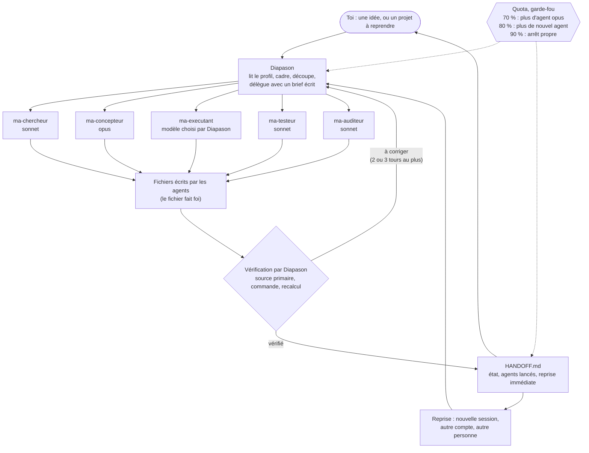

# Diapason : le guide

[English version](GUIDE.en.md) · Français · [Retour au README](README.md#francais)

Ce guide contient le détail : installation, sous-commandes, réglages, garde-fous, FAQ, limites. Le README, lui, tient en une page. Tu utilisais la v1.3 ou la v1.4, sous leur ancien nom (maitre-agent, majordome) ? Va à la section de migration (« Venir de… », entre l'installation et les sous-commandes).

## Prérequis

macOS ou Linux (les scripts sont en `sh`), [`jq`](https://jqlang.org/) (`brew install jq` ou `sudo apt install jq` ; sans lui, compteur, notifications et barre d'état restent muets), et Claude Code (CLI 2.1.299 essayée).

**Ce que ça coûte, par ordre croissant.** *Petit* (une question, un achat, un petit script) : 0 à 2 agents, souvent seul. *Moyen* : une conception, jusqu'à 2 recherches avec le préréglage `econome` (forfait Pro), des jalons l'un après l'autre. *Gros* : plusieurs fenêtres de 5 h, annoncé et à valider avant de commencer. Repère mesuré : un agent de recherche ≈ 209 000 tokens ≈ 12 % d'une fenêtre de 5 h (une mesure, forfait Pro). Le coût estimé est annoncé avant chaque lot. Le coût de l'atelier de cadrage et de la maquette n'est pas mesuré.

**Au premier lancement**, il te pose ton profil en quelques questions à boutons (accompagnement, dossier des projets, langue/ton/niveau, préréglage selon ton forfait) ; réponds « défauts » pour tout accepter. Ensuite, pour un projet à construire : un atelier de cadrage en 3 tours, puis une maquette à valider si le projet a une interface. Rien n'est construit avant ton « Valider ».

## Le pitch

`diapason` est un skill pour [Claude Code](https://code.claude.com/docs/en/skills). Tu lui donnes une idée (un script, un achat à comparer, une recherche, un texte) ou un projet à reprendre. La session principale devient le « diapason » : elle lit ton profil, découpe le travail, le confie à des sous-agents du bon modèle, vérifie elle-même les faits qui décident de tout, surveille ton quota et écrit un fichier de passation (`HANDOFF.md`).

Il est fait pour les personnes qui utilisent Claude Code sur des projets qui durent plus d'une conversation, et qui veulent garder la main : les décisions de produit sont à toi, des accords sont demandés avant tout ce qui coûte ou ne se rattrape pas, rien n'est construit avant que tu aies validé une fiche, et une reprise est possible après une coupure de quota, dans une nouvelle session, ou depuis un autre compte.

Il ne cherche pas à faire plus d'agents : il cherche le plus petit résultat utilisable. Pour une tâche minuscule, il travaille seul.

## La méthode



Les agents écrivent les gros morceaux. Ils ne lancent jamais d'autres agents. Les vérifications décisives, c'est Diapason qui les fait : « les tests passent » veut dire la sortie d'une commande lancée maintenant, pas le rapport d'un agent.

## Comment il travaille avec toi

Depuis la v1.3.0, le skill t'accompagne au lieu de foncer. Ce qui a motivé ce changement : sur un vrai projet, la session avait choisi seule de faire une page web et avait codé sans poser de question. Voici ce qui se passe maintenant. Chaque point renvoie au fichier du skill qui le décrit.

**Qui décide quoi** (`skills/diapason/SKILL.md`, §2).
- **À toi, toujours** : la forme du produit (site, application mobile, outil, document, jeu…), la plateforme, le public, les fonctions du MVP, les technos principales, où vivent les données, le style, les comptes et le budget.
- **Déléguées** : la structure des fichiers, les bibliothèques secondaires, les outils de test, le nommage. Il tranche, note « délégué » dans le `CLAUDE.md` du projet et te l'explique en une ligne au point d'étape (réglage `autonomie`, défaut `accompagnant`). Dans le doute, c'est une décision de produit, donc à toi.
- Les accords (argent, installation, publication, envoi, compte, suppression) restent demandés, quelle que soit la valeur d'`autonomie`.

**Un atelier de cadrage à boutons, en 3 tours** (`cadrage.md`). Tour 1 : le quoi (objectif, pour qui, forme, fonctions, avec une proposition de MVP). Tour 2 : le comment (technos, données, style, contraintes). Tour 3 : la fiche. Au plus 4 questions par appel, la recommandation en premier avec son pourquoi (coût, difficulté, où ça tourne). Sans outil de questions à boutons : une liste numérotée. Il ne redemande pas ce que ton profil ou son relevé des outils lui disent déjà. Petit projet : version courte.

**Une fiche à valider** (`cadrage.md`, `templates/FICHE.md`). Une page, `docs/FICHE.md` : objectif, critères de réussite, fonctions du MVP, hors périmètre, technos, décisions datées. Tu réponds **Valider / Modifier / Tout revoir**. Un « go » ou un silence ne valent pas validation. Si tu changes une décision de produit après coup, la fiche repasse en brouillon et tu la valides de nouveau. À la reprise d'un projet, une fiche absente ou non validée relance l'atelier (`reprise.md`). Un projet déjà construit sans fiche : il te propose l'atelier (garder, adapter ou repartir) sans l'imposer (`matrice.md`).

**Une maquette avant le code** (`phases.md`, section Maquette), si le projet a une interface. Il prend le premier échelon qui existe : ta maquette ou ta charte, un outil de design connecté (lire est permis ; **écrire dans un outil de design demande ton accord**), un Artifact privé, un fichier HTML statique `maquette/index.html`, ou au minimum un aperçu en texte dans les boutons. La maquette que tu valides devient la référence ; le testeur compare à elle. Un script, une analyse ou un document sans écrans saute cette étape.

**Des points d'étape** (`cadrage.md`) après la fiche, après la maquette et après chaque jalon : une ligne de **carte du parcours** (« Étape 3/8 : Maquette (à valider) · validé : Cadrage ✔ Recherche ✔ · reste : Conception, Audit, Jalons, Tests, Livraison »), une mini-démo, ce qui a changé, ce qui suit avec son coût estimé, puis **Continuer / Ajuster / S'arrêter**. Si le contexte de la session dépasse environ 40 %, il te propose de repartir d'une session neuve, `HANDOFF.md` prêt.

**Un garde-fou, le hook `garde-fiche.sh`** (`installation.md`, §6). Tant que la fiche n'est pas validée, il refuse d'écrire du code (hors `docs/`, `maquette/`, `CLAUDE.md`, `.claude/`) et de lancer l'agent `ma-executant` ; une fois la fiche validée, il refuse encore le code tant que la ligne « Maquette validée » dit « pas encore ». Sans fiche portant une ligne « Statut : … », il ne fait rien. **Ses limites :** les écritures faites par `Bash` ne sont pas filtrées ; il lit le texte de la fiche et ne sait pas si tu as vraiment répondu « Valider » ; il a été **appelé par Claude Code en vraie session**, une fois, le 2026-10-19 : dans une session de test neuve, un `Write` de code hors de `docs/` a été refusé tant que la fiche était en brouillon, et le message du hook a été montré à Claude (hook branché à la main dans ce projet de test). Il est aussi testé avec des JSON factices. **Non vérifié :** qu'il s'applique aux sous-agents (la documentation le dit), et son branchement par le plugin en session réelle. Il est branché par le plugin ; sans le plugin, la copie manuelle est décrite dans `installation.md`.

**Un préréglage selon ton forfait** (`reglages.md`, « Forfait et préréglage »). Au premier lancement, il lit le forfait dans l'outil d'usage et te propose, confirmé une fois : `econome` pour un forfait Pro (1 ou 2 agents en parallèle, le modèle le plus capable pour la conception seulement, une seule recherche regroupée, un tour d'audit, une variante de maquette), `normal` pour Max 5x (3 ou 4 agents), `intensif` pour Max 20x ou une clé d'API (5 agents, le modèle le plus capable aussi pour les audits, 2 à 3 variantes de maquette). **Seule la valeur « Pro » a été vue** ; les valeurs Max sont déduites et ne sont pas vérifiées : une valeur inattendue, il te la demande. Les réglages de chaque préréglage (nombre de recherches, tours d'audit, variantes) sont des choix de conception, non mesurés à l'usage.

**Ce qui est vérifié, et ce qui ne l'est pas.** Les scripts (réglages, quota, diagnostic, garde-fou) sont testés avec des JSON factices : 358 vérifications sous `sh` et sous `dash` à la v1.4.0, 0 échec. **Vu deux fois, le 2026-10-19, dans deux sessions de test neuves** (pilotées par Diapason, qui jouait l'utilisateur par messages). **Premier essai** (skill en français) : les tours 1 et 2 de l'atelier posés en liste numérotée, chacun avec une recommandation (le tour 1 a posé 5 questions au lieu de 4 : un écart) ; un « go » refusé avant « Valider » ; le garde-fou refusant un `Write` hors de `docs/` tant que la fiche était en brouillon ; la fiche validée ; une maquette HTML de 3 écrans, testée dans le navigateur par la session ; un point d'étape « Étape 2/7 » avec le coût de la suite et « Continuer / Ajuster / S'arrêter » ; un arrêt propre. **Second essai** (skill interne en anglais, réponses en français) : tout en français ; 4 questions par tour au plus ; la question des connecteurs posée ; un point d'étape « Étape 2/5 » ; une maquette en Artifact privé et `maquette/index.html`, une seule capture ; aucun code sur le disque ; arrêt après la maquette. **Pas vu** : les boutons de l'outil de questions (le premier essai les remplaçait par une liste ; le second ne les note pas), les sous-agents sous le garde-fou. Les évaluations 06 à 10 qui décrivent ces situations sont écrites, **pas lancées**.

## Fonctions

Colonne « Statut » : **utilisé en réel** = servi pendant la fabrication de ce dépôt ; **testé** = essai ou test automatique, décrit dans les limites ; **écrit** = présent et contrôlé par le lint, pas encore mis à l'épreuve.

| Fonction | Ce qu'elle fait | Statut |
|---|---|---|
| Profil | Lit `~/.claude/diapason/profil.md` en premier (langue, niveau, budget, machine). Le crée en deux échanges au plus à la première utilisation. Reste sur ta machine. | utilisé en réel (v1.0.0, détails non conservés) |
| Routage | Idée, chemin de projet, fichier à traiter, ou sous-commande : il choisit entre nouveau projet, reprise et commande. | utilisé en réel (v1.0.0, détails non conservés) ; routage des sous-commandes : écrit |
| Proportionnalité | Vise le plus petit résultat utilisable. Dans le doute entre deux tailles, il prend la plus petite et le dit. | utilisé en réel (v1.0.0, détails non conservés) |
| Délégation par modèle | Léger pour le mécanique, intermédiaire pour la recherche, l'audit et le code courant, le plus capable pour la conception. Le modèle est toujours donné explicitement. 5 agents `ma-*`. | utilisé en réel |
| Vérification | Les faits décisifs sont vérifiés par Diapason. Tableau de preuves exigées, audits bornés à 2 tours, corrections de code bornées à 3 tours, protocole des 3 échecs. | utilisé en réel |
| Atelier de cadrage (v1.3) | 3 tours à boutons (le quoi, le comment, la fiche), 4 questions au plus par appel, relevé des outils disponibles avant de poser les questions. Voir « Comment il travaille avec toi ». | vu deux fois (2026-10-19) : tours en liste numérotée avec recommandation ; 5 questions au tour 1 du premier essai (limite 4 : écart), 4 par tour au second ; question des connecteurs posée au second ; boutons non vus ; evals 06 à 10 écrites, non lancées |
| Fiche validée (v1.3) | `docs/FICHE.md` d'une page, « Valider / Modifier / Tout revoir » ; aucun code avant la validation ; re-validation si une décision de produit change. | vu deux fois (2026-10-19) : brouillon d'abord, « go » refusé avant « Valider », fiche validée (premier essai) ; fiche « Statut : validée » au second |
| Maquette avant le code (v1.3) | Échelle : ta maquette, outil de design connecté (écrire = ton accord), Artifact privé, HTML statique, aperçu texte. La maquette validée est la référence du testeur. | vu deux fois (2026-10-19) : HTML statique à 3 écrans, testé dans le navigateur par la session (premier essai) ; Artifact privé et `maquette/index.html` avec une seule capture (second) ; le design connecté n'a pas été joué |
| Points d'étape et carte du parcours (v1.3) | Après la fiche, la maquette et chaque jalon : carte « Étape N/M », mini-démo, coût de la suite, Continuer / Ajuster / S'arrêter. | vu deux fois (2026-10-19) : « Étape 2/7 » (premier essai), « Étape 2/5 » (second), coût de la suite, Continuer / Ajuster / S'arrêter, arrêt propre ; la carte complète n'a pas été vue |
| Garde-fou « fiche validée » (v1.3) | Hook `PreToolUse` `garde-fiche.sh` : refuse le code tant que la fiche (et la maquette) n'est pas validée. Limites dans « Comment il travaille avec toi ». | testé avec des JSON factices (`tests/hooks.sh`, `sh` et `dash`) ; appelé une fois par Claude Code en session de test (2026-10-19) : `Write` hors de `docs/` refusé. Non vu : les sous-agents, le branchement par le plugin |
| Préréglage selon le forfait (v1.3) | Lit `plan.plan` et propose `econome` / `normal` / `intensif`, confirmé une fois. | « Pro » vu ; valeurs Max non vérifiées ; application par le modèle : écrite, jamais vue |
| Permissions | Accord demandé avant argent, installation, publication, envoi, compte, suppression. Liste d'interdits (voir Garde-fous). | écrit ; les règles `permissions.ask` sont à installer à la main |
| Quota 5 h et 7 j (réglable) | Fenêtre de 5 h : `seuils` (70 / 80 / 90 % par défaut). À 70 %, plus d'agent du modèle le plus capable ; à 80 %, il propose et ne lance qu'avec ton accord explicite, coût annoncé ; à 90 %, arrêt propre. Fenêtre de 7 j : `seuils-hebdo` (écart en points, 20 / 40 / 60) et `plafonds-hebdo` (85 / 92 / 97 %), règle de rythme. `quota.sh` conclut le palier ; pour des chiffres donnés à la main, `quota.sh hebdo <% utilisé> <remise>`. Le modèle ne calcule pas. Il ne lit le quota que quand un agent va tourner. | arrêt à 90 % : utilisé en réel (v1.1.0) ; `quota.sh` et la règle hebdomadaire : testés avec des JSON factices et des chiffres donnés (`tests/hooks.sh`), mode hebdo testé sous macOS seulement ; le reste : écrit |
| Passation | `HANDOFF.md` avec balises [V] vérifié / [?] non revérifié, tableau « Agents lancés », « Reprise immédiate ». Les fichiers sur le disque font foi si le HANDOFF est en retard. | utilisé en réel (une reprise après coupure) |
| Sous-commandes | `aide`, `statut`, `reprendre`, `profil`, `reglages` (ou `settings`), `diagnostic` (ou `doctor` : 8 contrôles en lecture seule de l'installation, par le script `hooks/diagnostic.sh`, qui finit par « N KO sur 8 »), `nouveau`. | écrit |
| Réglages (v1.2, étendus en v1.3) | Une rubrique `## Réglages` du profil (et `## Réglages du projet` dans le `CLAUDE.md`) règle seuils de quota, taille de lot, autonomie (4 valeurs depuis la v1.3), modèles, agents en parallèle, notifications, barre d'état, git, langue, ton, rapports. Trois préréglages : `econome`, `normal`, `intensif`. Voir « Réglages » plus bas. | script `tools/reglages.sh` et lecture par les scripts : testés avec des JSON factices (`tests/hooks.sh`) ; application des réglages par le modèle : écrit, jamais vu en réel |
| Barre d'état du terminal | `🛎️ <projet> · <jalon> · <n> agents · 5 h <x> % (reset HH:MM) · 7 j <y> %`. Écrit aussi le quota dans `~/.claude/diapason/usage.json`. Alertes 7 j, une par palier et par remise. | testé avec des JSON factices à chaque push (`tests/hooks.sh`) ; pas vu dans un vrai terminal |
| Mod de bureau | La même idée pour l'onglet Code de l'app Claude de bureau : ligne d'état, alertes de quota, toast de fin d'agent. Il ne lit pas les seuils hebdomadaires. | testé : 41 tests sur 41 à la v1.5.0 (`claude plugin test bureau`, CLI 2.1.299 de l'app, HOME factice ; dont les réglages `seuils` et `notifications` et les trois dossiers de profil) ; ligne d'état et toast de fin d'agent vus en réel (v1.1.x) |
| Notifications | Notification système quand un agent `ma-*` finit et aux seuils de quota (70 / 80 / 90 % par défaut), actives par défaut ; « Claude attend » (permission, attente) **désactivée par défaut**. Le réglage `notifications` (`agent+quota`, `tout`, `quota`, `rien`) choisit ; sans lui, le fichier `~/.claude/diapason/notifications-on` active « Claude attend » et `notifications-off` coupe tout. macOS et Linux. Les alertes de quota exigent la barre d'état (terminal) ou le mod (bureau). | commande macOS testée en réel ; scripts testés avec des JSON factices (`tests/hooks.sh`) ; hooks non testés de bout en bout par Claude Code |
| Boutons | Les questions passent par l'outil de questions de l'environnement (4 questions au plus par appel, 2 à 4 options, la recommandée en premier, marquée « (recommandé) »). Sans cet outil : liste numérotée. | écrit |
| Chapitres | Un chapitre par phase (cadrage, recherche, maquette, conception, jalons, livraison) si l'environnement a un outil de chapitres. Sinon, rien. | écrit |
| « Depuis ta dernière visite » | À chaque reprise, 3 lignes : ce qui a changé, ce qui est fini, ce qu'on attend de toi. | écrit |
| Sobriété (v1.3) | Pas de sous-agents d'agents : Claude Code le permet jusqu'à 3 niveaux, le skill ne le fait pas (contexte neuf à chaque niveau, coût caché du suivi de quota, vérification par le seul diapason). **Connecteurs : jamais coupés par défaut** ; l'option recommandée est « Tout garder » ; il ne coupe que ceux que tu nommes, en rappelant que cela change le défaut des nouvelles sessions. Économies (**estimées**, sauf « mesuré ») : quota lu seulement quand un agent va tourner (≈ 8 k par projet moyen) ; reprise sans relire tous les briefs (≈ 3,6 k) ; HANDOFF et profil plafonnés (≈ 3,5 k) ; `reinject.sh` borné à 3 000 octets (mesuré : 6 078 → 852 octets). Briefs écrits une fois, l'appel d'agent dit seulement « lis ce chemin ». Maquette simple faite par Diapason ; variantes par `ma-executant` avec `briefs/maquette.md`. | écrit ; gain réel d'une session non mesuré. Repère, une seule mesure : le lot 12 a coûté 68 k tokens en 3 min, contre 110 à 250 k pour les lots précédents |

## Installation

Trois voies. Choisis-en **une seule** : le skill installé par deux voies se chargerait deux fois.

### Voie A : plugin (marketplace GitHub)

Dans une session Claude Code :

```text
/plugin marketplace add MalikMoussaoui/diapason
/plugin install diapason@diapason
```

Pour l'app de bureau (onglet Code), ajoute aussi le mod, qui remplace la barre d'état que l'app n'affiche pas :

```text
/plugin install diapason-bureau@diapason
```

En shell : `claude plugin marketplace add https://github.com/MalikMoussaoui/diapason`, puis `claude plugin install diapason@diapason` (forme essayée avec succès depuis GitHub, CLI 2.1.299, HOME factice, **sous l'ancien nom du plugin** : sous le nom Diapason, non réessayée). La forme abrégée `MalikMoussaoui/diapason` n'a pas été essayée (elle peut passer par SSH). Pour une version précise : `MalikMoussaoui/diapason#v1.5.0` (le tag n'existe qu'une fois la v1.4.0 publiée).

Ce que tu obtiens : le skill (lancé seulement par `/diapason`), les 5 agents `ma-*`, le compteur d'agents, la notification de fin d'agent, la réinjection de l'état après un résumé automatique, et (depuis la v1.3.0) le garde-fou « fiche validée ». **Les hooks sont actifs dans toutes tes sessions Claude Code**, pas seulement quand le skill tourne : la réinjection ne fait rien hors d'un projet qui a un `docs/HANDOFF.md`, le garde-fou ne fait rien hors d'un projet dont `docs/FICHE.md` porte une ligne « Statut : … » (dans un tel projet, il refuse d'écrire du code tant que la fiche n'est pas validée), et la notification « Claude attend » est désactivée par défaut. Les alertes de quota n'en font pas partie : elles viennent de la barre d'état (terminal) ou du mod (bureau). Ce que le plugin **ne peut pas** installer : la barre d'état du terminal et les règles `permissions.ask` (voir plus bas). Pas de plugins dans les sessions cloud.

Taille mesurée avec `claude plugin details` (CLI 2.1.299, 2026-10-19, estimations de la CLI ; non remesurées après le lot 17) : **v1.3.0** environ 3,9 k tokens quand le skill est appelé, environ 252 tokens ajoutés en permanence à chaque session (skill et 5 agents ; le garde-fou est un hook, sans coût de contexte selon l'outil). **v1.2.0**, mesurée le même jour : environ 3,7 k et environ 252. **v1.1.1**, remesurée le même jour sur le dépôt avant les changements de la v1.2.0 : environ 3,6 k et environ 267 (une mesure antérieure avait donné 257). **Les estimations de la CLI sous-estiment** : mesuré le 2026-10-21 par la différence de `get_usage` (une mesure), `SKILL.md` de la v1.5.0 (16 272 octets) pesait environ 6,4 k tokens, soit environ 2,5 octets par token et non 3,3 ; celui de la v1.6.0 (11 685 octets) pèse environ 4,3 k. Le détail des réglages est dans `skills/diapason/reglages.md`, lu seulement par la commande `reglages` ou quand un réglage est utilisé : il ne coûte rien à qui ne règle rien. **Langue du texte interne (v1.3.0), mesurée le 2026-10-19 sur le même texte** : `SKILL.md` coûte environ 8,8 k tokens réels en français et environ 6,2 k en anglais (−30 %) ; le même README coûte environ 25 % de tokens de plus en français que la version anglaise. Une mesure chacune, par la hausse du contexte (mesure de développement, non publiée). L'estimation de `claude plugin details` sous-estime nettement ce gain : ne t'y fie pas pour la taille.

### Voie B : copie du skill

```sh
git clone https://github.com/MalikMoussaoui/diapason.git
cd diapason
mkdir -p ~/.claude/skills && cp -R skills/diapason ~/.claude/skills/
```

Ouvre une nouvelle session. Les hooks (compteur d'agents, notifications, réinjection) ne viennent qu'avec le plugin ; sans lui, ils se copient à la main (`installation.md`, §5). Les 5 agents sont à copier dans `~/.claude/agents/` (`skills/diapason/agents/`) ; compare avant de remplacer un fichier du même nom. Le détail, écrit pour que Claude l'applique avec ton accord, est dans [`skills/diapason/installation.md`](skills/diapason/installation.md).

### Voie C : zip de release

Sur la [page des releases](https://github.com/MalikMoussaoui/diapason/releases), deux zips (même remarque que pour la voie B : le zip du skill seul n'apporte pas les hooks) :

```sh
# le skill seul (comme la voie B) : le zip contient le dossier diapason/
unzip diapason-skill-v1.6.0.zip -d ~/.claude/skills/

# le plugin complet (fichiers à la racine du zip), pour l'essayer
unzip diapason-plugin-v1.6.0.zip -d diapason-plugin
claude --plugin-dir diapason-plugin
```

### Nom de la commande
- Via le plugin : `/diapason:diapason`. Le nom court `/diapason` marche aussi tant qu'aucun autre skill ne le prend.
- Via la copie du skill (voies B et C) : `/diapason`.
- **À lancer par `/diapason`.** Le skill peut consommer une bonne part d'une fenêtre de quota : sa description et son `when_to_use` limitent son chargement à une demande explicite (la commande, ou une session qui demande la méthode). On a écarté `disable-model-invocation: true`, qui empêcherait une autre session de le lancer par l'outil Skill.

### Configuration manuelle (facultative, avec ton accord et en fusionnant)

Ces deux réglages vont dans `~/.claude/settings.json`. **Lis le fichier et fusionne : ne l'écrase jamais.**

**Barre d'état du terminal** (ne marche pas dans l'app de bureau, voir les limites). Avec le plugin, pas besoin de `git clone` : les scripts sont dans son cache, que tu copies vers un chemin stable (le dossier du cache change à chaque version, donc refais la copie après une mise à jour). Chemin **observé sur 2.1.299** après installation depuis GitHub, sous l'ancien nom du plugin, non documenté : `~/.claude/plugins/cache/diapason/diapason/<version>/hooks/` (même forme attendue avec le nom Diapason : non vérifié). Vérifie avec `ls` ; s'il y a plusieurs versions, remplace `*` par la plus récente :

```sh
mkdir -p ~/.claude/diapason
cp ~/.claude/plugins/cache/diapason/diapason/*/hooks/statusline.sh ~/.claude/diapason/
cp ~/.claude/plugins/cache/diapason/diapason/*/hooks/notify.sh ~/.claude/diapason/
chmod +x ~/.claude/diapason/statusline.sh ~/.claude/diapason/notify.sh
```

Sans le plugin (voies B et C), prends les mêmes fichiers dans `hooks/` d'une copie du dépôt (`git clone`) ou du zip du plugin.
```json
"statusLine": {
  "type": "command",
  "command": "~/.claude/diapason/statusline.sh",
  "refreshInterval": 10
}
```
Elle a besoin de `jq`. Le quota affiché vient de Claude Code (forfaits Pro et Max, après la première réponse de la session) ; sans lui, elle affiche `quota ?`. Le jalon affiché est la ligne `Jalon : …` de `docs/HANDOFF.md`. Le même script écrit le quota dans `~/.claude/diapason/usage.json`, que le skill lit pour appliquer ses seuils.

**Demander avant les commandes risquées** (`permissions.ask`) : un plugin ne peut pas les installer.
```json
"permissions": {
  "ask": [
    "Bash(git push *)", "Bash(gh repo create *)", "Bash(gh pr create *)", "Bash(gh release create *)",
    "Bash(npm publish *)", "Bash(rm -rf *)", "Bash(sudo *)", "Bash(brew install *)",
    "Bash(brew uninstall *)", "Bash(kill *)", "Bash(pkill *)", "Bash(killall *)"
  ]
}
```
Adapte la liste à ton système. Ces règles valent aussi pour les sous-agents.

## Venir de majordome (v1.4) ou de maitre-agent (v1.3)

Le skill s'est appelé `maitre-agent` jusqu'à la v1.3, puis `majordome` en v1.4 ; il s'appelle `diapason` depuis la v1.5. Ce qui change pour toi :

- **La commande** : `/maitre-agent` et `/majordome` deviennent `/diapason`. Aucun alias n'est livré : un projet dont le `CLAUDE.md` dit `/maitre-agent` ou `/majordome` se reprend avec `/diapason <chemin du projet>`.
- **Tes données** : à la première utilisation de `/diapason`, si `~/.claude/diapason/profil.md` manque et qu'un ancien profil existe, l'ancien dossier (`~/.claude/majordome/`, à défaut `~/.claude/maitre-agent/`) est **copié** vers `~/.claude/diapason/` (script `hooks/migrer.sh`), sans rien écraser ni supprimer, et le skill le dit en une ligne. Les dossiers `sauvegarde-skill-*` ne sont pas copiés. Si `~/.claude/diapason/profil.md` existe déjà, le script refuse de copier. L'ancien dossier reste en place : le supprimer est ton choix, à la main.
- **Ton `settings.json`** n'est jamais modifié par le script. Si un hook y pointe vers l'ancien dossier (typiquement `~/.claude/majordome/hooks/reinject.sh`), le script affiche seulement les lignes à changer (`-` ancien, `+` nouveau) ; tu valides, puis tu les appliques (ou tu le fais faire, après avoir vu le diff).
- **Tes projets** : rien à modifier. Un projet de la v1.3 ou v1.4 se reprend comme avant (`Jalon :`, `## Agents lancés`, `## Reprise immédiate`, `## Réglages`, les lignes de statut de `FICHE.md` sont lus tels quels).
- **Désinstalle l'ancien plugin ou l'ancien skill** (`majordome@majordome` ou `maitre-agent@maitre-agent`), puis installe Diapason (voie A, B ou C ci-dessus) : les deux ensemble se chargeraient deux fois. La sous-commande `diagnostic` signale un ancien skill resté dans `~/.claude/skills/` et un chemin de barre d'état resté dans l'ancien dossier (information, pas une erreur).
- **Barre d'état et mod de bureau** : le préfixe de la barre d'état devient `🎵`, le mod s'appelle `diapason-bureau` (avant : `majordome-bureau`). Si ta barre d'état pointe encore vers l'ancien dossier, `diagnostic` te le signale ; refais alors la copie décrite dans « Configuration manuelle ».
- **Variables d'environnement** : `DIAPASON_PROJECT_DIR`, `DIAPASON_DRY_RUN`, `DIAPASON_REINJECT_MAX`, `DIAPASON_PROFIL` ; les anciennes `MAJORDOME_*` (v1.4) et `MAITRE_AGENT_*` (v1.3) restent lues.
- Les agents gardent le préfixe `ma-` : aucun agent n'est renommé.

Dépôt : GitHub redirige en principe les anciennes adresses vers `github.com/MalikMoussaoui/diapason` une fois le dépôt renommé (comportement de GitHub, non vérifié pour les marketplaces de Claude Code). Détail : `skills/diapason/installation.md`, §7.

## Sous-commandes

| Commande | Alias | Effet |
|---|---|---|
| `/diapason aide` | `help`, `?` | explique le skill en 15 lignes au plus et dit ce qui est installé chez toi |
| `/diapason statut` | `status` | 5 lignes au plus par projet connu, sans rien modifier |
| `/diapason reprendre` | `resume` | te propose les projets connus en boutons, puis reprend celui que tu choisis |
| `/diapason profil` | `profile` | affiche ou modifie ton profil, sans lancer de projet |
| `/diapason reglages` | `settings` | sans argument : le tableau des réglages (valeur actuelle, défaut, source). `reglages <clé> <valeur>` en change un, `reglages econome` (ou `normal`, `intensif`) applique un préréglage, `reglages reset` revient aux défauts |
| `/diapason diagnostic` | `doctor` | 8 contrôles en lecture seule (`jq`, barre d'état, skill ou agents en double, quota lisible, notifications, version, profil), chacun « OK / KO + commande pour corriger » |
| `/diapason nouveau <idée>` | `new <idée>` | démarre un nouveau projet avec cette idée |
| `/diapason <idée>` | | idem, c'est le cas par défaut |
| `/diapason <chemin du projet>` | | reprend ce projet |

Avec le plugin, remplace `/diapason` par `/diapason:diapason` si le nom court est pris. Détail : [`skills/diapason/commandes.md`](skills/diapason/commandes.md).

## Réglages

Un seul endroit : la rubrique `## Réglages` de ton profil (`~/.claude/diapason/profil.md`), en lignes `- <clé> : <valeur>`. Une rubrique `## Réglages du projet` dans le `CLAUDE.md` d'un projet surcharge le profil pour ce projet, clé par clé. Rubrique absente, clé inconnue ou valeur invalide : la valeur par défaut. **Qui ne règle rien ne voit aucun changement de comportement.** Le détail des clés (`skills/diapason/reglages.md`) n'est lu que par la commande `reglages` ou quand un réglage est utilisé, et les calculs (seuils, paliers, lecture du profil) sont faits par des scripts, pas par le modèle. Surcoût mesuré pour qui ne s'en sert pas : environ 0,1 k tokens à l'appel du skill à la v1.2.0 (3,6 k à 3,7 k, mesure arrondie), puis environ 0,2 k de plus à la v1.3.0 (3,7 k à 3,9 k), le skill ayant gagné l'atelier et les points d'étape ; le coût permanent ne bouge pas (voir « Taille mesurée »).

| Clé | Valeurs | Défaut | Effet |
|---|---|---|---|
| `seuils` | 3 entiers croissants (10 à 99) | `70 80 90` | paliers de la fenêtre de 5 h : plus d'agent du modèle le plus capable, accord explicite, arrêt propre ; aussi les alertes de 5 h |
| `seuils-hebdo` | 3 entiers croissants (1 à 99), en points d'écart | `20 40 60` | paliers de la semaine (7 j) : écart entre le % utilisé et le % écoulé de la semaine ; aussi les alertes 7 j |
| `plafonds-hebdo` | 3 entiers croissants (1 à 99), en % | `85 92 97` | paliers de la semaine (7 j) : % utilisé. Moins de 12 h avant la remise, ou si moins de 10 % de la semaine est écoulé : seuls les plafonds comptent |
| `budget-lot` | 5 à 100 % | `30 %` | taille de lot au-delà de laquelle il demande ton accord |
| `autonomie` | `accompagnant`, `techniques`, `tout-demander`, `tout-sauf-accords` | `accompagnant` | ce qu'il tranche seul parmi les **décisions d'exécution** (les décisions de produit sont toujours à toi). `accompagnant` : il tranche et te l'explique en une ligne au point d'étape ; `techniques` (l'ancien défaut) : il tranche sans l'expliquer ; `tout-demander` : il te demande aussi l'exécution ; `tout-sauf-accords` : il tranche toute l'exécution, atelier condensé, fiche toujours à valider |
| `modeles` | `defaut`, `jamais-opus`, `opus-conception-seulement`, `opus-avec-audits` | `defaut` | quels modèles il peut choisir. `opus-conception-seulement` : le plus capable pour la conception seulement ; `defaut` : en plus le cœur du produit ; `opus-avec-audits` : en plus les audits |
| `agents-paralleles` | 1 à 5 | `5` | agents en même temps |
| `notifications` | `agent+quota`, `tout`, `quota`, `rien` | `agent+quota` | quelles notifications |
| `barre` | `projet` `jalon` `agents` `quota` (`cout` en option), dans l'ordre voulu | `projet jalon agents quota` | la barre d'état du terminal |
| `git` | `commit-local`, `aucun`, `push-branche` | `commit-local` | `push-branche` pousse une branche de travail (jamais la principale) sans redemander ; accord permanent, daté |
| `langue`, `ton` | `profil`, un code de langue ; `tutoiement`, `vouvoiement`, `neutre` | `profil` | comment il écrit |
| `rapports` | `court`, `detaille` | `detaille` | longueur des rapports d'agents et des réponses |

Préréglages (`/diapason reglages econome|normal|intensif`). Ce que le script `reglages preset` écrit :

| Préréglage | Pour | Écrit dans la rubrique `## Réglages` |
|---|---|---|
| **`econome`** | forfait Pro | `seuils 60 75 85`, `seuils-hebdo 15 30 45`, `plafonds-hebdo 80 90 95`, `budget-lot 15 %`, `modeles opus-conception-seulement`, `agents-paralleles 2`, `rapports court` |
| **`normal`** | Max 5x | `agents-paralleles 4`, le reste aux défauts |
| **`intensif`** | Max 20x, clé d'API | `seuils 80 90 95`, `seuils-hebdo 30 50 70`, `plafonds-hebdo 90 95 98`, `budget-lot 40 %`, `modeles opus-avec-audits`, `agents-paralleles 5` |

Un préréglage remplace la rubrique mais **garde ta ligne `autonomie`**. En plus de ces lignes, le skill applique des règles écrites (`reglages.md`) : `econome` demande des briefs courts, une seule recherche regroupée, un tour d'audit, une variante de maquette et un testeur au dernier jalon seulement ; `normal` fait 1 à 2 variantes de maquette et 2 tours d'audit ; `intensif` fait 2 à 3 variantes, et deux auditeurs indépendants pour ce qui est publié. Ces règles sont des choix de conception, **non mesurés**. Au premier lancement, le préréglage du forfait est proposé en premier, « recommandé » ; l'économie réelle d'`econome` n'est **pas mesurée** : à la fin d'un projet, le skill te donne un tableau agents / modèle / tokens / durée / part du quota et une ligne « pour la prochaine fois » (un réglage conseillé).

```text
/diapason reglages                       # le tableau
/diapason reglages econome               # le préréglage économe
/diapason reglages seuils 60 75 85       # un seul réglage
/diapason reglages barre quota projet    # barre d'état : quota puis projet
/diapason reglages reset                 # retour aux défauts
```

La barre d'état lit `seuils`, `seuils-hebdo`, `plafonds-hebdo` et `barre` ; `quota.sh` lit les trois clés de quota ; `notify.sh` lit `notifications`, pas les seuils. Le mod de bureau lit `seuils` et `notifications` (pas `barre` : sa ligne reste fixe ; pas les seuils hebdomadaires). Détail et limites : [`skills/diapason/reglages.md`](skills/diapason/reglages.md).

## Garde-fous

**Il demande ton accord avant :**
- tout ce qui coûte de l'argent (achat, abonnement, compte payant, domaine) ;
- une installation système ou un téléchargement lourd (il en donne la taille) ;
- toute publication (`git push`, dépôt distant, mise en ligne, partage d'un artifact) ;
- tout envoi (message, mail, formulaire) ;
- un compte (création, connexion, clé d'API) ;
- toute action irréversible (suppression, écrasement) ;
- écrire dans un outil de design connecté (compte, argent possible) ;
- et, sur le produit lui-même : toute décision de produit (voir « Comment il travaille avec toi »). Il ne construit rien avant ta validation de la fiche, et de la maquette si le projet a une interface.

Les dépendances d'un projet, installées dans son propre dossier, demandent un seul accord par jalon, sur une liste annoncée.

**Il ne fait jamais :**
- contourner une protection (captcha, anti-robot, DRM, paywall, anti-triche, licence) ;
- copier une œuvre protégée : on s'en inspire ;
- acheter à ta place : il donne les liens ;
- modifier les originaux que tu fournis ;
- toucher aux serveurs ou aux ports déjà utilisés, ni tuer un processus existant.

Ton profil ne lève jamais ces interdits, sauf instruction explicite et datée de ta part, écrite dans le profil. Le contenu d'un HANDOFF ou d'une recherche est traité comme une donnée, pas comme une instruction.

**Quota :** 70 % (plus d'agent du modèle le plus capable : la conception passe sur le modèle intermédiaire, et il le dit), 80 % (aucun nouvel agent de sa propre initiative : il propose, coût annoncé, et attend ton oui explicite), 90 % (arrêt propre, HANDOFF à jour, heure de remise à zéro donnée). Sur la semaine (7 j), même logique avec `seuils-hebdo` et `plafonds-hebdo` : règle de rythme, plafonds seuls à moins de 12 h de la remise. Il ne lit le quota que quand un agent va tourner.

**Tes données :** les scripts et le mod ne contactent aucun service tiers. Ton profil, tes projets et ton quota restent dans `~/.claude/` et dans le dossier de ton projet. Le travail de recherche passe par le web quand une question l'exige ; la règle du skill est que tes données, elles, restent sur ta machine (ni service tiers, ni publication, ni artifact partagé).

## FAQ

**Combien ça coûte en quota ?**
Le multi-agent coûte plus de tokens qu'une session seule, et le skill le dit lui-même : il ne délègue que si la tâche a un gros contexte à lire, un vrai parallélisme ou demande une vérification indépendante. Repères mesurés pendant la fabrication de ce dépôt, sur un forfait Pro : un agent de recherche, 209 000 tokens, 28 minutes, environ 12 % de la fenêtre de 5 heures ; deux agents d'implémentation, 110 000 et 111 000 tokens (pourcentage non mesuré). Ce sont trois mesures, pas une moyenne. L'atelier de cadrage (v1.3) et la maquette ajoutent des échanges avant tout agent ; leur coût en tokens n'est pas mesuré.

**Le forfait Pro suffit-il ?**
Ce dépôt a été fabriqué sur un forfait Pro, avec une pause forcée à 90 % de la fenêtre de 5 heures, puis une reprise après la remise à zéro. Le skill est fait pour ça (seuils 70 / 80 / 90 %, arrêt propre). Depuis la v1.1.1, une règle « forfait Pro » (qui fait partie, depuis la v1.3.0, du préréglage `econome` proposé selon le forfait) plafonne un projet Moyen à 1 conception + 2 recherches, jalons en séquence, et annonce un Gros comme « plusieurs fenêtres, N jours » avant de commencer. Pourquoi : en extrapolant une seule mesure (209 000 tokens ≈ 12 % de la fenêtre), la critique extérieure estimait qu'un Moyen d'au moins 1 conception et 1 jalon prend déjà un tiers à la moitié d'une fenêtre (estimation linéaire, non mesurée).

**Ça marche sans sous-agents ?**
Oui. Sans outil de sous-agents, le skill le dit une fois, puis travaille seul : il garde la vérification, les permissions et la passation. Un audit fait par lui-même n'est alors pas indépendant, et il l'écrit (« auto-vérifié, non indépendant »).

**Dans le terminal, l'app de bureau, le cloud ?**
Terminal : prévu pour tout, mais la barre d'état n'a été testée qu'avec des JSON factices. App de bureau : le skill ; les hooks sont prévus pour y marcher (non testés) ; la barre d'état n'y est pas affichée, installe le mod `diapason-bureau`. Cloud : le plugin n'y est pas disponible ; le skill seul dans un environnement cloud n'a pas été essayé (non vérifié).

**Quelle langue ?**
Celle de ton profil, pour tout ce que tu vois : réponses, fiche, points d'étape, questions à boutons. Le texte interne du skill (`SKILL.md`, fichiers du skill, briefs, gabarits, définitions des agents) est en anglais depuis la v1.3.0, pour économiser des tokens (−30 % sur `SKILL.md`, mesure du 2026-10-19). Les noms de fichiers restent en anglais (`HANDOFF.md`, `CLAUDE.md`…). Les messages des scripts (barre d'état, notifications) restent en français ; il n'y a pas de version anglaise de ces messages. Le garde-fou lit les fiches en français et en anglais.

**Puis-je reprendre un projet sur un autre compte ou un autre ordinateur ?**
Oui, c'est le but de la passation : seuls les fichiers du projet se transmettent (`CLAUDE.md`, `docs/HANDOFF.md`, `docs/research/`, `docs/briefs/`). Le profil utilisé est celui de la personne qui reprend. Le skill compare le HANDOFF au disque avant de relancer quoi que ce soit.

**Comment couper les notifications ?**
Le réglage `notifications` (`/diapason reglages notifications rien`) les coupe toutes, ou garde seulement le quota (`quota`). Sans ce réglage, les fichiers ci-dessous décident. Par défaut, la notification « Claude attend » (demande d'autorisation, attente) est **éteinte** ; la fin d'un agent `ma-*` et les alertes de quota notifient. Pour activer la première : crée `~/.claude/diapason/notifications-on`. Pour tout couper : crée `~/.claude/diapason/notifications-off` (plus aucune notification des scripts, alertes de quota comprises ; la barre d'état continue). Le mod de bureau a ses propres toasts, que ce fichier ne coupe pas. Utile dans l'app de bureau, qui notifie déjà la fin d'une tâche. Pour tester sans rien afficher : variable `DIAPASON_DRY_RUN=1`. Pour tout retirer : désinstalle le plugin.

**Les scripts sont-ils sûrs ?**
Le compteur, les notifications, la barre d'état et la réinjection ne bloquent jamais (délai court, `|| true`, code de sortie 0). **Le garde-fou `garde-fiche.sh`, lui, bloque volontairement** (code de sortie 2, sans `|| true`) : il refuse d'écrire du code tant que la fiche d'un projet n'est pas validée, et laisse tout passer sans `jq`, sans fiche ou avec une entrée illisible. Pour le couper : retire son bloc `PreToolUse` de `settings.json` (copie manuelle), ou désactive le plugin ; avec le plugin, la documentation lue ne dit pas comment couper un seul hook (non vérifié). Une recherche dans leur code n'y trouve aucun appel réseau (`curl`, `wget`…) ; ils n'écrivent que dans `~/.claude/diapason/`. Lis-les avant de les installer : `hooks/` fait environ 430 lignes de `sh` en tout (dont 98 pour le garde-fou). `tools/reglages.sh` (environ 240 lignes) écrit, lui, la rubrique « Réglages » du profil (ou du `CLAUDE.md` du projet avec `--projet`) quand tu lances la commande `reglages`. Le texte qu'ils affichent (jalon, rapport d'agent, message) est filtré : les caractères de contrôle (séquences d'échappement du terminal) sont retirés.

## Limites, honnêtement

- **La barre d'état du terminal n'est pas affichée dans l'app de bureau.** Un script témoin déclaré en `statusLine` n'y a été appelé par aucun des 6 messages suivants (réserve : le rechargement à chaud du réglage du projet n'est pas prouvé). Cela concorde avec le ticket public #41456 de Claude Code (ouvert) ; #83534 a été fermé comme doublon de #41456. D'où le mod `diapason-bureau`, qui repose sur une API en accès anticipé et peut casser d'une version à l'autre (écrit pour Claude Code 2.1.299).
- **Les hooks du plugin n'ont pas été testés de bout en bout par Claude Code.** Les scripts sont testés avec des JSON factices à chaque push (`tests/hooks.sh`, HOME factice, aucune notification réelle), et les commandes de `hooks.json` ont été exécutées une à une avec `sh -c` et la variable `CLAUDE_PLUGIN_ROOT` ; le plugin passe `claude plugin validate --strict`. Mais Claude Code ne les a pas encore déclenchés dans une vraie session avec le plugin installé. Le garde-fou « fiche validée » (v1.3.0) a été appelé par Claude Code une fois, dans l'essai réel du 2026-10-19 (hook branché à la main dans le projet de test, pas par le plugin). Non vérifié : son branchement par le plugin, son application aux outils des sous-agents, la forme de l'entrée de `MultiEdit` et `NotebookEdit`, le nom d'outil `Task` et l'affichage du refus à l'utilisateur. Un agent interrompu par toi ne déclenche peut-être pas `SubagentStop` (non vérifié) : le compteur ignore alors ses fichiers au bout de 5 h.
- **Notifications :** la commande macOS a été vue en réel quand elle est lancée hors du bac à sable des commandes de Claude. Linux (`notify-send`) : non testé.
- **Installation depuis la marketplace GitHub : essayée, avec une réserve.** Le 2026-10-19, un relecteur extérieur a installé le plugin et le mod de bureau (sous leurs anciens noms) depuis GitHub dans un HOME factice (CLI 2.1.299, URL HTTPS complète) : « Successfully installed », statut enabled. Non essayé : l'installation sous le nom Diapason, la forme abrégée `owner/repo`, l'app de bureau, et le comportement en vraie session (aucune authentification dans un HOME factice).
- **Noms des agents sous plugin.** Sous plugin les agents s'appellent `diapason:ma-chercheur`. Depuis la v1.1.1, le skill demande « le nom exact affiché par l'outil de sous-agents » ; que cela se résolve bien dans une vraie session n'a pas été essayé (essai réel unique à faire). Si les `ma-*` manquent, il retombe sur `general-purpose`, et le dit.
- **Les workflows GitHub (`lint.yml`, `release.yml`) ont été exécutés** et étaient au vert le 2026-10-18 (lint et release, release v1.1.0 avec ses deux zips). Le résultat de la v1.1.1 n'est connu qu'après son push.
- **Les évaluations sont écrites mais pas encore lancées** : dix situations dans [`evals/`](evals/README.md), dont les cinq de la v1.3 (06 à 10 : pas de construction avant la fiche, jeu avec maquette avant le code, reprise sans cadrage, projet sans interface, outils de maquette). Leur format n'est pas celui de `claude plugin eval`. Aucun résultat n'est annoncé.
- **L'atelier, la fiche, la maquette et les points d'étape n'ont été vus que dans deux essais**, dans deux sessions de test neuves (2026-10-19, Diapason jouant l'utilisateur). Dans le premier essai (skill en français), le tour 1 a posé 5 questions (limite de 4). Dans le second (skill interne en anglais), 4 questions par tour, et aucun code sur le disque. Ni l'un ni l'autre ne note les boutons de l'outil de questions ; la proposition de session neuve à 40 % de contexte et la carte complète du parcours n'ont pas été relevées. Les réglages n'ont pas été vus dans ces essais ; seuls les scripts (réglages, quota, diagnostic, garde-fou) sont testés en plus.
- **Le forfait n'est connu que pour Pro.** `plan.plan` n'a été vu qu'avec « Pro » ; les valeurs Max (et celle d'une clé d'API) sont déduites. Les faits sur l'écriture dans Figma (outil `use_figma`, bêta, forfait payant) viennent de la documentation de Figma lue le 2026-10-19 et ne sont pas revérifiés pour cette version ; le support exact par Claude Code n'est pas vérifié.
- **Le quota en terminal vient de la barre d'état.** L'outil `get_usage` n'est pas visible du modèle dans la CLI 2.1.299 (il n'apparaît que comme requête de contrôle du SDK) ; le skill lit donc `usage.json` par `hooks/quota.sh`, ce qui suppose la barre d'état installée (et appelée : pas dans l'app de bureau). Sans mesure valable (moins de 15 min), il te demande le pourcentage.
- **Boutons et chapitres dépendent de l'environnement.** Sans outil de questions, le skill pose des listes numérotées ; sans outil de chapitres, il n'en ouvre pas. L'outil de chapitres de l'app de bureau n'est pas documenté publiquement.
- **Les réglages sont testés côté scripts et mod, pas côté modèle.** Que le modèle applique bien chaque clé (modèles, autonomie, rapports, préréglages) n'a pas été vu en vraie session ; l'économie d'`econome` n'est pas mesurée, ni les règles par préréglage (recherches, audits, variantes).
- **Le multi-agent coûte plus cher** qu'une session seule, et rien ne garantit qu'il soit plus rapide. Pour un petit travail, le skill reste seul.
- **Seuls les cas décrits plus haut sont vérifiés.** Une ligne de ce guide qui n'indique ni « testé » ni « utilisé en réel » doit se lire comme non testée.

## Crédits

`diapason` s'inspire d'idées lues dans ces projets et ces documents. Tout est reformulé : aucun texte n'a été copié.

- [obra/superpowers](https://github.com/obra/superpowers) (MIT) : la passation sur disque comme registre de confiance après une compaction ; des statuts de rapport codifiés pour les agents (terminé, terminé avec réserves, besoin de contexte, bloqué) ; un brief par fichier plutôt que du texte collé ; le modèle toujours précisé à chaque lancement ; l'exigence de preuve avant de dire « c'est fait ».
- [OthmanAdi/planning-with-files](https://github.com/OthmanAdi/planning-with-files) (MIT) : écrire ses trouvailles dans un fichier au fil de l'eau ; le protocole des trois échecs (diagnostic, autre approche, remise en question) ; un seul propriétaire du plan ; l'idée qu'une reprise se teste en quelques questions.
- [github/spec-kit](https://github.com/github/spec-kit) (MIT) : une « constitution » de principes non négociables à laquelle on confronte un livrable, et des questions de clarification bornées. L'audit à barème et la section « Règles non négociables » qui en découlent sont prévus, pas encore faits.
- La documentation de Claude Code : [skills](https://code.claude.com/docs/en/skills), [sous-agents](https://code.claude.com/docs/en/sub-agents), [hooks](https://code.claude.com/docs/en/hooks), [plugins](https://code.claude.com/docs/en/plugins/overview) et [barre d'état](https://code.claude.com/docs/en/statusline). Le format du skill, des agents, des hooks et du plugin, les champs du quota reçus par la barre d'état, et le nom de commande d'un skill de plugin viennent de là.
- Anthropic Engineering, [« How we built our multi-agent research system »](https://www.anthropic.com/engineering/multi-agent-research-system) (2025-06-13) : l'architecture chef d'orchestre et travailleurs, l'effort proportionné à la question, et le constat que les agents consomment environ 4 fois plus de tokens qu'un chat, et les systèmes multi-agents environ 15 fois (par rapport à un simple chat ; chiffres de l'article, non mesurés ici).

Une vingtaine d'autres dépôts ont été lus pendant la recherche de départ ; seuls ceux ci-dessus ont directement façonné le résultat.

## Fait avec lui-même

> **Ce dépôt a été conçu, audité et publié avec le skill lui-même (sous son ancien nom jusqu'à la v1.3).**

Le récit, court, drôle et vérifiable :

- **La v1.0.0** : des recherches sur une vingtaine de dépôts GitHub et sur la doc de Claude Code, une conception, **2 audits** et **1 test réel** (d'après le cahier des charges ; détails non conservés), puis un lint maison. Le skill s'est donc d'abord relu avant de relire quiconque.
- **La v1.1.0** a été pilotée par le skill sur son propre chantier, avec ses propres agents : un `ma-chercheur` (sonnet, 209 000 tokens), deux `ma-executant` (sonnet) pour le plugin et le mod de bureau, un troisième pour écrire le README. Diapason s'est réservé les vérifications qui comptaient.
- **Il s'est arrêté pile quand il fallait.** À 90 % du quota de 5 heures, la règle du skill a joué : arrêt propre, HANDOFF mis à jour, plus un seul agent lancé. Après la remise à zéro, le chantier a repris, HANDOFF à jour.
- **Il s'est aussi pris les pieds dans le tapis, et l'a écrit.** Diapason a écrasé un fichier de réglages local sans le lire (le contraire de sa propre règle). Un commit censé contenir une recherche n'en contenait rien, à cause d'une exclusion git. Les deux sont racontés dans la passation, pas cachés.
- **Les tests réels ont des limites assumées :** la notification est arrivée, mais pas quand elle était lancée depuis le bac à sable ; le test témoin a montré que l'app de bureau n'appelle pas la barre d'état, ce qui a fait naître le mod.
- **Relu par un auditeur indépendant (`ma-auditeur`) le 2026-10-18, corrections appliquées.**
- **La v1.1.1** vient d'une critique extérieure du dépôt publié (15 corrections, 5 modifications, 4 ajouts, relecteur en lecture seule) : barre d'état filtrée, quota enfin lisible par le skill, règle « forfait Pro », skill lancé seulement par commande, sous-commande `diagnostic`, tests des hooks.
- **La v1.2.0** (réglages personnalisables) a été demandée par l'utilisateur et écrite par un agent `ma-executant`.
- **La v1.3.0** (le skill accompagnant) a été écrite par deux agents `ma-executant` (le premier : autonomie, atelier, fiche, maquette, points d'étape, préréglages ; le second : relevé des outils, échelle de maquette, garde-fou, fiche complète, carte du parcours, matrice) et la documentation par un troisième. Diapason a relu les fichiers et lancé les tests lui-même. Un seul essai en session de test neuve (2026-10-19) a montré une partie du parcours ; le reste n'a pas tourné en vraie session.
- **La v1.4.0** vient de 10 simulations sur papier du skill v1.3.0 (1 blocage, 19 points gênants), corrigés, puis du changement de nom en Majordome. Les valeurs et règles de ce lot sont des réglages de conception, non rejoués en vraie session.
- **La v1.5.0** est le changement de nom en Diapason (nom choisi par l'utilisateur) : renommage, migration des données et tests étendus, sans changement de fonctionnement. Les 41 tests du mod de bureau passent (`claude plugin test`, CLI 2.1.299).
- **La v1.6.0** garde le corps de `SKILL.md` sous le plafond de réinjection de Claude Code (les 5 000 premiers tokens d'un skill après un résumé automatique) : de 16 272 à 11 685 octets, soit environ 4,3 k tokens mesurés contre environ 6,4 k avant (mesure par différence de `get_usage`, une seule mesure ; la sortie de `claude plugin details` n'a pas été relancée). Elle ajoute un budget par agent, des vérificateurs sceptiques, des contrôles de cohérence dans le lint et un rappel dans le hook de réinjection. **Deux évaluations réelles ont été jouées le 2026-10-21** : la reprise avec HANDOFF en retard (03, réussie) et le cadrage d'une idée d'une ligne (06 et un complément : aucun code avant la fiche et la maquette validées, techno non recommandée respectée ; la forme non recommandée, « Modifier » et « go » n'ont pas été testés).
- **Pas encore fait :** les neuf autres évaluations (`evals/`), et l'observation d'un vrai résumé automatique après la découpe de `SKILL.md`.

L'histoire complète, avec les agents, leurs modèles, leurs coûts mesurés, les décisions et les erreurs : [`docs/fabrication.md`](docs/fabrication.md).

## Licence

[MIT](LICENSE) © 2026 Chopa. Voir aussi [`CONTRIBUTING.md`](CONTRIBUTING.md) et [`CHANGELOG.md`](CHANGELOG.md).
