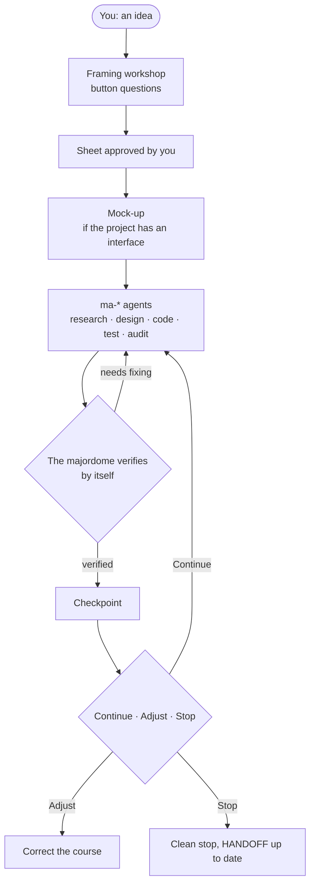

<div align="center">

# Majordome

**A Claude Code skill that runs your project with sub-agents: it frames it with you, splits, delegates, verifies the facts itself, and reports back.**

English · [Version française](README.md)

[](https://github.com/MalikMoussaoui/majordome/releases)
[](LICENSE)
[](https://github.com/MalikMoussaoui/majordome/actions/workflows/lint.yml)
[](GUIDE.en.md#made-with-itself)

</div>

## How it works



## In 3 steps

1. **Install** (in a Claude Code session):
   ```text
   /plugin marketplace add MalikMoussaoui/majordome
   /plugin install majordome@majordome
   ```
2. **Run it**, with your idea:
   ```text
   /majordome compare three silent mechanical keyboards under 100 EUR and tell me which one to buy
   ```
3. **Answer the questions.** They come as buttons; nothing is built before you say "Valider" (approve).

Prerequisites: macOS or Linux, [`jq`](https://jqlang.org/), Claude Code. Details and other install routes: [GUIDE.en.md](GUIDE.en.md).

## What it looks like

A real excerpt from a workshop trial, when resuming a project that was already built without a sheet (the skill's questions come in the language of your profile; translated here):

```text
Question: how do we resume this project?
1. Adapt (recommended): I write the sheet from what exists and ask you 2 or 3 questions. […]
2. Keep as is: we carry on with J3 right away, without a sheet. I note it, dated, in CLAUDE.md […]
3. Start from scratch: full framing, with a mock-up before any code. The existing work is first copied into a dated folder […]
```

## Why

- **You decide the product.** Shape, audience, features, technologies, style: yours. The majordome only decides execution, and tells you.
- **A mock-up before the code.** If the project has an interface, you approve it before the first line of code; a safeguard refuses code until the sheet is approved.
- **Quota-aware.** It reads your plan, offers a preset, follows the week's pace and stops cleanly before the wall.
- **Independent verification.** "The tests pass" means the output of a command run just now, not an agent's report.
- **Everything is resumable.** A handoff file (`HANDOFF.md`) lets you resume after a cut, in a fresh session or from another account.

## Going further

- [GUIDE.en.md](GUIDE.en.md): installation, sub-commands, settings, safeguards, FAQ, limits, credits. Were you using v1.3 under its former name? The guide has a migration section.
- [CHANGELOG.md](CHANGELOG.md): what changes in each version (in French).
- License: [MIT](LICENSE) © 2026 Chopa.
