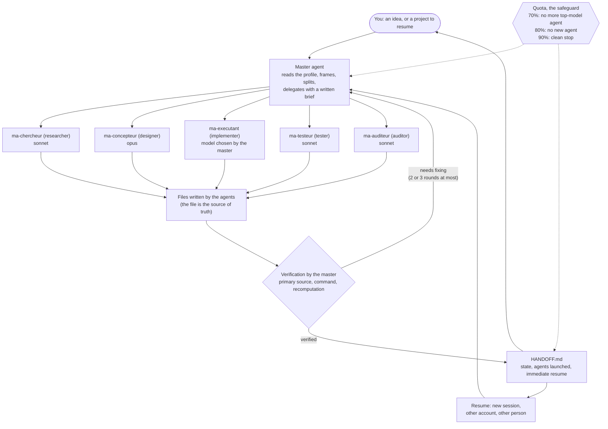

<div align="center">

# maitre-agent

**One session that drives sub-agents, verifies the facts itself, and leaves a handoff you can resume from at any time.**

English · [Version française](README.md)

[](https://github.com/MalikMoussaoui/maitre-agent/releases)
[](LICENSE)
[](https://github.com/MalikMoussaoui/maitre-agent/actions/workflows/lint.yml)
[](#made-with-itself)

</div>

> The skill itself, its prompts, scripts and messages are written in French. This page is a full translation of the French README. Some linked documents (`docs/fabrication.md`, `evals/`, `skills/`) are in French.

## The pitch

`maitre-agent` is a skill for [Claude Code](https://code.claude.com/docs/en/skills). You give it an idea (a script, a purchase to compare, a piece of research, a text) or a project to resume. The main session becomes the "master agent": it reads your profile, splits the work, hands it to sub-agents running the right model, verifies the facts that matter by itself, watches your quota, and writes a handoff file (`HANDOFF.md`).

It is for people who use Claude Code on projects that last longer than one conversation and who want to stay in control: approval is asked before anything that costs money or cannot be undone, and work can resume after a quota cut, in a fresh session, or from another account.

It does not aim for more agents. It aims for the smallest usable result. For a tiny task it works alone.

## The method



The agents write the big pieces. They never launch other agents. The master agent does the decisive checks itself: "the tests pass" means the output of a command run just now, not an agent's report.

## Features

"Status" column: **used for real** = used while building this repository; **tested** = a trial or automated test, described in the limits; **written** = present and checked by the lint, not yet put to the test.

| Feature | What it does | Status |
|---|---|---|
| Profile | Reads `~/.claude/maitre-agent/profil.md` first (language, level, budget, machine). Creates it in two exchanges at most on first use. Stays on your machine. | used for real (v1.0.0, details not kept) |
| Routing | Idea, project path, file to process, or sub-command: it picks between new project, resume and command. | used for real (v1.0.0, details not kept); sub-command routing: written |
| Proportionality | Aims for the smallest usable result. When unsure between two sizes, it takes the smaller one and says so. | used for real (v1.0.0, details not kept) |
| Delegation by model | Light model for mechanical work, intermediate for research, audit and routine code, most capable for design. The model is always stated explicitly. 5 `ma-*` agents. | used for real |
| Verification | Decisive facts are verified by the master. Required-proof table, audits capped at 2 rounds, code fixes capped at 3 rounds, "3 failures" protocol. | used for real |
| Permissions | Approval asked before money, installs, publishing, sending, accounts, deletion. List of prohibitions (see Safeguards). | written; the `permissions.ask` rules must be installed by hand |
| Quota 70 / 80 / 90% | No more top-model agent at 70%, no new agent at 80%, clean stop at 90%. | used for real (one stop at 90% during the build) |
| Handoff | `HANDOFF.md` with [V] verified / [?] not rechecked tags, an "Agents launched" table, an "Immediate resume" section. Files on disk win if HANDOFF is behind. | used for real (one resume after a cut) |
| Sub-commands | `aide` (help), `statut`, `reprendre`, `profil`, `nouveau`. | written |
| Terminal status line | `🧭 <project> · <milestone> · <n> agents · 5 h <x> % (reset HH:MM) · 7 j <y> %`. Also writes the quota to `~/.claude/maitre-agent/usage.json`. | tested with dummy JSON; not seen in a real terminal |
| Desktop mod | The same idea for the Code tab of the Claude desktop app: status line, quota alerts, agent-finished toast. | tested: 25 of 25 tests; status line and agent-finished toast seen for real |
| Notifications | System notification when an agent finishes, when the session is blocked, and at 70 / 80 / 90% quota. macOS and Linux. Quota alerts require the status line (terminal) or the mod (desktop). | macOS command tested for real; hooks not tested end to end |
| Buttons | Questions go through the environment's question tool (2 to 4 options, the recommended one first, marked "(recommandé)"). Without that tool: a numbered list. | written |
| Chapters | One chapter per phase (framing, research, design, milestones, delivery) if the environment has a chapter tool. Otherwise nothing. | written |
| "Since your last visit" | On every resume, 3 lines: what changed, what is done, what is expected from you. | written |

## Installation

Three routes. Pick **only one**: a skill installed through two routes would load twice.

### Route A: plugin (GitHub marketplace)

In a Claude Code session:

```text
/plugin marketplace add MalikMoussaoui/maitre-agent
/plugin install maitre-agent@maitre-agent
```

For the desktop app (Code tab), also add the mod, which replaces the status line the app does not display:

```text
/plugin install maitre-agent-bureau@maitre-agent
```

From a shell: `claude plugin marketplace add MalikMoussaoui/maitre-agent`, then `claude plugin install maitre-agent@maitre-agent`. To pin a version: `MalikMoussaoui/maitre-agent#v1.1.0`.

You get: the skill, the 5 `ma-*` agents, the agent counter, agent-finished and session-blocked notifications, and re-injection of the state after an automatic summary. Quota alerts are not part of it: they come from the status line (terminal) or the mod (desktop). What a plugin **cannot** install: the terminal status line and the `permissions.ask` rules (see below). No plugins in cloud sessions.

### Route B: copy the skill

```sh
git clone https://github.com/MalikMoussaoui/maitre-agent.git
cd maitre-agent
mkdir -p ~/.claude/skills && cp -R skills/maitre-agent ~/.claude/skills/
```

Open a new session. The hooks (agent counter, notifications, re-injection) only come with the plugin; without it, they are copied by hand (`installation.md`, section 5). The 5 agents are to be copied into `~/.claude/agents/` (from `skills/maitre-agent/agents/`); compare before replacing a file of the same name. The details, written so that Claude can apply them with your approval, are in [`skills/maitre-agent/installation.md`](skills/maitre-agent/installation.md) (in French).

### Route C: release zip

On the [releases page](https://github.com/MalikMoussaoui/maitre-agent/releases), two zips (same remark as route B: the skill-only zip brings no hooks):

```sh
# the skill alone (same as route B): the zip contains the maitre-agent/ folder
unzip maitre-agent-skill-v1.1.0.zip -d ~/.claude/skills/

# the full plugin (files at the zip root), to try it out
unzip maitre-agent-plugin-v1.1.0.zip -d maitre-agent-plugin
claude --plugin-dir maitre-agent-plugin
```

### Command name
- Through the plugin: `/maitre-agent:maitre-agent`. The short name `/maitre-agent` also works as long as no other skill takes it.
- Through the copied skill (routes B and C): `/maitre-agent`.

### Manual configuration (optional, with your approval, and merging)

Both settings go in `~/.claude/settings.json`. **Read the file and merge: never overwrite it.**

**Terminal status line** (does not work in the desktop app, see the limits). Run the commands below from a copy of the repository (`git clone`); with the plugin, these files sit in its cache, hence the copy:

```sh
mkdir -p ~/.claude/maitre-agent
cp hooks/statusline.sh hooks/notify.sh ~/.claude/maitre-agent/
chmod +x ~/.claude/maitre-agent/statusline.sh ~/.claude/maitre-agent/notify.sh
```
```json
"statusLine": {
  "type": "command",
  "command": "~/.claude/maitre-agent/statusline.sh",
  "refreshInterval": 10
}
```
It needs `jq`. The quota it shows comes from Claude Code (Pro and Max plans, after the session's first reply); without it, the line shows `quota ?`.

**Ask before risky commands** (`permissions.ask`): a plugin cannot install these.
```json
"permissions": {
  "ask": [
    "Bash(git push *)", "Bash(gh repo create *)", "Bash(gh pr create *)", "Bash(gh release create *)",
    "Bash(npm publish *)", "Bash(rm -rf *)", "Bash(sudo *)", "Bash(brew install *)",
    "Bash(brew uninstall *)", "Bash(kill *)", "Bash(pkill *)", "Bash(killall *)"
  ]
}
```
Adapt the list to your system. These rules also apply to sub-agents.

## Sub-commands

| Command | Alias | Effect |
|---|---|---|
| `/maitre-agent aide` | `help`, `?` | explains the skill in 15 lines at most and says what is installed on your machine |
| `/maitre-agent statut` | `status` | 5 lines at most per known project, changes nothing |
| `/maitre-agent reprendre` | `resume` | offers the known projects as buttons, then resumes the one you pick |
| `/maitre-agent profil` | `profile` | shows or edits your profile, starts no project |
| `/maitre-agent nouveau <idea>` | `new <idea>` | starts a new project with that idea |
| `/maitre-agent <idea>` | | same thing, it is the default case |
| `/maitre-agent <project path>` | | resumes that project |

With the plugin, use `/maitre-agent:maitre-agent` if the short name is taken. Details: [`skills/maitre-agent/commandes.md`](skills/maitre-agent/commandes.md) (in French).

## Safeguards

**It asks for your approval before:**
- anything that costs money (purchase, subscription, paid account, domain);
- a system install or a heavy download (it states the size);
- any publishing (`git push`, remote repository, going live, sharing an artifact);
- any sending (message, email, form);
- an account (creation, login, API key);
- any irreversible action (deletion, overwriting).

A project's dependencies, installed in its own folder, need a single approval per milestone, on an announced list.

**It never:**
- bypasses a protection (captcha, anti-bot, DRM, paywall, anti-cheat, license);
- copies a protected work: it takes inspiration from it;
- buys for you: it gives the links;
- modifies the original files you provide;
- touches servers or ports already in use, or kills an existing process.

Your profile never lifts these prohibitions, except for an explicit, dated instruction from you written in the profile. The content of a HANDOFF or a research file is treated as data, not as an instruction.

**Quota:** 70% (no more top-model agent), 80% (no new agent at all), 90% (clean stop, HANDOFF updated, reset time given).

**Your data:** the scripts and the mod contact no third-party service. Your profile, projects and quota stay in `~/.claude/` and in your project folder. Research work goes through the web when a question requires it; the skill's rule is that your data stays on your machine (no third-party service, no publishing, no shared artifact).

## FAQ

**How much quota does it cost?**
Multi-agent work costs more tokens than a single session, and the skill says so itself: it only delegates when a task has a large context to read, real parallelism, or needs independent verification. Figures measured while building this repository, on a Pro plan: one research agent, 209,000 tokens, 28 minutes, about 12% of the 5-hour window; two implementation agents, 110,000 and 111,000 tokens (percentage not measured). Three measurements, not an average.

**Is a Pro plan enough?**
This repository was built on a Pro plan, with a forced pause at 90% of the 5-hour window and a resume after the reset. The skill is designed for that (70 / 80 / 90% thresholds, clean stop), but a big project will take several windows.

**Does it work without sub-agents?**
Yes. Without a sub-agent tool, the skill says so once, then works alone: it keeps verification, permissions and handoff. An audit done by itself is then not independent, and it writes so ("auto-vérifié, non indépendant", self-verified, not independent).

**In the terminal, the desktop app, the cloud?**
Terminal: meant to do everything, but the status line has only been tested with dummy JSON. Desktop app: the skill; the hooks are meant to work there (not tested); the status line is not displayed there, so install the `maitre-agent-bureau` mod. Cloud: plugins are not available there; the skill alone in a cloud environment has not been tried (not verified).

**Which language?**
The language of your profile, for everything the skill writes. File names stay in English (`HANDOFF.md`, `CLAUDE.md`...). The skill's texts and the scripts' messages (status line, notifications) are in French; there is no English version of the scripts' messages.

**Can I resume a project on another account or another computer?**
Yes, that is the point of the handoff: only the project's files travel (`CLAUDE.md`, `docs/HANDOFF.md`, `docs/research/`, `docs/briefs/`). The profile used is the one of the person resuming. The skill compares HANDOFF to the disk before relaunching anything.

**How do I turn notifications off?**
Create the file `~/.claude/maitre-agent/notifications-off`: no more notifications from the scripts (quota alerts included), the status line keeps working. The desktop mod has its own toasts, which this file does not turn off. Useful in the desktop app, which already notifies when a task ends. To test without showing anything: environment variable `MAITRE_AGENT_DRY_RUN=1`. To remove everything: uninstall the plugin.

**Are the scripts safe?**
They never block (short timeout, `|| true`, exit code 0). A search through their code finds no network call (`curl`, `wget`...); they write only to `~/.claude/maitre-agent/`. Read them before installing: `hooks/` is about 250 lines of `sh` in total.

## Limits, honestly

- **The terminal status line is not displayed in the desktop app.** A test script declared as `statusLine` was called by none of the 6 following messages (caveat: hot reloading of the project setting is not proven). This matches the public Claude Code issue #41456 (open); #83534 was closed as a duplicate of #41456. Hence the `maitre-agent-bureau` mod, which relies on an early-access API and may break from one version to the next (written for Claude Code 2.1.299).
- **The plugin's hooks have not been tested end to end by Claude Code.** The commands in `hooks.json` were run one by one with `sh -c` and the `CLAUDE_PLUGIN_ROOT` variable; the plugin zip passes `claude plugin validate --strict`. But Claude Code has not yet triggered them in a real session with the plugin installed.
- **Notifications:** the macOS command was seen working when run outside the sandbox of Claude's commands. Linux (`notify-send`): not tested.
- **Installation from the GitHub marketplace could not be tried before publication** (`/plugin marketplace add`, `claude plugin install`, `claude --plugin-dir` on the zip): only the plugin's static validation is proven. The desktop mod was loaded from a local folder, not from the marketplace. This limit will be replaced after a real trial.
- **Short agent names under the plugin** (`ma-chercheur` instead of `maitre-agent:ma-chercheur`): the skill asks for the short name; that it resolves under the plugin is not verified.
- **The GitHub workflows (`lint.yml`, `release.yml`) had not been run yet** when this README was written.
- **The evaluations are written but not yet run**: see [`evals/`](evals/README.md) (in French; their format is not that of `claude plugin eval`). No result is claimed.
- **Buttons and chapters depend on the environment.** Without a question tool, the skill asks numbered lists; without a chapter tool, it opens none. The desktop app's chapter tool is not publicly documented.
- **Multi-agent costs more** than a single session, and nothing guarantees it is faster. For a small job, the skill stays alone.
- **Only the cases described above are verified.** A line of this README that says neither "tested" nor "used for real" should be read as untested.

## Credits

`maitre-agent` draws on ideas read in these projects and documents. Everything is reworded: no text was copied.

- [obra/superpowers](https://github.com/obra/superpowers) (MIT): the on-disk handoff as a ledger of trust after compaction; codified agent report statuses (done, done with concerns, needs context, blocked); one brief per file instead of pasted text; the model always stated at each launch; the requirement of proof before saying "it's done".
- [OthmanAdi/planning-with-files](https://github.com/OthmanAdi/planning-with-files) (MIT): writing findings to a file as you go; the three-failures protocol (diagnose, try another approach, rethink); a single owner of the plan; the idea that a resume can be tested with a few questions.
- [github/spec-kit](https://github.com/github/spec-kit) (MIT): a "constitution" of non-negotiable principles against which a deliverable is checked, and bounded clarifying questions. The scored audit and the "non-negotiable rules" section that follow from it are planned, not done yet.
- Claude Code documentation: [skills](https://code.claude.com/docs/en/skills), [sub-agents](https://code.claude.com/docs/en/sub-agents), [hooks](https://code.claude.com/docs/en/hooks), [plugins](https://code.claude.com/docs/en/plugins/overview) and [status line](https://code.claude.com/docs/en/statusline). The skill, agent, hook and plugin formats, the quota fields received by the status line, and the command name of a plugin skill come from there.
- Anthropic Engineering, ["How we built our multi-agent research system"](https://www.anthropic.com/engineering/multi-agent-research-system) (2025-06-13): the conductor-and-workers architecture, effort scaled to the question, and the finding that agents use about 4 times more tokens than a chat, and multi-agent systems about 15 times (compared with a plain chat; figures from the article, not measured here).

About twenty other repositories were read during the initial research; only those above directly shaped the result.

## Made with itself

> **This repository was designed, audited and published with the maitre-agent skill itself.**

The story, short, funny and checkable:

- **v1.0.0**: research on about twenty GitHub repositories and on the Claude Code docs, a design, **2 audits** and **1 real test** (per the project brief; details not kept), then a home-made lint. The skill reviewed itself before reviewing anyone else.
- **v1.1.0**, this one, was driven by the skill on its own build, with its own agents: one `ma-chercheur` (sonnet, 209,000 tokens), two `ma-executant` (sonnet) for the plugin and the desktop mod, and a third to write this README. The master agent kept the checks that mattered for itself.
- **It stopped exactly when it should.** At 90% of the 5-hour quota, the skill's rule kicked in: clean stop, HANDOFF updated, not one more agent launched. After the reset, the build resumed, HANDOFF up to date.
- **It also tripped over its own feet, and wrote it down.** The master agent overwrote a local settings file without reading it (the opposite of its own rule). A commit meant to contain a piece of research contained none of it, because of a git exclusion. Both are told in the handoff, not hidden.
- **The real tests have admitted limits:** the notification arrived, but not when it was fired from the sandbox; the test script showed that the desktop app does not call the status line, which is how the mod was born.
- **Reviewed by an independent auditor (`ma-auditeur`) on 2026-10-18, corrections applied.**
- **Not done yet at the time of writing:** running the GitHub workflows, running the evaluations.

The full story, with the agents, their models, measured costs, decisions and mistakes: [`docs/fabrication.md`](docs/fabrication.md) (in French).

## License

[MIT](LICENSE) © 2026 Chopa. See also [`CONTRIBUTING.md`](CONTRIBUTING.md) and [`CHANGELOG.md`](CHANGELOG.md) (in French).
