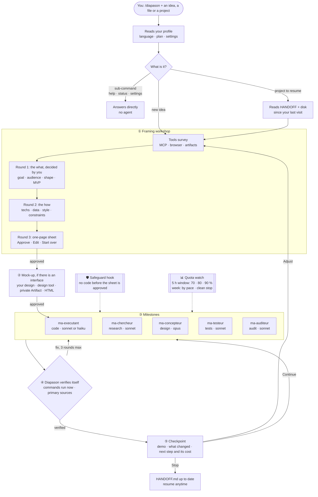
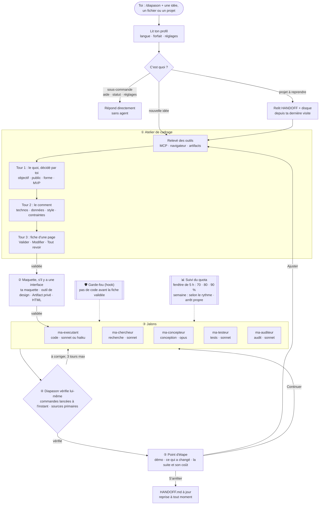

<div align="center">

# 🎵 Diapason

**Your project, run by a team of Claude Code sub-agents — you decide, it does the work and checks it.**<br/>
**Ton projet mené par une équipe de sous-agents Claude Code : tu décides, il fait le travail et le vérifie.**

[](https://github.com/MalikMoussaoui/diapason/releases)
[](LICENSE)
[](https://github.com/MalikMoussaoui/diapason/actions/workflows/lint.yml)

**[🇬🇧 English](#english)** · **[🇫🇷 Français](#francais)**

</div>

---

<a id="english"></a>

## 🇬🇧 English

Diapason is a skill for [Claude Code](https://code.claude.com/docs/en/skills). You give it an idea, a file to process or a project to resume. It asks you the product questions, splits the work, hands it to sub-agents running the right model, **checks the decisive facts itself**, watches your quota, and keeps a handoff file so anything can be resumed later.

The name: a *diapason* is the tuning fork that gives the A to an orchestra. Here it sets the pitch for your team of agents: same goal, same rules, same checks, before anyone plays a note. The `ma-*` agents keep their names.

**For whom:** anyone who uses Claude Code on work that lasts longer than one conversation (an app, a game, a piece of research, a purchase to compare) and wants to stay in control.

### At a glance

| | |
|---|---|
| 🧭 **You decide the product** | Shape, audience, features, technologies, style: always yours, asked as button questions with a recommendation. It only decides execution, and tells you. |
| 📝 **Nothing built before your "approve"** | A one-page sheet to approve, then a mock-up if there is an interface. A safeguard (hook) refuses code until the sheet is approved. |
| ✅ **It checks, not just reports** | "The tests pass" means a command run just now, not an agent's word. |
| 📊 **Quota-aware** | Reads your plan (Pro, Max), suggests a preset, follows the week's pace and stops cleanly before the wall. |
| 🔁 **Resumable** | A `HANDOFF.md` lets you pick up after a cut, in a new session or from another account. |

### How it works



### Get started in 3 steps

1. **Install** (in a Claude Code session):
   ```text
   /plugin marketplace add MalikMoussaoui/diapason
   /plugin install diapason@diapason
   ```
2. **Run it** with your idea:
   ```text
   /diapason compare three silent mechanical keyboards under 100 EUR and tell me which one to buy
   ```
3. **Answer the questions.** They come as buttons; nothing is built before you approve.

Requirements: macOS or Linux, [`jq`](https://jqlang.org/), Claude Code. Other install routes (skill copy, release zip): [GUIDE.en.md](GUIDE.en.md).

### What it looks like

A real excerpt from a trial, resuming a project that had been built without a sheet (questions come in your profile's language; translated here):

```text
Question: how do we resume this project?
1. Adapt (recommended): I write the sheet from what exists and ask you 2 or 3 questions. […]
2. Keep as is: we carry on with J3 right away, without a sheet. I note it, dated, in CLAUDE.md […]
3. Start from scratch: full framing, with a mock-up before any code. The existing work is first copied into a dated folder […]
```

### Learn more

- 📘 [GUIDE.en.md](GUIDE.en.md): sub-commands, settings, safeguards, FAQ, honest limits, credits, and migration from the former names `maitre-agent` and `majordome`.
- 📜 [CHANGELOG.md](CHANGELOG.md) (in French) · 🤝 [CONTRIBUTING.md](CONTRIBUTING.md) · ⚖️ [MIT](LICENSE) © 2026 Chopa.

<div align="right"><a href="#francais">🇫🇷 Version française ↓</a></div>

---

<a id="francais"></a>

## 🇫🇷 Français

Diapason est un skill pour [Claude Code](https://code.claude.com/docs/en/skills). Tu lui donnes une idée, un fichier à traiter ou un projet à reprendre. Il te pose les questions de produit, découpe le travail, le confie à des sous-agents du bon modèle, **vérifie lui-même les faits qui décident de tout**, surveille ton quota, et tient un fichier de passation pour tout reprendre plus tard.

Le nom : un *diapason* est le petit instrument qui donne le la à un orchestre. Ici, il donne le la à ton équipe d'agents : même but, mêmes règles, mêmes vérifications, avant que quiconque joue la première note. Les agents `ma-*` gardent leur nom.

**Pour qui :** toute personne qui utilise Claude Code sur un travail qui dure plus d'une conversation (une appli, un jeu, une recherche, un achat à comparer) et qui veut garder la main.

### En un coup d'œil

| | |
|---|---|
| 🧭 **Tu décides le produit** | Forme, public, fonctions, technos, style : toujours à toi, en questions à boutons avec une recommandation. Il ne tranche que l'exécution, et te le dit. |
| 📝 **Rien n'est construit avant ton « Valider »** | Une fiche d'une page à valider, puis une maquette s'il y a une interface. Un garde-fou (hook) refuse le code tant que la fiche n'est pas validée. |
| ✅ **Il vérifie, il ne fait pas que rapporter** | « Les tests passent » veut dire une commande lancée à l'instant, pas la parole d'un agent. |
| 📊 **Attentif à ton quota** | Il lit ton forfait (Pro, Max), propose un préréglage, suit le rythme de la semaine et s'arrête proprement avant le mur. |
| 🔁 **Tout se reprend** | Un `HANDOFF.md` permet de reprendre après une coupure, dans une nouvelle session ou depuis un autre compte. |

### Comment ça marche



### Démarrer en 3 étapes

1. **Installer** (dans une session Claude Code) :
   ```text
   /plugin marketplace add MalikMoussaoui/diapason
   /plugin install diapason@diapason
   ```
2. **Lancer** avec ton idée :
   ```text
   /diapason compare trois claviers mécaniques silencieux à moins de 100 € et dis-moi lequel acheter
   ```
3. **Répondre aux questions.** Elles arrivent en boutons ; rien n'est construit avant ton « Valider ».

Prérequis : macOS ou Linux, [`jq`](https://jqlang.org/), Claude Code. Autres voies d'installation (copie du skill, zip de release) : [GUIDE.md](GUIDE.md).

### À quoi ça ressemble

Extrait réel d'un essai, à la reprise d'un projet construit sans fiche :

```text
Question : comment on reprend ce projet ?
1. Adapter (recommandé) : j'écris la fiche à partir de ce qui existe et je te pose 2 ou 3 questions. […]
2. Garder tel quel : on enchaîne J3 tout de suite, sans fiche. Je le note daté dans CLAUDE.md […]
3. Repartir de zéro : cadrage complet, avec une maquette avant tout code. L'existant est d'abord copié dans un dossier daté […]
```

### Pour aller plus loin

- 📘 [GUIDE.md](GUIDE.md) : sous-commandes, réglages, garde-fous, FAQ, limites honnêtes, crédits, et migration depuis les anciens noms `maitre-agent` et `majordome`.
- 📜 [CHANGELOG.md](CHANGELOG.md) · 🤝 [CONTRIBUTING.md](CONTRIBUTING.md) · ⚖️ [MIT](LICENSE) © 2026 Chopa.

<div align="right"><a href="#english">🇬🇧 English version ↑</a></div>
