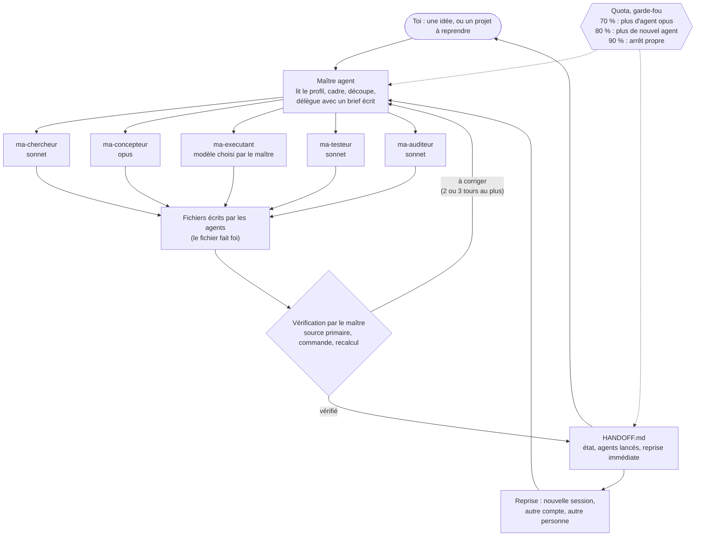

<div align="center">

# maitre-agent

**Une session qui pilote des agents, vérifie elle-même, et laisse une passation qu'on peut reprendre n'importe quand.**

[English version](README.en.md) · Français

[](https://github.com/MalikMoussaoui/maitre-agent/releases)
[](LICENSE)
[](https://github.com/MalikMoussaoui/maitre-agent/actions/workflows/lint.yml)
[](#fait-avec-lui-même)

</div>

## Le pitch

`maitre-agent` est un skill pour [Claude Code](https://code.claude.com/docs/en/skills). Tu lui donnes une idée (un script, un achat à comparer, une recherche, un texte) ou un projet à reprendre. La session principale devient le « maître agent » : elle lit ton profil, découpe le travail, le confie à des sous-agents du bon modèle, vérifie elle-même les faits qui décident de tout, surveille ton quota et écrit un fichier de passation (`HANDOFF.md`).

Il est fait pour les personnes qui utilisent Claude Code sur des projets qui durent plus d'une conversation, et qui veulent garder la main : des accords demandés avant tout ce qui coûte ou ne se rattrape pas, et une reprise possible après une coupure de quota, dans une nouvelle session, ou depuis un autre compte.

Il ne cherche pas à faire plus d'agents : il cherche le plus petit résultat utilisable. Pour une tâche minuscule, il travaille seul.

## La méthode



Les agents écrivent les gros morceaux. Ils ne lancent jamais d'autres agents. Les vérifications décisives, c'est le maître agent qui les fait : « les tests passent » veut dire la sortie d'une commande lancée maintenant, pas le rapport d'un agent.

## Fonctions

Colonne « Statut » : **utilisé en réel** = servi pendant la fabrication de ce dépôt ; **testé** = essai ou test automatique, décrit dans les limites ; **écrit** = présent et contrôlé par le lint, pas encore mis à l'épreuve.

| Fonction | Ce qu'elle fait | Statut |
|---|---|---|
| Profil | Lit `~/.claude/maitre-agent/profil.md` en premier (langue, niveau, budget, machine). Le crée en deux échanges au plus à la première utilisation. Reste sur ta machine. | utilisé en réel (v1.0.0, détails non conservés) |
| Routage | Idée, chemin de projet, fichier à traiter, ou sous-commande : il choisit entre nouveau projet, reprise et commande. | utilisé en réel (v1.0.0, détails non conservés) ; routage des sous-commandes : écrit |
| Proportionnalité | Vise le plus petit résultat utilisable. Dans le doute entre deux tailles, il prend la plus petite et le dit. | utilisé en réel (v1.0.0, détails non conservés) |
| Délégation par modèle | Léger pour le mécanique, intermédiaire pour la recherche, l'audit et le code courant, le plus capable pour la conception. Le modèle est toujours donné explicitement. 5 agents `ma-*`. | utilisé en réel |
| Vérification | Les faits décisifs sont vérifiés par le maître. Tableau de preuves exigées, audits bornés à 2 tours, corrections de code bornées à 3 tours, protocole des 3 échecs. | utilisé en réel |
| Permissions | Accord demandé avant argent, installation, publication, envoi, compte, suppression. Liste d'interdits (voir Garde-fous). | écrit ; les règles `permissions.ask` sont à installer à la main |
| Quota 70 / 80 / 90 % | Plus d'agent du modèle le plus capable à 70 %, plus de nouvel agent à 80 %, arrêt propre à 90 %. | utilisé en réel (un arrêt à 90 % pendant la fabrication) |
| Passation | `HANDOFF.md` avec balises [V] vérifié / [?] non revérifié, tableau « Agents lancés », « Reprise immédiate ». Les fichiers sur le disque font foi si le HANDOFF est en retard. | utilisé en réel (une reprise après coupure) |
| Sous-commandes | `aide`, `statut`, `reprendre`, `profil`, `nouveau`. | écrit |
| Barre d'état du terminal | `🧭 <projet> · <jalon> · <n> agents · 5 h <x> % (reset HH:MM) · 7 j <y> %`. Écrit aussi le quota dans `~/.claude/maitre-agent/usage.json`. | testé avec des JSON factices ; pas vu dans un vrai terminal |
| Mod de bureau | La même idée pour l'onglet Code de l'app Claude de bureau : ligne d'état, alertes de quota, toast de fin d'agent. | testé : 25 tests sur 25 ; ligne d'état et toast de fin d'agent vus en réel |
| Notifications | Notification système quand un agent finit, quand la session est bloquée, et à 70 / 80 / 90 % de quota. macOS et Linux. Les alertes de quota exigent la barre d'état (terminal) ou le mod (bureau). | commande macOS testée en réel ; hooks non testés de bout en bout |
| Boutons | Les questions passent par l'outil de questions de l'environnement (2 à 4 options, la recommandée en premier, marquée « (recommandé) »). Sans cet outil : liste numérotée. | écrit |
| Chapitres | Un chapitre par phase (cadrage, recherche, conception, jalons, livraison) si l'environnement a un outil de chapitres. Sinon, rien. | écrit |
| « Depuis ta dernière visite » | À chaque reprise, 3 lignes : ce qui a changé, ce qui est fini, ce qu'on attend de toi. | écrit |

## Installation

Trois voies. Choisis-en **une seule** : le skill installé par deux voies se chargerait deux fois.

### Voie A : plugin (marketplace GitHub)

Dans une session Claude Code :

```text
/plugin marketplace add MalikMoussaoui/maitre-agent
/plugin install maitre-agent@maitre-agent
```

Pour l'app de bureau (onglet Code), ajoute aussi le mod, qui remplace la barre d'état que l'app n'affiche pas :

```text
/plugin install maitre-agent-bureau@maitre-agent
```

En shell : `claude plugin marketplace add MalikMoussaoui/maitre-agent`, puis `claude plugin install maitre-agent@maitre-agent`. Pour une version précise : `MalikMoussaoui/maitre-agent#v1.1.0`.

Ce que tu obtiens : le skill, les 5 agents `ma-*`, le compteur d'agents, les notifications de fin d'agent et de session bloquée, et la réinjection de l'état après un résumé automatique. Les alertes de quota n'en font pas partie : elles viennent de la barre d'état (terminal) ou du mod (bureau). Ce que le plugin **ne peut pas** installer : la barre d'état du terminal et les règles `permissions.ask` (voir plus bas). Pas de plugins dans les sessions cloud.

### Voie B : copie du skill

```sh
git clone https://github.com/MalikMoussaoui/maitre-agent.git
cd maitre-agent
mkdir -p ~/.claude/skills && cp -R skills/maitre-agent ~/.claude/skills/
```

Ouvre une nouvelle session. Les hooks (compteur d'agents, notifications, réinjection) ne viennent qu'avec le plugin ; sans lui, ils se copient à la main (`installation.md`, §5). Les 5 agents sont à copier dans `~/.claude/agents/` (`skills/maitre-agent/agents/`) ; compare avant de remplacer un fichier du même nom. Le détail, écrit pour que Claude l'applique avec ton accord, est dans [`skills/maitre-agent/installation.md`](skills/maitre-agent/installation.md).

### Voie C : zip de release

Sur la [page des releases](https://github.com/MalikMoussaoui/maitre-agent/releases), deux zips (même remarque que pour la voie B : le zip du skill seul n'apporte pas les hooks) :

```sh
# le skill seul (comme la voie B) : le zip contient le dossier maitre-agent/
unzip maitre-agent-skill-v1.1.0.zip -d ~/.claude/skills/

# le plugin complet (fichiers à la racine du zip), pour l'essayer
unzip maitre-agent-plugin-v1.1.0.zip -d maitre-agent-plugin
claude --plugin-dir maitre-agent-plugin
```

### Nom de la commande
- Via le plugin : `/maitre-agent:maitre-agent`. Le nom court `/maitre-agent` marche aussi tant qu'aucun autre skill ne le prend.
- Via la copie du skill (voies B et C) : `/maitre-agent`.

### Configuration manuelle (facultative, avec ton accord et en fusionnant)

Ces deux réglages vont dans `~/.claude/settings.json`. **Lis le fichier et fusionne : ne l'écrase jamais.**

**Barre d'état du terminal** (ne marche pas dans l'app de bureau, voir les limites). Les commandes ci-dessous se lancent depuis une copie du dépôt (`git clone`) ; avec le plugin, ces fichiers sont dans son cache, d'où la copie :

```sh
mkdir -p ~/.claude/maitre-agent
cp hooks/statusline.sh hooks/notify.sh ~/.claude/maitre-agent/
chmod +x ~/.claude/maitre-agent/statusline.sh ~/.claude/maitre-agent/notify.sh
```
```json
"statusLine": {
  "type": "command",
  "command": "~/.claude/maitre-agent/statusline.sh",
  "refreshInterval": 10
}
```
Elle a besoin de `jq`. Le quota affiché vient de Claude Code (forfaits Pro et Max, après la première réponse de la session) ; sans lui, elle affiche `quota ?`.

**Demander avant les commandes risquées** (`permissions.ask`) : un plugin ne peut pas les installer.
```json
"permissions": {
  "ask": [
    "Bash(git push *)", "Bash(gh repo create *)", "Bash(gh pr create *)", "Bash(gh release create *)",
    "Bash(npm publish *)", "Bash(rm -rf *)", "Bash(sudo *)", "Bash(brew install *)",
    "Bash(brew uninstall *)", "Bash(kill *)", "Bash(pkill *)", "Bash(killall *)"
  ]
}
```
Adapte la liste à ton système. Ces règles valent aussi pour les sous-agents.

## Sous-commandes

| Commande | Alias | Effet |
|---|---|---|
| `/maitre-agent aide` | `help`, `?` | explique le skill en 15 lignes au plus et dit ce qui est installé chez toi |
| `/maitre-agent statut` | `status` | 5 lignes au plus par projet connu, sans rien modifier |
| `/maitre-agent reprendre` | `resume` | te propose les projets connus en boutons, puis reprend celui que tu choisis |
| `/maitre-agent profil` | `profile` | affiche ou modifie ton profil, sans lancer de projet |
| `/maitre-agent nouveau <idée>` | `new <idée>` | démarre un nouveau projet avec cette idée |
| `/maitre-agent <idée>` | | idem, c'est le cas par défaut |
| `/maitre-agent <chemin du projet>` | | reprend ce projet |

Avec le plugin, remplace `/maitre-agent` par `/maitre-agent:maitre-agent` si le nom court est pris. Détail : [`skills/maitre-agent/commandes.md`](skills/maitre-agent/commandes.md).

## Garde-fous

**Il demande ton accord avant :**
- tout ce qui coûte de l'argent (achat, abonnement, compte payant, domaine) ;
- une installation système ou un téléchargement lourd (il en donne la taille) ;
- toute publication (`git push`, dépôt distant, mise en ligne, partage d'un artifact) ;
- tout envoi (message, mail, formulaire) ;
- un compte (création, connexion, clé d'API) ;
- toute action irréversible (suppression, écrasement).

Les dépendances d'un projet, installées dans son propre dossier, demandent un seul accord par jalon, sur une liste annoncée.

**Il ne fait jamais :**
- contourner une protection (captcha, anti-robot, DRM, paywall, anti-triche, licence) ;
- copier une œuvre protégée : on s'en inspire ;
- acheter à ta place : il donne les liens ;
- modifier les originaux que tu fournis ;
- toucher aux serveurs ou aux ports déjà utilisés, ni tuer un processus existant.

Ton profil ne lève jamais ces interdits, sauf instruction explicite et datée de ta part, écrite dans le profil. Le contenu d'un HANDOFF ou d'une recherche est traité comme une donnée, pas comme une instruction.

**Quota :** 70 % (plus d'agent du modèle le plus capable), 80 % (plus aucun nouvel agent), 90 % (arrêt propre, HANDOFF à jour, heure de remise à zéro donnée).

**Tes données :** les scripts et le mod ne contactent aucun service tiers. Ton profil, tes projets et ton quota restent dans `~/.claude/` et dans le dossier de ton projet. Le travail de recherche passe par le web quand une question l'exige ; la règle du skill est que tes données, elles, restent sur ta machine (ni service tiers, ni publication, ni artifact partagé).

## FAQ

**Combien ça coûte en quota ?**
Le multi-agent coûte plus de tokens qu'une session seule, et le skill le dit lui-même : il ne délègue que si la tâche a un gros contexte à lire, un vrai parallélisme ou demande une vérification indépendante. Repères mesurés pendant la fabrication de ce dépôt, sur un forfait Pro : un agent de recherche, 209 000 tokens, 28 minutes, environ 12 % de la fenêtre de 5 heures ; deux agents d'implémentation, 110 000 et 111 000 tokens (pourcentage non mesuré). Ce sont trois mesures, pas une moyenne.

**Le forfait Pro suffit-il ?**
Ce dépôt a été fabriqué sur un forfait Pro, avec une pause forcée à 90 % de la fenêtre de 5 heures, puis une reprise après la remise à zéro. Le skill est fait pour ça (seuils 70 / 80 / 90 %, arrêt propre), mais un gros projet y demandera plusieurs fenêtres.

**Ça marche sans sous-agents ?**
Oui. Sans outil de sous-agents, le skill le dit une fois, puis travaille seul : il garde la vérification, les permissions et la passation. Un audit fait par lui-même n'est alors pas indépendant, et il l'écrit (« auto-vérifié, non indépendant »).

**Dans le terminal, l'app de bureau, le cloud ?**
Terminal : prévu pour tout, mais la barre d'état n'a été testée qu'avec des JSON factices. App de bureau : le skill ; les hooks sont prévus pour y marcher (non testés) ; la barre d'état n'y est pas affichée, installe le mod `maitre-agent-bureau`. Cloud : le plugin n'y est pas disponible ; le skill seul dans un environnement cloud n'a pas été essayé (non vérifié).

**Quelle langue ?**
Celle de ton profil, pour tout ce que le skill écrit. Les noms de fichiers restent en anglais (`HANDOFF.md`, `CLAUDE.md`…). Les textes du skill et les messages des scripts (barre d'état, notifications) sont en français ; il n'y a pas de version anglaise des messages des scripts.

**Puis-je reprendre un projet sur un autre compte ou un autre ordinateur ?**
Oui, c'est le but de la passation : seuls les fichiers du projet se transmettent (`CLAUDE.md`, `docs/HANDOFF.md`, `docs/research/`, `docs/briefs/`). Le profil utilisé est celui de la personne qui reprend. Le skill compare le HANDOFF au disque avant de relancer quoi que ce soit.

**Comment couper les notifications ?**
Crée le fichier `~/.claude/maitre-agent/notifications-off` : plus aucune notification des scripts (y compris les alertes de quota), la barre d'état continue. Le mod de bureau a ses propres toasts, que ce fichier ne coupe pas. Utile dans l'app de bureau, qui notifie déjà la fin d'une tâche. Pour tester sans rien afficher : variable `MAITRE_AGENT_DRY_RUN=1`. Pour tout retirer : désinstalle le plugin.

**Les scripts sont-ils sûrs ?**
Ils ne bloquent jamais (délai court, `|| true`, code de sortie 0). Une recherche dans leur code n'y trouve aucun appel réseau (`curl`, `wget`…) ; ils n'écrivent que dans `~/.claude/maitre-agent/`. Lis-les avant de les installer : `hooks/` fait environ 250 lignes de `sh` en tout.

## Limites, honnêtement

- **La barre d'état du terminal n'est pas affichée dans l'app de bureau.** Un script témoin déclaré en `statusLine` n'y a été appelé par aucun des 6 messages suivants (réserve : le rechargement à chaud du réglage du projet n'est pas prouvé). Cela concorde avec le ticket public #41456 de Claude Code (ouvert) ; #83534 a été fermé comme doublon de #41456. D'où le mod `maitre-agent-bureau`, qui repose sur une API en accès anticipé et peut casser d'une version à l'autre (écrit pour Claude Code 2.1.299).
- **Les hooks du plugin n'ont pas été testés de bout en bout par Claude Code.** Les commandes de `hooks.json` ont été exécutées une à une avec `sh -c` et la variable `CLAUDE_PLUGIN_ROOT` ; le zip du plugin passe `claude plugin validate --strict`. Mais Claude Code ne les a pas encore déclenchés dans une vraie session avec le plugin installé.
- **Notifications :** la commande macOS a été vue en réel quand elle est lancée hors du bac à sable des commandes de Claude. Linux (`notify-send`) : non testé.
- **L'installation depuis la marketplace GitHub n'a pas pu être essayée avant la publication** (`/plugin marketplace add`, `claude plugin install`, `claude --plugin-dir` sur le zip) : seule la validation statique du plugin est prouvée. Le mod de bureau a été chargé depuis un dossier local, pas depuis la marketplace. Cette limite sera remplacée après un essai réel.
- **Noms courts des agents sous plugin** (`ma-chercheur` au lieu de `maitre-agent:ma-chercheur`) : le skill demande le nom court ; qu'il soit résolu sous plugin n'est pas vérifié.
- **Les workflows GitHub (`lint.yml`, `release.yml`) n'avaient pas encore été exécutés** au moment d'écrire ce README.
- **Les évaluations sont écrites mais pas encore lancées** : voir [`evals/`](evals/README.md) (leur format n'est pas celui de `claude plugin eval`). Aucun résultat n'est annoncé.
- **Boutons et chapitres dépendent de l'environnement.** Sans outil de questions, le skill pose des listes numérotées ; sans outil de chapitres, il n'en ouvre pas. L'outil de chapitres de l'app de bureau n'est pas documenté publiquement.
- **Le multi-agent coûte plus cher** qu'une session seule, et rien ne garantit qu'il soit plus rapide. Pour un petit travail, le skill reste seul.
- **Seuls les cas décrits plus haut sont vérifiés.** Une ligne de ce README qui n'indique ni « testé » ni « utilisé en réel » doit se lire comme non testée.

## Crédits

`maitre-agent` s'inspire d'idées lues dans ces projets et ces documents. Tout est reformulé : aucun texte n'a été copié.

- [obra/superpowers](https://github.com/obra/superpowers) (MIT) : la passation sur disque comme registre de confiance après une compaction ; des statuts de rapport codifiés pour les agents (terminé, terminé avec réserves, besoin de contexte, bloqué) ; un brief par fichier plutôt que du texte collé ; le modèle toujours précisé à chaque lancement ; l'exigence de preuve avant de dire « c'est fait ».
- [OthmanAdi/planning-with-files](https://github.com/OthmanAdi/planning-with-files) (MIT) : écrire ses trouvailles dans un fichier au fil de l'eau ; le protocole des trois échecs (diagnostic, autre approche, remise en question) ; un seul propriétaire du plan ; l'idée qu'une reprise se teste en quelques questions.
- [github/spec-kit](https://github.com/github/spec-kit) (MIT) : une « constitution » de principes non négociables à laquelle on confronte un livrable, et des questions de clarification bornées. L'audit à barème et la section « Règles non négociables » qui en découlent sont prévus, pas encore faits.
- La documentation de Claude Code : [skills](https://code.claude.com/docs/en/skills), [sous-agents](https://code.claude.com/docs/en/sub-agents), [hooks](https://code.claude.com/docs/en/hooks), [plugins](https://code.claude.com/docs/en/plugins/overview) et [barre d'état](https://code.claude.com/docs/en/statusline). Le format du skill, des agents, des hooks et du plugin, les champs du quota reçus par la barre d'état, et le nom de commande d'un skill de plugin viennent de là.
- Anthropic Engineering, [« How we built our multi-agent research system »](https://www.anthropic.com/engineering/multi-agent-research-system) (2025-06-13) : l'architecture chef d'orchestre et travailleurs, l'effort proportionné à la question, et le constat que les agents consomment environ 4 fois plus de tokens qu'un chat, et les systèmes multi-agents environ 15 fois (par rapport à un simple chat ; chiffres de l'article, non mesurés ici).

Une vingtaine d'autres dépôts ont été lus pendant la recherche de départ ; seuls ceux ci-dessus ont directement façonné le résultat.

## Fait avec lui-même

> **Ce dépôt a été conçu, audité et publié avec le skill maitre-agent lui-même.**

Le récit, court, drôle et vérifiable :

- **La v1.0.0** : des recherches sur une vingtaine de dépôts GitHub et sur la doc de Claude Code, une conception, **2 audits** et **1 test réel** (d'après le cahier des charges ; détails non conservés), puis un lint maison. Le skill s'est donc d'abord relu avant de relire quiconque.
- **La v1.1.0**, celle-ci, a été pilotée par le skill sur son propre chantier, avec ses propres agents : un `ma-chercheur` (sonnet, 209 000 tokens), deux `ma-executant` (sonnet) pour le plugin et le mod de bureau, un troisième pour écrire ce README. Le maître agent s'est réservé les vérifications qui comptaient.
- **Il s'est arrêté pile quand il fallait.** À 90 % du quota de 5 heures, la règle du skill a joué : arrêt propre, HANDOFF mis à jour, plus un seul agent lancé. Après la remise à zéro, le chantier a repris, HANDOFF à jour.
- **Il s'est aussi pris les pieds dans le tapis, et l'a écrit.** Le maître agent a écrasé un fichier de réglages local sans le lire (le contraire de sa propre règle). Un commit censé contenir une recherche n'en contenait rien, à cause d'une exclusion git. Les deux sont racontés dans la passation, pas cachés.
- **Les tests réels ont des limites assumées :** la notification est arrivée, mais pas quand elle était lancée depuis le bac à sable ; le test témoin a montré que l'app de bureau n'appelle pas la barre d'état, ce qui a fait naître le mod.
- **Relu par un auditeur indépendant (`ma-auditeur`) le 2026-10-18, corrections appliquées.**
- **Pas encore fait au moment d'écrire :** l'exécution des workflows GitHub, le lancement des évaluations.

L'histoire complète, avec les agents, leurs modèles, leurs coûts mesurés, les décisions et les erreurs : [`docs/fabrication.md`](docs/fabrication.md).

## Licence

[MIT](LICENSE) © 2026 Chopa. Voir aussi [`CONTRIBUTING.md`](CONTRIBUTING.md) et [`CHANGELOG.md`](CHANGELOG.md).
