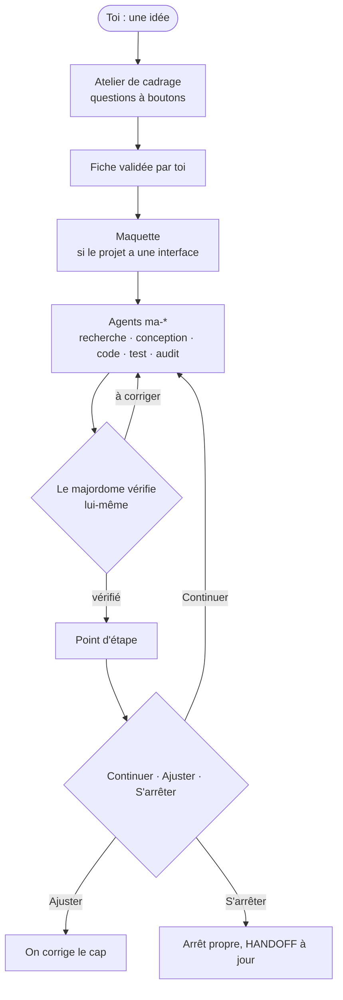

<div align="center">

# Majordome

**Un skill Claude Code qui mène ton projet avec des sous-agents : il cadre avec toi, découpe, délègue, vérifie lui-même, et te rend compte.**

[English version](README.en.md) · Français

[](https://github.com/MalikMoussaoui/majordome/releases)
[](LICENSE)
[](https://github.com/MalikMoussaoui/majordome/actions/workflows/lint.yml)
[](GUIDE.md#fait-avec-lui-même)

</div>

## Comment ça marche



## En 3 étapes

1. **Installer** (dans une session Claude Code) :
   ```text
   /plugin marketplace add MalikMoussaoui/majordome
   /plugin install majordome@majordome
   ```
2. **Lancer**, avec ton idée :
   ```text
   /majordome compare trois claviers mécaniques silencieux à moins de 100 € et dis-moi lequel acheter
   ```
3. **Répondre aux questions.** Elles arrivent en boutons ; rien n'est construit avant ton « Valider ».

Prérequis : macOS ou Linux, [`jq`](https://jqlang.org/), Claude Code. Détails et autres voies d'installation : [GUIDE.md](GUIDE.md).

## À quoi ça ressemble

Extrait réel d'un essai de l'atelier, à la reprise d'un projet déjà construit sans fiche :

```text
Question : comment on reprend ce projet ?
1. Adapter (recommandé) : j'écris la fiche à partir de ce qui existe et je te pose 2 ou 3 questions. […]
2. Garder tel quel : on enchaîne J3 tout de suite, sans fiche. Je le note daté dans CLAUDE.md […]
3. Repartir de zéro : cadrage complet, avec une maquette avant tout code. L'existant est d'abord copié dans un dossier daté […]
```

## Pourquoi

- **Tu décides le produit.** Forme, public, fonctions, technos, style : c'est à toi. Le majordome tranche seulement l'exécution, et te le dit.
- **Une maquette avant le code.** Si le projet a une interface, tu la valides avant la première ligne de code ; un garde-fou refuse le code tant que la fiche n'est pas validée.
- **Attentif à ton quota.** Il lit ton forfait, propose un préréglage, suit le rythme de la semaine et s'arrête proprement avant le mur.
- **Vérification indépendante.** « Les tests passent » veut dire la sortie d'une commande lancée maintenant, pas le rapport d'un agent.
- **Tout se reprend.** Un fichier de passation (`HANDOFF.md`) permet de reprendre après une coupure, dans une nouvelle session ou depuis un autre compte.

## Aller plus loin

- [GUIDE.md](GUIDE.md) : installation, sous-commandes, réglages, garde-fous, FAQ, limites, crédits. Tu utilisais la v1.3 sous son ancien nom ? Le guide a une section de migration.
- [CHANGELOG.md](CHANGELOG.md) : ce qui change à chaque version.
- Licence : [MIT](LICENSE) © 2026 Chopa.
